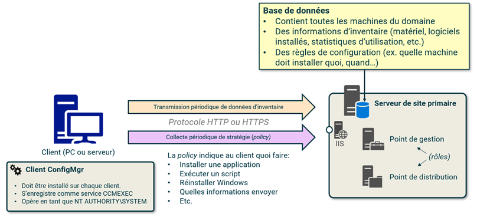

import Tabs from '@theme/Tabs';
import TabItem from '@theme/TabItem';

<span class="tag-date">:calendar: Cours du mardi 20 octobre 2026</span>

# Introduction

:::note Plan de la séance

<Tabs>
<TabItem value="contenu" label="📋 Contenu" default>
- Présentation du cours et du plan de cours
- Introduction: administration centralisée des parcs informatiques
- Fonctionnement de SCCM
</TabItem>
<TabItem value="activites" label="💻 Activités">
- [Labo 1: Montage de l'infra](../labs/01)
</TabItem>
<TabItem value="ressources" label="📓 Ressources et documentation">
Les documents suivants peuvent être téléchargés sur Léa:

- :page_facing_up: Plan de cours
- :page_facing_up: Annexe au plan de cours
- :page_facing_up: 01 - Introduction.pdf
</TabItem>
</Tabs>
:::

## Déroulement du cours

Ce cours est séparé en trois modules:

- **Module 1:** Installation et configuratiopn initiale du serveur de site SCCM (cours 1 à 3)
  - Mini-test #1 au début du cours 4 (30 minutes)
  - Présentation en classe du TP1 avant la fin du cours 4
- **Module 2:** Déploiement automatisé d'applications sur les postes de travail (cours 4 à 7)
  - Mini-test #2 au début du cours 8 (30 minutes)
  - Présentation en classe du TP1 avant la fin du cours 8
- **Module 3:** Déploiement automatisé des systèmes d'exploitation Windows (cours 8 à 11)
  - Présentation en classe du TP3 idéalement avant la fin du cours 11
- **Examen final** (cours 12)
  - Durée: 3 heures

## Qu'est-ce que SCCM

- Logiciel de gestion de systèmes développé par Microsoft
- Facilite la gestion centralisée des postes de travail (et des serveurs) Windows dans des environnements d'envergure
- Au fil du temps, il a acquis des fonctionnalités lui permettant de gérer également des clients MacOS, iOS, Android et Windows Phone.
- Il pouvait également gérer des machines Linux/UNIX, mais cette fonctionnalité a été retirée tout récemment.
- Il s'intègre avec Microsoft InTune, qui est un peu son équivalent basé sur le Cloud pour gérer les appareils mobiles
- Microsoft pousse de plus en plus vers InTune en remplacement de SCCM, mais de nombreuses entreprises utilisent toujours ce produit en mode hybride.

### Historique des versions

- SMS 1.0 (1994)
- SMS 2.0 (1999)
- SMS 2003
- System Center Configuration Manager 2007
- System Center Configuration Manager 2012
- System Center Configuration Manager 2012 R2
- Configuration Manager Current Branch (CB)

Son nom officiel est maintenant Microsoft Configuration Manager (MCM) ou tout simplement Configuration Manager ou ConfigMgr.

### Principe général de fonctionnement



### Architecture et sites

L'architecture SCCM est composée d'un ou plusieurs **sites**.

Chaque site:

- Est identifié par un code unique de trois caractères alphanumériques
- Possède un serveur de site (Site Server)
- Possède sa propre base de données.
- Englobe un ou plusieurs sytèmes de sites (Site System) occupant des rôles

Un site SCCM n'a rien à voir avec un site Active Directory ou un site Physique. Cela désigne une partie de l'infrastructure SCCM qui possède sa propre base de données.

- Une BD complète pour un site primaire
- Une réplique de la BD du site primaire pour un site secondaire

Il existe 3 types de sites:

- Un **site primaire** permet de gérer des clients (jusqu'à 150000) et possède une base de données complète. Il peut être soit autonome (standalone) ou soit se rapporter à un cite central d'administration.
- Un **site secondaire** est un délégué du site primaire. Il contient une copie partielle de la base de données du site primaire.
- Un **site central d'administration (CAS)** ne peut pas gérer de clients, il ne gère que des sites primaires.

:::warning Évitez les architectures trop complexes
Une architecture à un seul site primaire autonome est fortement recommandée dans la grande majorité des cas, même les entreprises qui possèdent de nombreux sites physiques. Dans ce cours, il ne sera question que d'un site primaire autonome.
:::

### Rôles de systèmes de site

Une infrastructure SCCM est composée d'un ou plusieurs serveurs qui se partagent certaines responsabilités, appelées des **rôles**. Un système qui possède au moins un rôle est appelé **système de site** (*site system*).

Parmi les rôles qu'un système de site peut prendre, il y a:

- Serveur de site (site server): le serveur principal SCCM responsable de son site primaire
- Serveur de base de données de site: le serveur responsable d'interagir avec la base de données
- Point de gestion (Management Point): le serveur responsable de communiquer avec les clients
- Point de distribution (Distribution Point): le serveur sur lequel les clients téléchargent le contenu
- Point de mise à jour logicielle: le serveur qui contrôle les mises à jour système
- etc.

Nous explorerons certains de ces rôles plus en détails au fil du cours.

<!--```mermaid
timeline TD
    title Titre
    section Module 1 - Infrastructure SCCM
        01 - Introduction : Introduction
        02 : Installation de l'infrastructure
        03 : Configuration initiale
           : Déploiement du client
    section Module 2
        04 : Mini-test #1
           : Applications
        05 : Config
        06 : Deploiement client
        07 : Bebe
           : Mini-test #1
           : baba
    section Module 3
        08 : Intro
        09 : Config
        10 : Deploiement client
        11 : sadasd
    section Examen final
```-->

