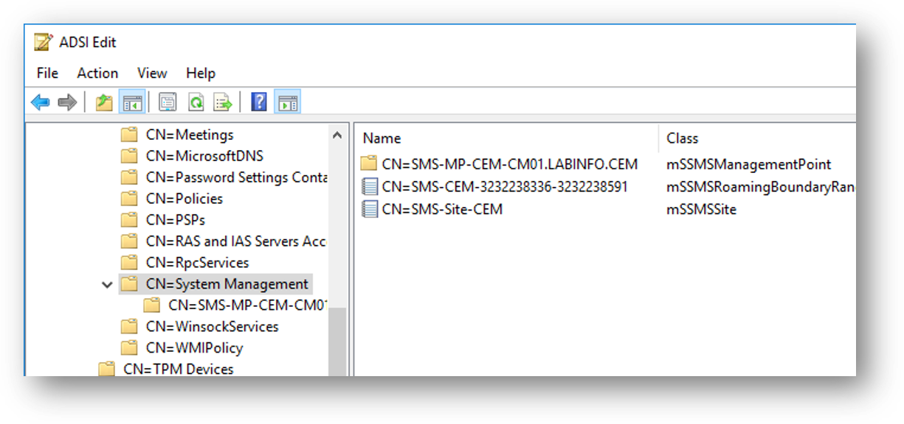
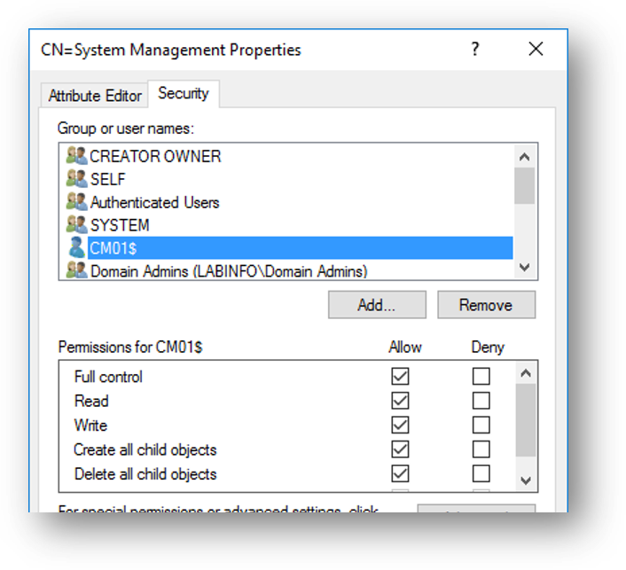
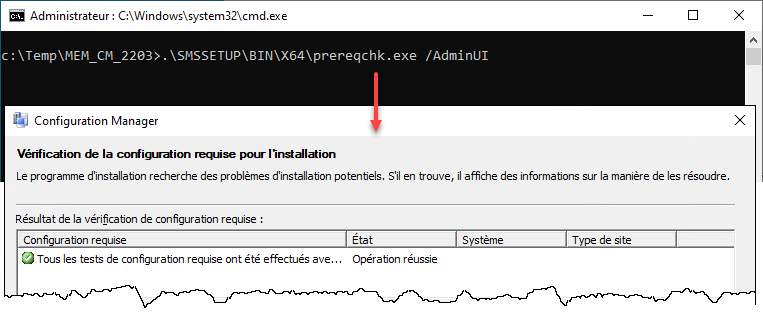

import Tabs from '@theme/Tabs';
import TabItem from '@theme/TabItem';

<span class="tag-date">:calendar: Cours du mardi 27 octobre 2026</span>

# Installation de l'infrastructure SCCM

:::note Plan de la séance

<Tabs>
<TabItem value="contenu" label="📋 Contenu" default>
- Prérequis d'installation
  - SQL Server
  - IIS, BITS, RDC
  - Extension de schéma Active Directory
  - Conteneur System Management
  - Windows ADK
  - Configuration des disques et volumes
- Procédure d'installation
</TabItem>
<TabItem value="activites" label="💻 Activités">
- [Labo 2: Installation de SCCM](../labs/02)
</TabItem>
<TabItem value="ressources" label="📓 Ressources et documentation">
Les documents suivants peuvent être téléchargés sur Léa:

- :page_facing_up: 02 - Installation.pdf
</TabItem>
</Tabs>
:::

Ce cours porte sur les étapes nécessaires pour installer **un serveur de site primaire autonome SCCM**.

## Prérequis

Avant d'installer SCCM, on doit mettre en place un ensemble de prérequis.

### Recommandations matérielles

SCCM et SQL Server sont très gourmands en ressources. En production, pour le serveur de site primaire, s'il exécute sa base de données sur le même serveur, Microsoft recommande 96 GO de mémoire et 16 coeurs de processeurs, avec 80% de la mémoire allouée à SQL.

> :link: [Recommandations matérielles](https://docs.microsoft.com/fr-ca/sccm/core/plan-design/configs/recommended-hardware)

:::tip Environnement de laboratoire
Pour un environnement de test, on peut avoir un SCCM fonctionnel avec 8 Go de mémoire (préférablement 16 Go), 50% de la mémoire allouée à SQL, 4 coeurs et 100 Go de disque.
:::

### Système d'exploitation

Pour installer SCCM, on doit avoir un **serveur Windows** qui est **membre du domaine** et qui n'est **pas un contrôleur de domaine**. Comme tout serveur, il est hautement préférable qu'il dispose d'une **adresse IP statique**.

### SQL Serveur

SCCM a besoin d'une base de données pour fonctionner. Le moteur de base de données est obligatoirement **Microsoft SQL Server**. SQL Server Express n'est pas supporté pour les serveurs de site primaires (il est supporté pour les sites secondaires, mais ceux-ci ne seront pas vus dans ce cours). Aussi, il faut s'assurer que la version de SQL Server et ses mises à jour soient compatible avec la version de SCCM.

> :link: [Voir la documentation pour les versions de SQL Server supportées.](https://docs.microsoft.com/fr-ca/sccm/core/plan-design/configs/support-for-sql-server-versions)

De plus, vous pouvez opter pour l'installation de l'instance SQL Server sur le même serveur que SCCM ou sur un serveur différent. Dans ce cours, on installera les deux sur le même serveur, mais il n'est pas rare que les entreprises préfèrent installer SQL sur un serveur séparé. Si SQL et SCCM tournent sur le même serveur, il faut réserver une partie de la mémoire (au moins 8 Go) au reste du système (sinon SQL va bouffer toute la mémoire disponible et il ne restera plus rien pour SCCM).

:::warning Important
Les règles de **classement** (*collation*) de l'instance SQL doit obligatoirement avoir cette valeur:

```text
SQL_Latin1_General_CP1_CI_AS
```

Toute autre règle causera l'échec de l'installation. Si vous vous êtes trompé pendant l'installation et sélectionné le mauvais mode de classement, vous devez procéder à la réparation de l'instance. Suivez [cette procédure](/astuces/04)
:::

### IIS et composants Web

La communication entre les clients et le serveur SCCM se fait avec les protocoles Web (HTTP/HTTPS). Par conséquent, on doit activer le rôle **Serveur Web (IIS)**. Voici les composants requis:

| Nom d'affichage du composant | Nom |
| :-- | :-- |
| Fonctionnalités communes | Web-Common-Http |
| Authentification Windows | Web-Windows-Auth |
| Extensions ISAPI | Web-ISAPI-Ext |
| Compatibilité avec métadonnées IIS 6 | Web-Metabase |
| Compatibilité avec le service WMI IIS 6 | Web-WMI |
| ASP.NET 3.5 | Web-Asp-Net |
| ASP.NET 4.5+ | Web-Asp-Net45 |
| Activation HTTP | NET-HTTP-Activation |
| Activation non-HTTP | NET-Non-HTTP-Activ |
| Fonctionnalités de .NET Framework 3.5 | NET-Framework-Features |
| Fonctionnalités de .NET Framework 4.5+ | NET-Framework-45-Features |
| Servcie de transfert intelligent en arrière-plan | BITS |
| Compression différentielle à distance | RDC |

### Configuration du domaine AD

Il y a deux modifications à effectuer sur le domaine:

#### Extension du schéma

Vous devez lancer l'outil d'extension de schéma inclus dans les fichiers d'installation. L'opération peut être faite sur n'importe quelle machine qui est membre du domaine, à condition que le compte utilisateur soit membre du groupe des **Administrateurs du schéma** (RID 518). Vous pouvez confirmer que vous êtes membre du groupe.

<ConsoleWindow title="Windows PowerShell" backgroundColor="#012456">
```text
PS C:\> & whoami.exe /groups /fo csv | ConvertFrom-Csv | ? SID -Match '-518$' | Select Nom*

Nom du groupe
-------------
DOMAINE\Administrateurs du schéma
```
</ConsoleWindow>

Pour lancer l'outil, il suffit d'appeler l'utilitaire `SMSSETUP\BIN\X64\extadsch.exe`, contenu dans le médium d'installation.

<ConsoleWindow title="cmd" backgroundColor="#000000" foregroundColor="#cccccc">
```text
F:\SMSSETUP\BIN\X64> .\extadsch.exe

Microsoft Endpoint Configuration Manager v5.00 (Build 9078)
Copyright (C) 2011 Microsoft Corp.


Successfully exyended the Active Directory schema.

Please refer to the ConfigMgr documentation for instructions on the manual configuration of access rights in active directory which may still need to be performed.  (Although the AD schema has now be extended, AD must be configured to allow each ConfigMgr Site security rights to publish in each of their domains.)
```
</ConsoleWindow>

:::warning
Cette étape est irréversible! Toute opération d'extension du schéma doit être scrupuleusement planifiée.
:::

#### Conteneur "System Management"

Pour permettre à SCCM de publier sa topologie dans Active Directory, il faut lui créer un conteneur particulier et donner des droits complets au compte ordinateur du serveur de site.





### Windows ADK

Les outils du Windows ADK (Windows Assessment and Deployment Kit) sont essentiels pour permettre à SCCM d'automatiser l'installation de Windows. L'ADK doit être mis à jour régulièrement pour permettre la prise en charge des versions les plus récentes de Windows. Ce kit inclut des outils très utiles, notamment:

- Les outils de déploiement (DISM), qui permet de capturer et configurer des images Windows
- Windows SIM, qui permet de produire un fichier réponse afin de modifier le déroulement d'une installation
- User State Migration Tool (USMT), qui permet de préserver les données et les préférences des utilisateurs lors d'un rafraîchissement
- Windows PE, un système d'exploitation temporaire pour permettre l'installation de Windows
- Etc.

On a deux paquets à installer sur le serveur:

- Windows ADK
- PE Addon for the Windows ADK

:link: [Voici le lien vers la page de téléchargement](https://learn.microsoft.com/en-us/windows-hardware/get-started/adk-install)

### Configuration des disques durs

SCCM et SQL Server sont très exigeants sur le disque dur. Dans un environnement de production, voici un exemple d'un agencement recommandé:

| Lettre | Contenu             | Taille | Taille de bloc NTFS |
| :----- | :------------------ | :----- | :------------------ |
| C:\    | Système             | 100 Go | 4 Ko                |
| D:\    | SCCM et contenu     | 200 Go | 4 Ko                |
| E:\    | SQL Base de données | 40 Go  | 64 Ko               |
| F:\    | SQL TempDB          | 40 Go  | 64 Ko               |
| G:\    | SQL Logs            | 40 Go  | 64 Ko               |

SCCM a besoin de beaucoup d'espace disque, pour contenir tous les logiciels et les images de système d'exploitation à envoyer aux clients.

Par défaut, il prend tout l'espace disponible sur les volumes. Si on a un volume qu'on ne souhaite pas que SCCM puisse utiliser pour stocker son contenu, on doit déposer un fichier appelé `no_sms_on_drive.sms` à la racine de ce volume. Le contenu du fichier n'a pas d'importance, il peut être vide.

Par exemple, pour empêcher SCCM d'empièter sur le C: (volume réservé au système d'exploitation) et le E: (volume résevré pour la base de données), vous pouvez faire la commande suivante:

<ConsoleWindow title="Administrateur: Windows PowerShell" backgroundColor="#012456">
```text
PS C:\> "C:", "E:" | ForEach-Object { New-Item "$_\no_sms_on_drive.sms" }

  ...
```
</ConsoleWindow>

### Téléchargement des mises à jour

Certains fichiers supplémentaires doivent être téléchargés préalablement à l'installation d'SCCM. Cette étape sera traitée automatiquement lors de l'installation, mais on peut s'y prendre à l'avance. La commande suivant télécharge les fichiers prérequis dans le répertoire `C:\Temp\CM_Prereqs` (le répertoire doit exister préalablement).

<ConsoleWindow title="cmd" backgroundColor="#000000" foregroundColor="#cccccc">
```text
F:\SMSSETUP\BIN\X64> .\setupdl.exe "C:\Temp\CM_Prereqs"
```
</ConsoleWindow>

### Vérification des prérequis

Il est recommandé de lancer l'outil de vérification des prérequis. Il pourrait vous identifier les éléments que vous auriez oublié.



## Installation du serveur de site primaire

Une fois tous les prérequis en place, vous pouvez enfin démarrer l'installation d'SCCM. Il suffit de lancer la commande `SMSSETUP\BIN\X64\setup.exe` et répondre aux questions. Suivez les étapes identifiées dans [le laboratoire 2](/labs/02#lancement-de-linstallation) pour en savoir plus.
