Tout au long de la session, vous allez travailler dans un environnement virtuel à plusieurs sites, afin de simuler un réseau d'entreprise. Votre réseau sera présent sur deux sites: le site principal situé à Longueuil, et une succursale (aussi appelé site satellite), localisé dans la petite municipalité de Saint-Trou. Le routeur natte le trafic externe dans un réseau spécial qui a été créé spécifiquement pour le cours, et qui est connecté à Internet.

Dans ce laboratoire, vous devez mettre en place les éléments suivants dans votre environnement Labinfo.

Le diagramme suivant montre ce que vous allez mettre en place dans cet exercice:

- Un contrôleur de domaine (LG-DC01)
- Un serveur DHCP (LG-DHCP01)
- Deux postes de travail Windows 10 (LG-PC0001 et LG-PC0002)
- Une passerelle pfSense unissant vos trois sous-réseau (deux à Longueuil, un à Saint-Trou) et Internet.

## Étape 1: Création des VM

Montez deux PC Windows 10 (noms d'hôte: LG-PC0001 et LG-PC0002) ainsi que deux serveurs Windows Server 2022 (noms d'hôte LG-DC01 et LG-DHCP01).

Voici les modèles que vous pouvez utiliser dans Labinfo:

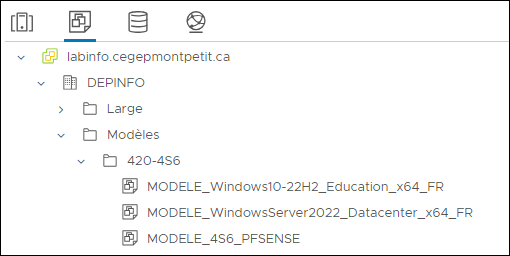

Vous pouvez connecter vos VM au réseau Accès Internet 1 (ou 2 ou 3) sous Labinfo pour qu'elles aient accès à Internet. Laissez la configuration IP être déterminée par DHCP pour l'instant. Faites les mises à jour si vous le souhaitez, mais ce n'est pas essentiel.

:::warning Attention! Nomenclature obligatoire
Toutes vos VM dans l'environnement LabInfo doivent être **nommées selon cette nomenclature**:

> **`B74-XX_NOMDEMACHINE`**, où *XX* sont vos initiales.

Cette nomenclature ne concerne que le **nom des VM dans Labinfo**. Le nom d'hôte de vos machines doit refléter les énoncés de laboratoire.

Par exemple, le contrôleur de domaine de Paul Meilleur sera appelé `B74-PM_LG-DC01` dans Labinfo et son nom d'hôte sera `LG-DC01`.
:::

:::danger Clonage d'un contrôleur de domaine
**Ne clonez jamais** un contrôleur de domaine pour créer vos autres serveurs! Si vous le faites, vous aurez de nombreux problèmes lorsque vous tenterez de joindre les serveurs du domaine. Chaque VM doit être un clone d'un modèle.
:::

Assurez-vous d'activer la balise "Ne pas fermer" sur les serveurs DC et DHCP (pas sur les postes de travail)

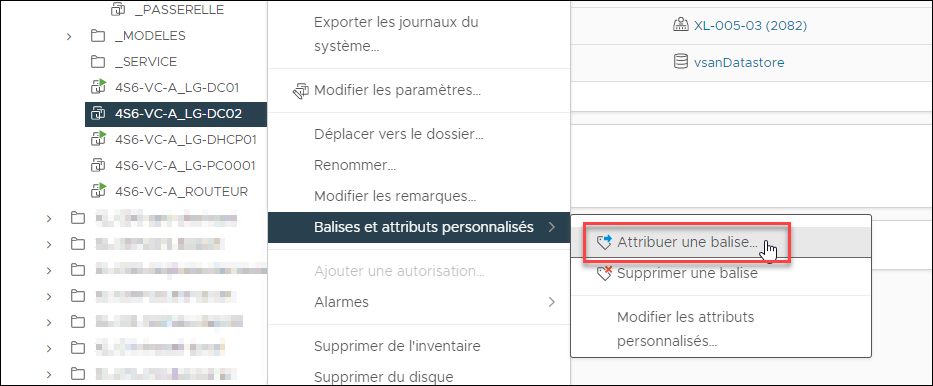

Cochez la balise Ne pas fermer, puis cliquez sur Attribuer.

## Étape 2: Configuration du pfSense

### Planifiez votre topologie réseau

Avant toute chose, planifiez vos subnets et déterminez l'adresse de la passerelle par défaut pour chacun d'eux. 

Localisez d'abord votre plan d'adressage dans le panneau ci-dessous.

Assignation des adresses IP

Voici l'assignation des adresses IP pour le groupe 6151. Le numéro correspond aux **3 derniers chiffres** de votre numéro d'étudiant.

| Id | Numéro  | Bloc assigné        | LGSRV             | LGPDT             | STNET             |
| -- | ------- | ------------------- | ----------------- | ----------------- | ----------------- |
| 01 | **160** | *`10.103.8.0/21`*   | `10.103.8.0/24`   | `10.103.9.0/24`   | `10.103.12.0/24`  |
| 02 | **177** | *`10.103.16.0/21`*  | `10.103.16.0/24`  | `10.103.17.0/24`  | `10.103.20.0/24`  |
| 03 | **214** | *`10.103.24.0/21`*  | `10.103.24.0/24`  | `10.103.25.0/24`  | `10.103.28.0/24`  |
| 04 | **303** | *`10.103.32.0/21`*  | `10.103.32.0/24`  | `10.103.33.0/24`  | `10.103.36.0/24`  |
| 05 | **323** | *`10.103.40.0/21`*  | `10.103.40.0/24`  | `10.103.41.0/24`  | `10.103.44.0/24`  |
| 06 | **392** | *`10.103.48.0/21`*  | `10.103.48.0/24`  | `10.103.49.0/24`  | `10.103.52.0/24`  |
| 07 | **431** | *`10.103.56.0/21`*  | `10.103.56.0/24`  | `10.103.57.0/24`  | `10.103.60.0/24`  |
| 08 | **503** | *`10.103.64.0/21`*  | `10.103.64.0/24`  | `10.103.65.0/24`  | `10.103.68.0/24`  |
| 09 | **542** | *`10.103.72.0/21`*  | `10.103.72.0/24`  | `10.103.73.0/24`  | `10.103.76.0/24`  |
| 10 | **650** | *`10.103.80.0/21`*  | `10.103.80.0/24`  | `10.103.81.0/24`  | `10.103.84.0/24`  |
| 11 | **675** | *`10.103.88.0/21`*  | `10.103.88.0/24`  | `10.103.89.0/24`  | `10.103.92.0/24`  |
| 12 | **694** | *`10.103.96.0/21`*  | `10.103.96.0/24`  | `10.103.97.0/24`  | `10.103.100.0/24` |
| 13 | **696** | *`10.103.104.0/21`* | `10.103.104.0/24` | `10.103.105.0/24` | `10.103.108.0/24` |
| 14 | **760** | *`10.103.112.0/21`* | `10.103.112.0/24` | `10.103.113.0/24` | `10.103.116.0/24` |
| 15 | **978** | *`10.103.120.0/21`* | `10.103.120.0/24` | `10.103.121.0/24` | `10.103.124.0/24` |

:::warning
N'oubliez pas que lors de la configuration de votre passerelle pfSense, vous devez saisir **l'adresse IP de l'interface** et non l'adresse du réseau. Ainsi, si l'adresse de LGSRV est 10.103.8.0/24, l'adresse de l'interface qui donne sur ce réseau sera 10.103.8.**1**/24.
:::

Puis prenez note des adresses de chacun de vos subnets. Pour chacun des trois réseaux, choisissez un commutateur virtuel dans Labinfo. L'identifiant du commutateur virtuel doit être un réseau de 1 à 10. Assurez-vous qu'aucune autre VM associée à un autre cours utilise les trois réseaux que vous avez choisi. Vous devriez noter ces informations dans un tableau comme celui-ci:

| Nom du site | Identifiant | Commutateur virtuel | Adresse réseau            | Passerelle par défaut  |
| ----------- | ----------- | ------------------- | ------------------------- | ---------------------- |
| Longueuil   | LGSRV       | L- \_\_\_ - \_\_    | 10. \_\_\_ . \_\_\_ .0/24 | 10. \_\_\_ . \_\_\_ .1 |
| Longueuil   | LGPDT       | L- \_\_\_ - \_\_    | 10. \_\_\_ . \_\_\_ .0/24 | 10. \_\_\_ . \_\_\_ .1 |
| Saint-Trou  | STNET       | L- \_\_\_ - \_\_    | 10. \_\_\_ . \_\_\_ .0/24 | 10. \_\_\_ . \_\_\_ .1 |

### Créez la VM de votre passerelle

Créez un clone du modèle de **MODELE_4S6_PFSENSE** (situés sous `Modèles/420-4S6`). Remplacez XX par vos initiales lorsque vous nommez votre VM.

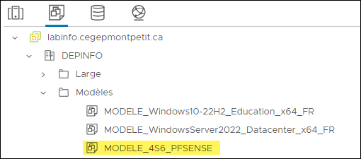

Cette VM pfSense est très légère et l'utilisation qu'on en fait dans ce projet est minime. Elle ne devrait pas causer trop d'interférence dans votre environnement virtuel.

**Ne démarrez pas la VM maintenant!** On doit d'abord modifier quelques paramètres matériels.

### Configurez les interfaces réseau

Ce routeur virtuel unira 4 réseaux:
- Du côté interne (LAN), 3 VLANs privés
- Du côté externe (WAN), le VLAN partagé Acces-Internet-1

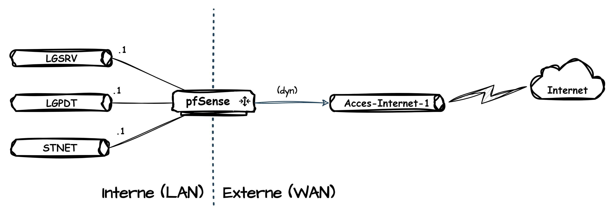

Votre VM pfSense doit donc posséder 4 interfaces réseau, chacune branchée sur l'une des interfaces. La dernière doit rester en NAT sur Acces-Internet-1.

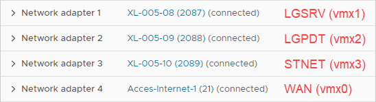

:::info
En raison d'un bug de pfSense, l'ordre des interfaces change lorsqu'il y en a quatre ou plus. Pour cette raison, l'interface WAN qui vous donnera accès à Internet est la dernière dans vmWare mais la première dans pfSense. Faites attention à ce détail.
:::
    
**Assurez-vous d'activer la balise "Ne pas fermer" dans l'interface de vSphere.**

Puis démarrez la passerelle. Vous devriez arriver à cet écran.

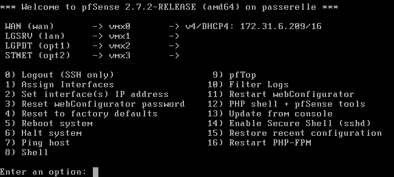

L'interface WAN est assignée dynamiquement par DHCP via la connexion à `Acces-Internet-1`. Les interfaces LAN, OPT1 et OPT2 n'ont présentement aucune adresse IP et doivent être configurées manuellement. Elles seront respectivement les adresses de passerelle pour les sites LGSRV, LGPDT et STNET respectivement. Vous devrez configurer chacune d'entre elles

Dans l'interface console de pfSense, sélectionnez l'option 2 dans le menu, pour attribuer une adresse IP aux trois interfaces LAN. Vous devrez définir l'adresse IP de l'interface ainsi que son masque. Par exemple, si vous avez l'adresse réseau 10.3.248.0/24, alors cette interface devrait porter l'adresse 10.3.248.**1**/24. **N'activez pas DHCP sur ces interfaces!**

Notez qu'ici, la notation est un peu spéciale puisqu'elle combine l'adresse IP de l'hôte et le masque en notation CIDR.

À la fin, vous devriez avoir vos interfaces configurées telles qu'illustrées. Assurez-vous que les adresses se terminent bien par **.1**!

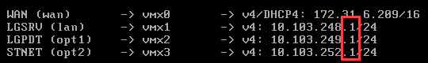

### Configurez le pare-feu

La prochaine étape consiste à permettre aux trois réseaux de se parler. Par défaut, pfSense est parfaitement capable de router le trafic entre les réseaux internes, mais le pare-feu bloque ce trafic. Il faut créer des règles permettant de laisser passer le trafic.

Puisque c'est un environnement de laboratoire, on va configurer une règle qui laisse tout passer, mais sachez que dans un réseau de production, c'est une très mauvaise pratique.

Il vous faut vous connecter à l'interface Web de configuration de pfSense à l'aide d'une machine connectée du côté LAN. Vous devez donc connecter une VM sur ce réseau (Windows, Linux, peu importe, pourvu qu'elle soit munie d'un fureteur Web). Évidemment, comme il n'y a pas encore de service DHCP sur ce réseau, vous allez devoir configurer manuellement sa carte réseau dans le LAN 1 (LGSRV).

Le nom d'utilisateur par défaut est **admin**, et le mot de passe est **pfsense**. Il est une bonne pratique de le changer, si vous tenez à la sécurité!

À la première connexion à l'interface Web, annulez la configuration initiale. Vous l'avez déjà faite! Naviguez dans le menu **Firewall**, puis **Rules**.

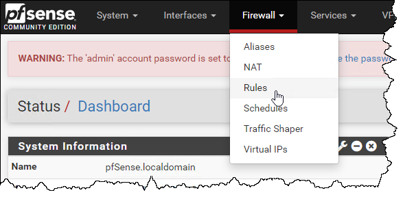

Sélectionnez **LAN** et ajoutez une règle.

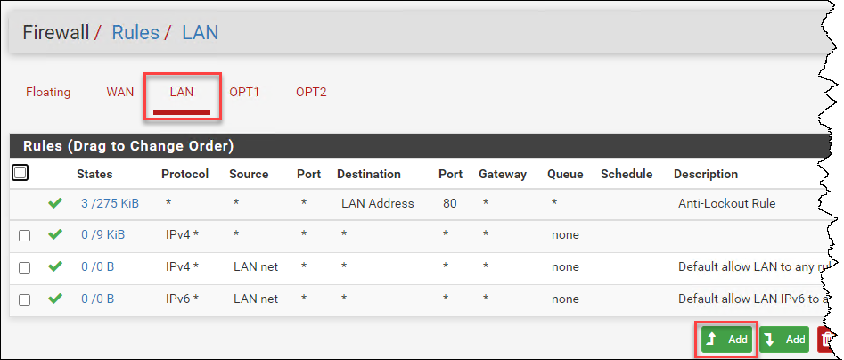

Configurez cette règle pour laisser passer absolument tout! On aime ça vivre dangereusement!

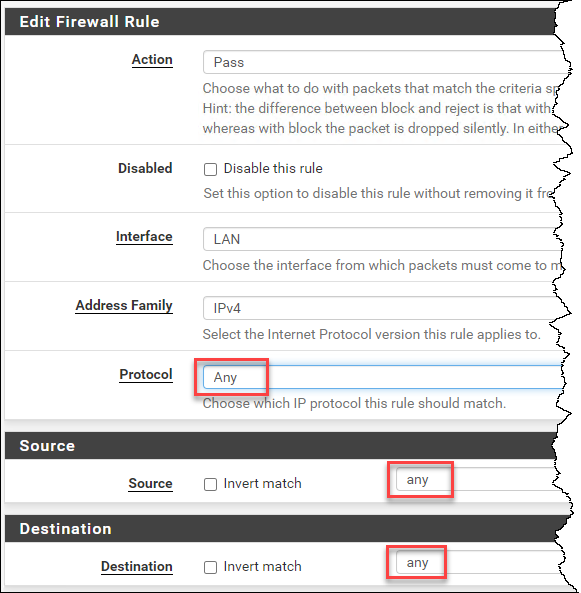

Puis faites la même chose pour OPT1 et OPT2.

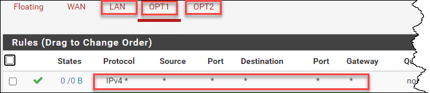

Finalement, appliquez les changements.

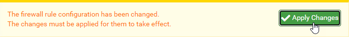

### Testez la communication

Pour tester, connectez simplement des machines dans chacun des chacun des réseaux locaux. Configurez statiquement leur adresse IP et leur passerelle par défaut pour qu'elles correspondent au subnet sur lesquelles elles sont connectées, et donnez-leur un résolveur DNS quelconque (par exemple, 8.8.8.8). Essayez de pinger des hôtes sur Internet (par exemple, google.ca) et essayez de pinger les hôtes des autres subnets.

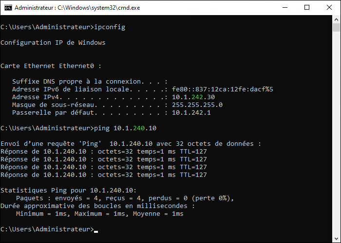

:::info Ouverture du pare-feu
Vous pourriez avoir besoin d'ouvrir le pare-feu local pour recevoir des pings. Il vous suffit d'ouvrir le pare-feu avancé de Windows (wf.msc) et activer la règle ***Analyse de l'ordinateur virtuel (Demande d’écho - Trafic entrant ICMPv4)*** pour que celui-ci puisse répondre aux pings.
:::

## Étape 3: Création du domaine AD

### Promouvez le DC

Connectez le serveur **LG-DC01** dans le subnet **LGSRV**, donnez-lui l'adresse IP 10.x.x.**10**, puis effectuez sa promotion en contrôleur de domaine Active Directory.

:::danger ATTENTION, TRÈS IMPORTANT!
Assurez-vous que votre contrôleur de domaine s'appelle **LG-DC01** (son nom d'hôte, pas simplement le nom de la VM dans Labinfo). Utilisez la commande hostname pour confirmer.

Assurez-vous aussi que le contrôleur de domaine possède la bonne adresse IP. Confirmer avec le prof si vous avez des doutes.

Il sera très difficile de modifier ces paramètres après avoir promu votre contrôleur de domaine, et vous risquez de devoir remonter tout votre domaine. Vous devez donc être sûr de votre coup **avant** de procéder à la promotion.
:::

Vous devez créer votre forêt du même coup. Trouvez un **nom valide** (votre prénom, surnom, totem, etc.) pour constituer les noms DNS et NETBIOS de votre domaine et consignez-le dans vos notes.

- Nom DNS du domaine: `intranet.nomdudomaine.cemti.ca`
- Nom NETBIOS: `NOMDUDOMAINE`

### Créez la structure d'OU

Créez cette structure d'OU dans Active Directory pour y contenir vos comptes:

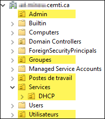

| Nom de l'OU | Description |
| -- | -- |
| Admin | Contient les comptes privilégiés pour l'administration système |
| Groupes | Contient les groupes de sécurité pour l'accès aux ressources par les utilisateurs |
| Postes de travail | Contient les comptes machine des postes de travail |
| Services | Contient les comptes machine et les comptes de service pour des services spécifiques |
| → DHCP | Contient les comptes machine, les comptes de service et les groupes d'administration pour le service DHCP |
| Utilisateurs | Contient les comptes utilisateurs (réguliers) |

### Configurez un redirecteur DNS

Le redirecteur fera en sorte que toutes les requêtes faites à un nom de domaine différent de ceux sur lesquels votre contrôleur de domaine fait figure d'autorité sera acheminée à un résolveur public en mode récursif, au lieu d'une résolution itérative à partir des serveurs racine.

- Dans la **console DNS** (*dnsmgmt.msc*), cliquez-droit sur la racine du serveur, puis **Propriétés**.
- Dans l'onglet **Redirecteurs**, ajoutez les serveurs suivants:
  - 8.8.8.8
  - 8.8.4.4

:::info
Il se peut que les redirecteurs soient déjà configurés. En effet, si vous avez déjà mis des résolveurs DNS dans la configuration IP du serveur avant sa promotion, ces serveurs sont automatiquement configurés comme redirecteurs.
:::

### Créez des zones DNS inverses

Pour permettre la résolution d'une adresse IP à un nom d'hôte, vous devez créer des zones de recherche inverses dans le serveur DNS. Vous pouvez le faire dans la console du gestionnaire DNS, sous **Zone de recherche inversée**.

:::info Mise à jour des enregistrements PTR
Après la mise en place de la zone de recherche inversée, les clients DHCP mettront à jour leur enregistrement au prochain renouvellement de leur bail. Pour forcer la mise à jour immédiate d'un client dans la zone inverse, vous pouvez faire  ipconfig /renew.
:::

<!--[:film_strip: Démonstration vidéo](https://www.youtube.com/watch?v=KRncFfYVISU&list=PLPW9T9fw1MsiNek-NIabxEIcv-3gZ_oDW&index=2)-->

## Étape 4: Mise en place de DHCP

### Jonction du serveur au domaine

Connectez **LG-DHCP01** au réseau **LGSRV**, donnez-lui l'adresse 10.x.x.**20** et joignez-le au domaine.

N'oubliez pas de définir **l'adresse IP du contrôleur de domaine** en guise de résolveur DNS. Si vous le ne faites pas, il vous sera impossible de joindre le domaine.

Puis, dans la console **Utilisateurs et Ordinateurs Active Directory** (*dsa.msc*), déplacez le compte machine de ce serveur dans l'OU **Services / DHCP**.

### Configuration du service DHCP

Commencez par installer le service DHCP sur le serveur **LG-DHCP01**.

Démarrez une session sur le serveur en tant qu'administrateur du domaine (NOMDOMAINE\Administrateur). Puis dans la **console de gestion DHCP** (*dhcpmgmt.msc*), créez **deux nouvelles étendues IPv4**: une pour LGPDT et l'autre pour STNET.

- Définissez les plages d'adresses:
  - LGPDT: de .10 à .254
  - STNET: de .50 à .254
- Indiquez l'adresse de la passerelle par défaut du subnet (10.x.x.1)
- Indiquez le nom DNS de votre domaine parent (intranet.votrenom.cemti.ca)
- Indiquez l'adresse IP de votre contrôleur de domaine comme résolveur DNS

Assurez-vous que votre serveur DHCP est bien autorisé dans Active Directory. Si vous avez effectué la configuration de l'étendue en tant qu'administrateur local du serveur, vous devez obligatoirement l'autoriser en fournissant un identifiant qui possède des droits d'administration. Pour ce faire, cliquez-droit sur le serveur DHCP dans la console de gestion DHCP, et faites Autoriser. Si vous ne voyez pas l'option Autoriser, mais qu'à la place, vous voyez Interdire, c'est le signe que l'autorisation est déjà faite, et votre serveur devrait déjà être fonctionnel.

### Configurez le relais DHCP

Il ne devrait pas y avoir de poste de travail dans le VLAN de serveurs, ni de serveur dans le VLAN des postes de travail. C'est une bonne pratique, car on peut insérer un pare-feu entre les réseaux pour filtrer le trafic. Cependant, DHCP ne fonctionne que dans le réseau local, car ce protocole implique des diffusions (broadcast). Il vous faudra alors exploiter une fonctionnalité de la machine pfSense pour agir comme intermédiaire entre les clients DHCP du réseau Longueuil-PDT et le serveur DHCP du réseau Longueuil-SRV.

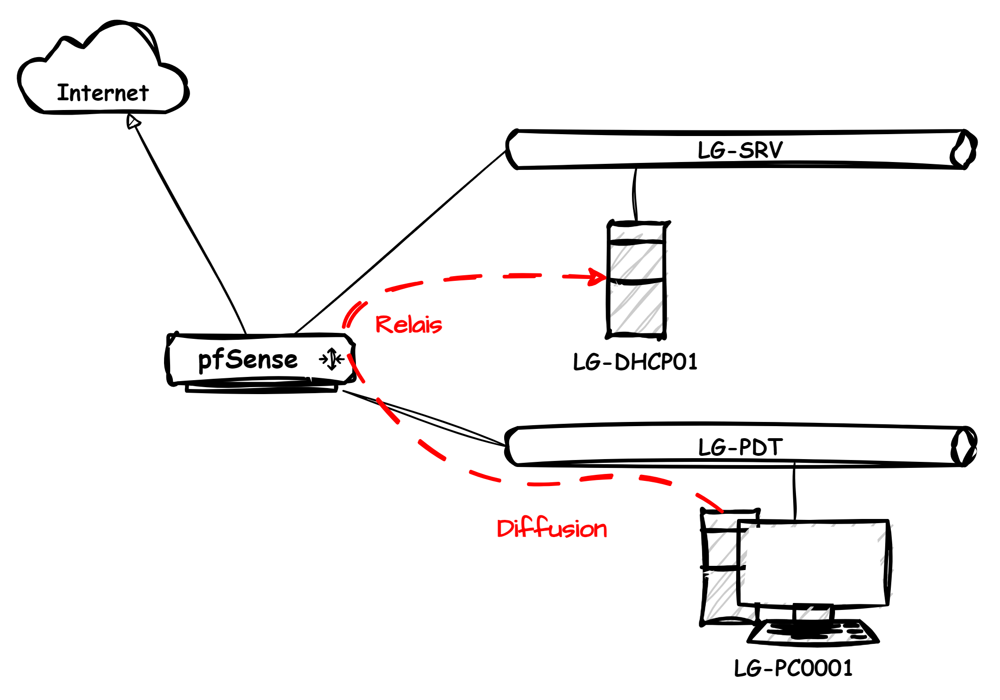

À partir d'une machine située dans votre réseau, connectez-vous à pfSense en utilisant l'adresse IP de sa passerelle. Puis dans le menu **Services**, accédez à **DHCP Relay**.

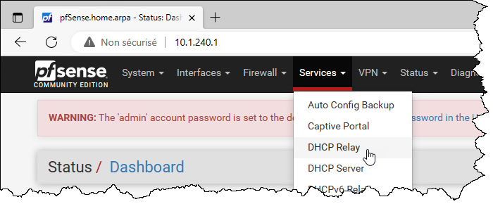

Le serveur DHCP se trouve déjà connecté à l'interface LAN, donc le relais doit opérer sur les interfaces OPT1 et OPT2. Sélectionnez-les toutes les deux dans la liste (avec la touche CTRL) et spécifiez l'adresse IP de votre serveur DHCP. Puis sauvegardez la configuration.

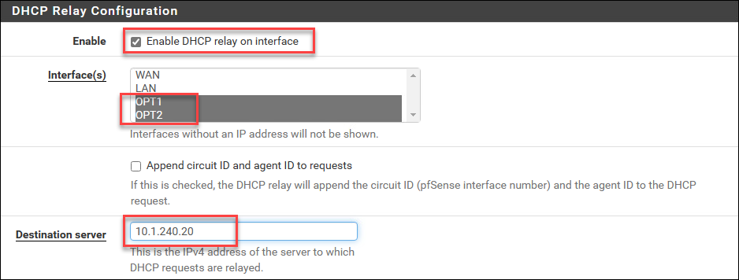

Puis, testez l'assignation d'adresses IP dans chacun de vos subnets.

Vous pouvez tester en déposant un client DHCP (par exemple, PC0001) dans un chacun des VLANs et en vérifiant avec IPCONFIG si la machine reçoit la bonne configuration IP. Portez une attention particulière aux serveur DNS et à la passerelle par défaut, et vérifiez si vous pouvez communiquer par Internet (ping google.com) et si vous pouvez résoudre le domaine (nslookup corp.mondomaine.com).

## Étape 5: Jonction des postes

Connectez **LG-PC0001** dans le réseau LGPDT et laissez-le prendre une adresse IP dynamique par DHCP (confirmez avec IPCONFIG). Puis, joignez-le au domaine.

:::warning Adresse IP statique
Si vous avez donné une adresse IP statique à ce PC pour tester votre passerelle, retirez la configuration manuelle et restaurez-la à une configuration dynamique par DHCP. Vérifiez le résultat avec la commande IPCONFIG /ALL.
:::

Faites la même chose avec **LG-PC0002**.

## Conclusion

Vous devriez maintenant avoir un réseau fonctionnel représenté par le diagramme ci-dessous:

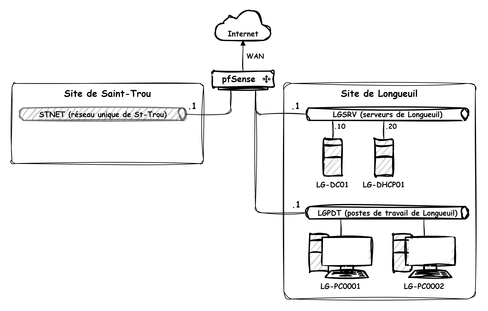
