Dans ce laboratoire, vous installerez un serveur de site Configuration Manager (aussi appelé ConfigMgr, MCM ou SCCM). 

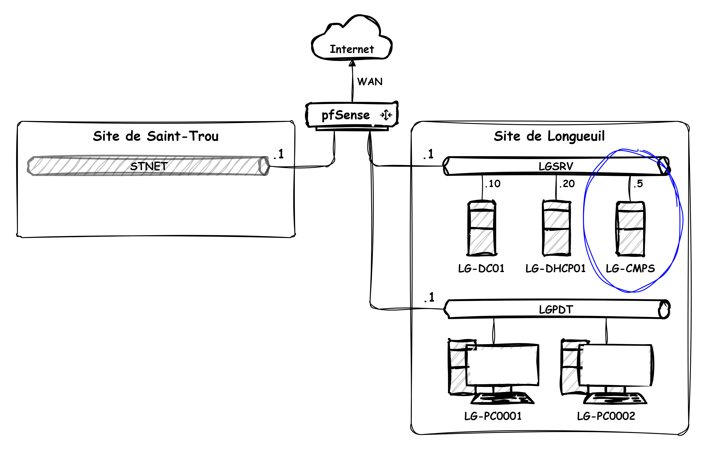

:::warning IMPORTANT! 
Suivez scrupuleusement cette procédure, et portez attention aux détails. La procédure est assez longue et une petite erreur au début peut entraîner un échec complet à la toute fin.
:::

## Étape 1: Préparation du serveur

### Création de la machine virtuelle

Créez une machine virtuelle Windows Server 2022 en utilisant le modèle du laboratoire précédent et appelez-la `LG-CMPS`. Nommez la VM dans Labinfo en **suivant la nomenclature** établie dans le dernier laboratoire.

**NE CLONEZ SURTOUT PAS VOTRE CONTRÔLEUR DE DOMAINE EXISTANT!**

N'oubliez pas non plus d'attribuer la balise pour ne pas que votre VM se ferme automatiquement pendant la maintenance de nuit.

Modifiez la configuration matérielle de la façon suivante:

- **4** processeurs virtuels
- **16 Go** de RAM
- Un disque dur supplémentaire de **200 Go** (pour SCCM)
- Un disque dur supplémentaire de **90 Go** (pour SQL)
- L'adapteur réseau connecté dans votre réseau **LGSRV**

Puis, démarrez la VM.

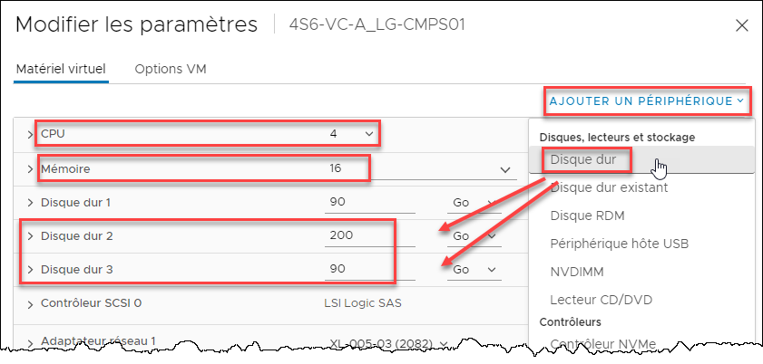

### Initialisation des disques durs

Activez et formatez les disques supplémentaires

- Le disque de 200 Go formaté NTFS et la **lettre D**
- Le disque de 90 Go formaté NTFS avec unité d'allocation de 64Ko et la **lettre E**
- Le lecteur DVD virtuel avec la **lettre F**

:::tip Lettre non disponible?
Si la lettre D n'est pas disponible, c'est peut-être parce qu'elle est déjà prise par le lecteur DVD. Modifiez sa lettre en premier, ça libérera le D.
:::

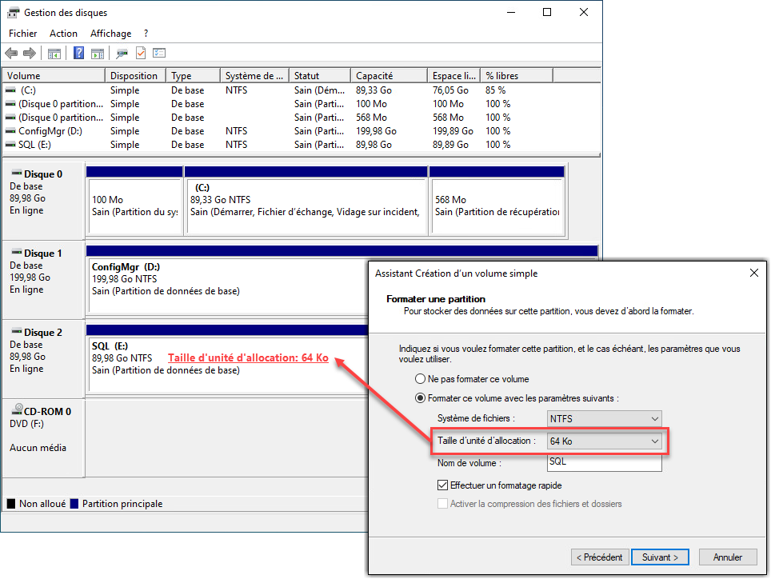

### Configuration du réseau

- [ ] Définissez l'adresse IP statique .5 dans votre réseau LGSRV, en prenant soin de bien définir le masque, la passerelle par défaut ainsi que les résolveurs DNS.

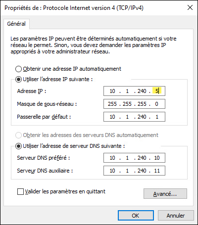

- [ ] Renommez cette machine `LG-CMPS` et la joignez-la au domaine. Redémarrez.

- [ ] Démarrez avec le compte Administrateur du domaine (VOTREDOMAINE\Administrateur)

> Pour ce labo, il sera plus simple pour vous d'utiliser ce compte, même si son usage est découragé en production.

- [ ] Dans votre domaine, créez un OU ConfigMgr quelque part dans votre structure (typiquement dans la structure où se trouvent les serveurs). Créez-y le groupe CM-Admins et déplacez-y le compte machine du serveur.

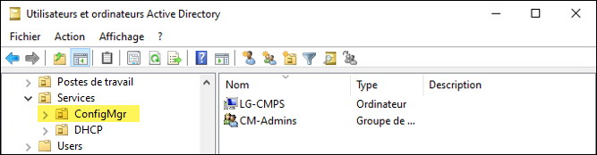

- [ ] Ajoutez le groupe CM-Admins dans le groupe des administrateurs locaux du serveur.

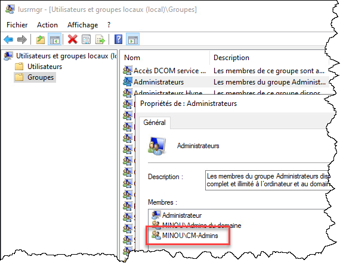

- [ ] Insérez le fichier H25_ConfigMgr.iso contenant les fichiers d'installation.

- [ ] Le fichier H25_ConfigMgr.iso se trouve dans le datastore Logiciels/_Cours/4S6-B74. Il peut être monté sur une VM dans LabInfo. Vous pouvez copier le contenu du ISO dans un répertoire local (C:\Temp) par exemple.

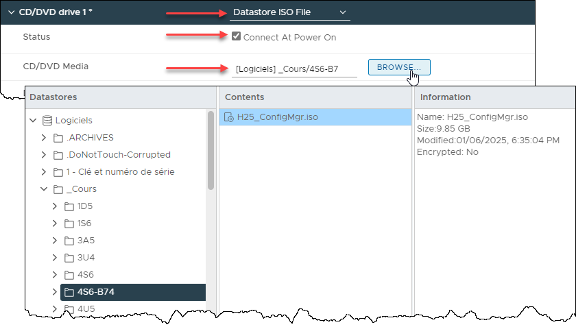

Une fois monté, vous devriez voir la structure suivante.

| Nom du répertoire   | Contenu                                                                                                                                                |
| ------------------- | ------------------------------------------------------------------------------------------------------------------------------------------------------ |
| ADK_10.1.26100.2454 | Le kit de déploiement ADK qui contient les outils nécessaires au déploiement automatisé du système d'exploitation Windows et la production d'images de démarrage Windows PE. |
| CM_2403             | Les fichiers d'installation de ConfigMgr (SCCM)                                                                                                        |
| CM_Prereqs          | Les prérequis d'installation de ConfigMgr pré-téléchargés.                                                                                             |
| MSODBCSQL           | Le pilote ODBC pour SQL Server                                                                                                                         |
| SQL2019_CU30_x64    | La mise à jour cumulative 30 de Microsoft SQL Server 2019.                                                                                             |
| SQL2019_SSRS_x64    | Les fichiers d'installation de Microsoft SQL Server Reporting Services 2019.                                                                           |
| SQL2019_x64_ENU     | Les fichiers d'installation de Microsoft SQL Server 2019                                                                                               |
| SSMS_20.2           | Le paquet d'installation de Microsoft SQL Server Management Studio.                                                                                    |
| SXS                 | Les fichiers nécessaires à l'activation de .NETFX 3.0, qui n'est pas inclus dans une installation normale de Windows.                                  |
| Tools               | Des outils divers qui pourront être utilisés en cours de session.                                                                                      |

## Étape 2: SQL Server

### Installation de SQL Server

- [ ] Lancez `Setup.exe` à partir du médium d'installation de SQL Server 2019 (répertoire SQL2019_x64_ENU) et procédez à l'installation d'une nouvelle instance.

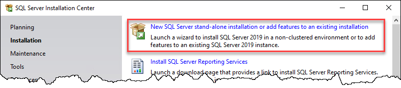

- [ ] Choisissez la version d'évaluation. Laissez la clé de produit vide. Acceptez les termes de licence. Ignorez les mises à jour automatiques.

- [ ] À la vérification des règles d'installation, il pourrait y avoir un avertissement concernant le pare-feu. C'est normal. Les autres règles devraient être en succès.

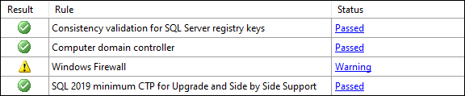

- [ ] À la page de sélection des fonctionnalités, cochez uniquement Database Engine Service. Et dans les chemins d'installation, remplacez C: par D: pour que le logiciel s'installe sur un autre lecteur que celui du système d'exploitation.

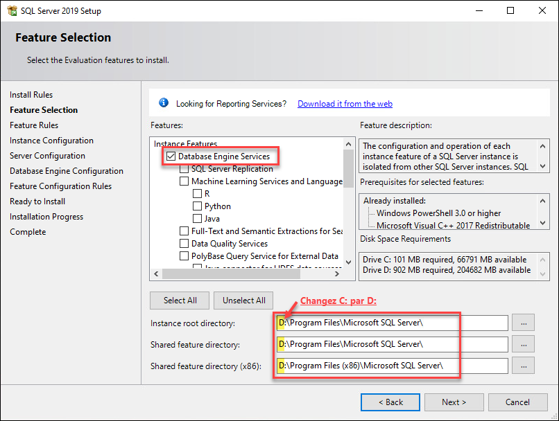

- [ ] À la page Instance Configuration, gardez l'instance par défaut.

- [ ] À la page Server Configuration, dans l'onglet Service Accounts, modifiez le compte SQL Server Database Engine pour le compte Système. Ne faites pas Next tout de suite!

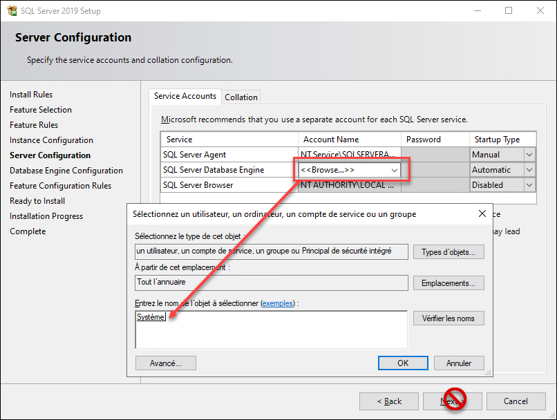

- [ ] À la même page, dans l'onglet Collation, il est très important de sélectionner SQL_Latin1_General_CP1_CI_AS. Soyez très vigilent, car il y en a plusieurs qui ressemblent à un caractère près. Si vous sélectionnez le mauvais, Configuration Manager ne s'installera pas correctement.

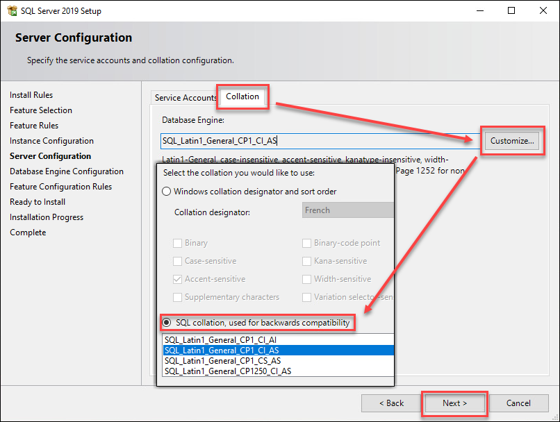

- [ ] À la page Database Engine Configuration, dans l'onglet Server Configuration, ajoutez le groupe CM-Admins, le groupe des Admins du domaine ainsi que le compte Administrateur sur lequel vous êtes authentifié. Ne cliquez pas tout de suite sur Next!

- [ ] En temps normal, c'est une mauvaise pratique que les admins du domaine soient admins SQL, mais on triche ici pour simplifier la configuration.

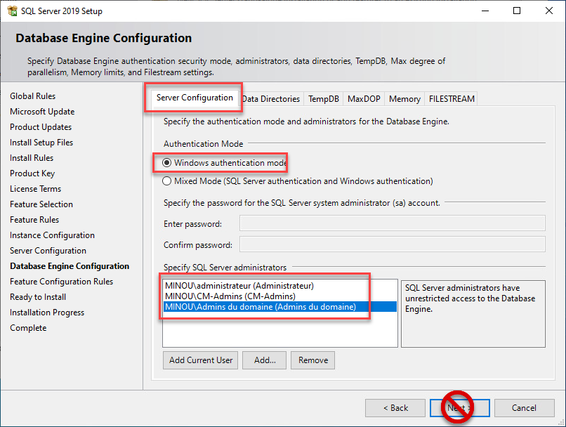

- [ ] Toujours à la même page, dans l'onglet Data Directories, changez le chemin Data root directory à E:\. Cela aura pour effet de modifier tous les autres chemins. Ne cliquez pas sur Next tout de suite!

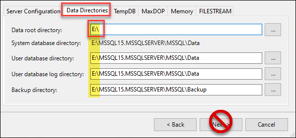

- [ ] Toujours à la même page, dans l'onglet Memory, cochez Recommended et modifiez la mémoire maximale pour la moitié  de la RAM du serveur, en Mo. Si votre serveur a 16 Go de mémoire, alors la valeur devrait être 8192.

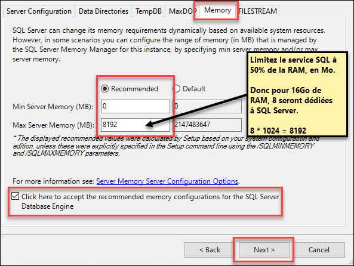

- [ ] Suivez les étapes en conservant les options par défaut jusqu'à ce que SQL Server s'installe avec succès.

- [ ] Redémarrez votre serveur.

### Installation de SSRS

- [ ] Exécutez `SQLServerReportingServices.exe` (répertoire SQL2019_SSRS_x64) et suivez les étapes d'installation. N'oubliez pas de modifier le chemin d'installation pour que le produit s'installe sur le lecteur D: et non sur le C:.

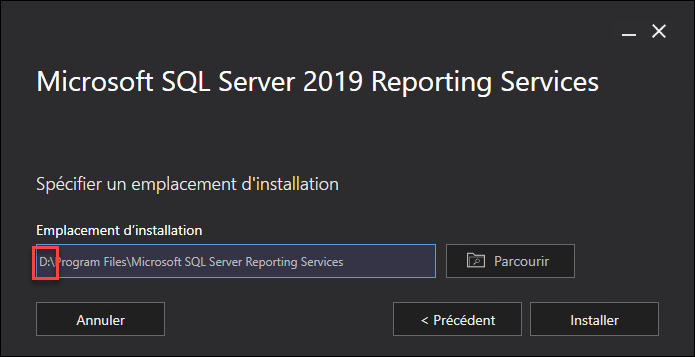


### Installation de SSMS

Exécutez `SSMS-Setup-ENU.exe` et suivez les étapes d'installation. N'oubliez pas de modifier le chemin d'installation pour que le produit s'installe sur le lecteur D: et non sur le C:.

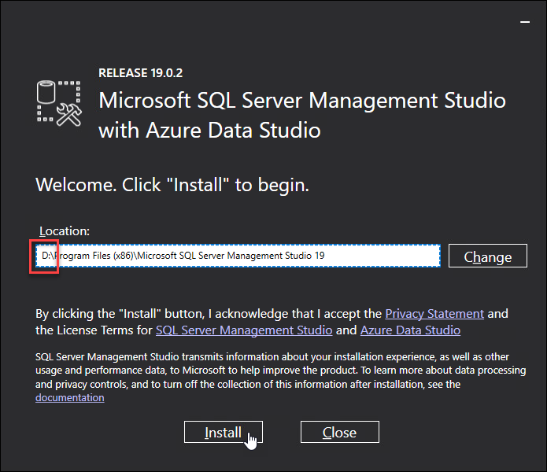

### Mise à jour de SQL Server

Il faut installer les mises à jour cumulative sur le serveur SQL pour que SCCM soit supporté. On doit se fier à la documentation du produit pour savoir quelle version de mise à jour est requise, en fonction de la version de SQL Server et de SCCM. Ici, vous installerez le **CU30 pour SQL Server 2019**.

- [ ] Exécutez `SQLServer2019-KB5049235-x64.exe` et suivez les étapes d'installation.

- [ ] Redémarrez votre serveur.

### Installation des pilotes ODBC

- [ ] Installez le paquet `msodbcsql.msi` situé dans le répertoire MSODBCSQL.

## Étape 3: Préparation des prérequis

### Extension du schéma AD

Cette étape doit être faite par un utilisateur membre du groupe des **administrateurs du schéma**. Si vous êtes loggés avec le compte **Administrateur** du domaine, celui-ci est déjà membre de ce groupe, par défaut. Cette étape peut se faire sur n'importe quelle machine membre du domaine, pas obligatoirement sur un contrôleur de domaine, en autant que ce soit fait par un admin du schéma.

Pour savoir si vous êtes administrateur du schéma, lancez la commande `whoami /groups`.

- [ ] Démarrez une console de commande en tant qu'administrateur et lancez la commande `.\SMSSETUP\BIN\X64\extadsch.exe` à partir du médium d'installation de ConfigMgr.

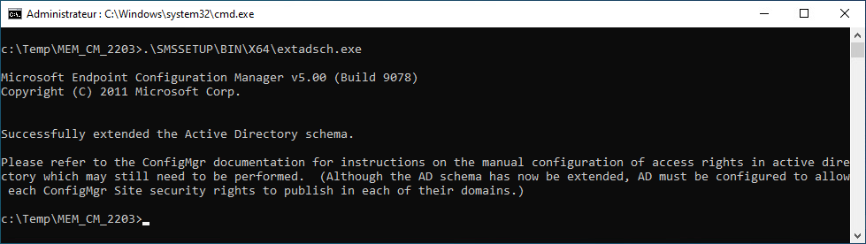

### Création du conteneur dans AD

- [ ] Sur un contrôleur de domaine ou une machine sur laquelle les outils d'administration RSAT pour Active Directory ont été installés, démarrez la console **ADSIEdit** (*adsiedit.msc*) et connectez-vous au contexte d'attribution de noms par défaut. Cliquez-droit sur `CN=System`, et créez un nouvel objet de type container appelé `System Management`.

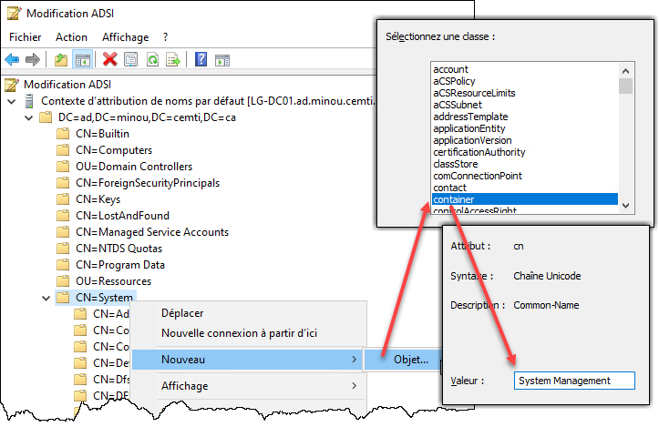

:::warning Important!
Le nom du conteneur doit obligatoirement s'appeler `System Management`. Si le conteneur est mal écrit (par exemple, avec une faute de frappe) ou si c'est un OU, certaines fonctionnalités d'SCCM ne seront pas accessibles et cela aura un impact sur des laboratoires futurs.
:::

- [ ] Ouvrez les propriétés de ce conteneur. Dans l'onglet Sécurité, ajoutez le plein contrôle au compte machine du serveur SCCM (LG-CMPS01).

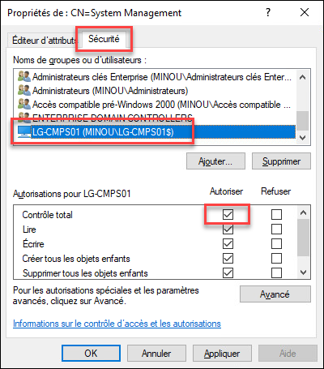

- [ ] N'oubliez pas que pour ajouter un compte ordinateur à une liste de permission, vous devez d'abord cocher ce type d'objet.

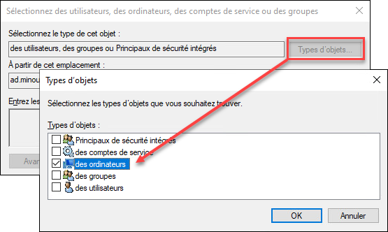

- [ ] Il faut aussi activer la propagation de la permission à tous les objets enfants. Pour ce faire, cliquez sur Avancé, puis sélectionnez le compte ordinateur du serveur SCCM et cliquez sur Modifier.

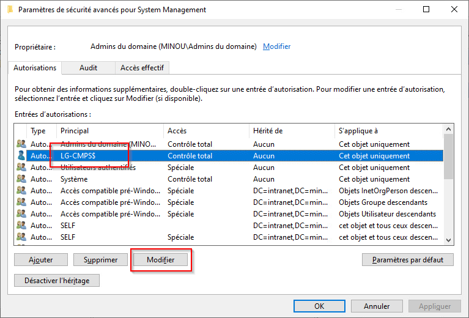

- [ ] Faites en sorte que la permission s'applique à cet objet et tous ceux descendants. Puis enregistrez la liste de contrôle d'accès en cliquant sur OK.
    
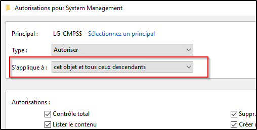


### Installation des fonctionnalités

Il y a plusieurs rôles et fonctionnalités à installer. Dans une console PowerShell en admin, sur le serveur, lancez ces commandes **et assurez-vous qu'elles ne donnent pas d'erreur**:

```powershell
Install-WindowsFeature -Name 'Web-Windows-Auth'
Install-WindowsFeature -Name 'Web-ISAPI-Ext'
Install-WindowsFeature -Name 'Web-Metabase'
Install-WindowsFeature -Name 'Web-WMI'
Install-WindowsFeature -Name 'BITS'
Install-WindowsFeature -Name 'RDC'
Install-WindowsFeature -Name 'Web-Asp-Net'
Install-WindowsFeature -Name 'Web-Asp-Net45'
Install-WindowsFeature -Name 'NET-HTTP-Activation'
Install-WindowsFeature -Name 'NET-Non-HTTP-Activ'
Install-WindowsFeature -Name 'NET-Framework-Features'
```

:::info Composant DotNet 3.5
Il se pourrait que cette commande n'arrive pas à installer le composant NET-Framework-Features. La raison la plus probable est que votre serveur n'arrive pas à contacter le service de Windows Update. Vérifiez votre connectivité à Internet si tel est le cas. Si vous ne pouvez pas garantir une telle connectivité, alors il faut fournir les sources d'installation du composant. J'ai inclus celui pour Windows Server 2022 en français dans le ISO fourni, sous le répertoire SXS.

```powershell
Install-WindowsFeature -Name 'NET-Framework-Features' -Source 'F:\SXS'
```

:::

### Installation de Windows ADK

Pour procéder à l'imagerie bureautique, SCCM dépend des outils du *Windows Assessment and Deployment Kit* (ADK).

- [ ] Exécutez `adksetup.exe` (dans le répertoire ADK_10.1.26100.2454\ADK) et suivez les instructions. Sélectionnez seulement les options illustrées.

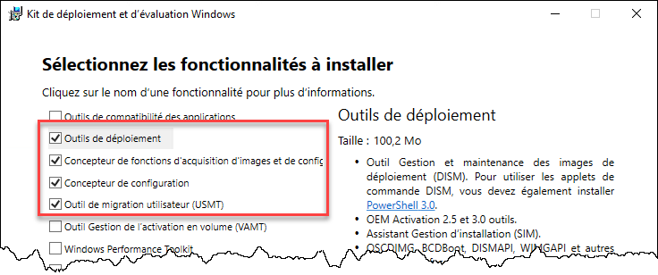

- [ ] Exécutez `adkwinpesetup.exe` (dans le répertoire ADK_10.1.26100.2454\ADKWinPEAddons) et suivez les instructions.

### Protection des volumes C et E

Il faut créer un fichier `no_sms_on_drive.sms` à la racine des lecteurs C:\ et E:\ pour éviter que ConfigMgr squatte ces volumes. Ça se fait facilement avec PowerShell.

<ConsoleWindow title="Administrateur: Windows PowerShell" backgroundColor="#012456">
```
PS C:\> "C", "E" | ForEach-Object { New-Item ('{0}:\no_sms_on_drive.sms' -f $_) }
```
</ConsoleWindow>

### Téléchargement des prérequis

:::tip Étape facultative
Pour sauver du temps, j'ai inclus les prérequis dans le ISO que je vous ai fourni. Ils sont dans le répertoire **CM_Prereqs**. Vous n'avez donc pas à faire cette étape.
:::

- [ ] À l'invite de commande en tant qu'admin, créez le répertoire `c:\temp\CM_Prereqs` puis lancez la commande: `.\SMSSETUP\BIN\X64\setupdl.exe "c:\temp\CM_Prereqs"` à partir du médium d'installation de ConfigMgr.

### Vérification des prérequis

- [ ] À l'invite de commande en tant qu'admin, lancez la commande: `.\SMSSETUP\BIN\X64\prereqchk.exe /AdminUI` à partir du médium d'installation de ConfigMgr.

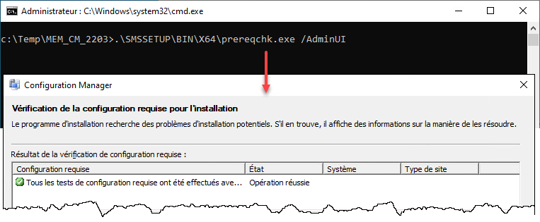

Si un prérequis est manquant ou incorrectement configuré, ce sera indiqué ici.

## Étape 4: Installation de SCCM

### Lancement de l'installation

- [ ] À l'invite de commande en tant qu'admin, lancez la commande: `.\SMSSETUP\BIN\X64\setup.exe` à partir du médium d'installation de ConfigMgr.

- [ ] À la page Mise en route, cochez **Installer un site principal**.

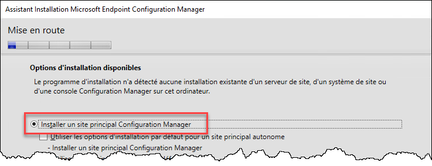

- [ ] À la page Clé du produit, choisissez d'**Installer la version d'évaluation**.

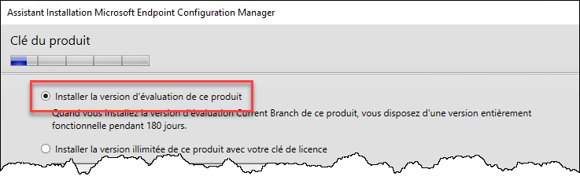

- [ ] À la page Termes du contrat de licence, **cochez toutes les cases**.

- [ ] À la page Téléchargements requis, cochez **Utiliser des fichiers précédemment téléchargés**. Indiquez le répertoire où ils se trouvent (vous pouvez utiliser `F:\CM_Prereqs` où F: est le lecteur DVD correspondant au fichier ISO.)

- [ ] À la page Sélection de la langue du serveur, sélectionnez **français** et **anglais**.

- [ ] À la page Sélection de la langue du client, sélectionnez **français** et **anglais**.

- [ ] À la page Paramètres d'installation et du site, choisissez un **code de 3 caractères** et un **nom** qui identifieront votre site ConfigMgr. Changez aussi le répertoire d'installation pour qu'il soit sur le **lecteur D:**.

> *Notez que ce site n'a rien à voir avec les sites Active Directory, il n'y en n'aura qu'un seul dans la majorité des cas.*

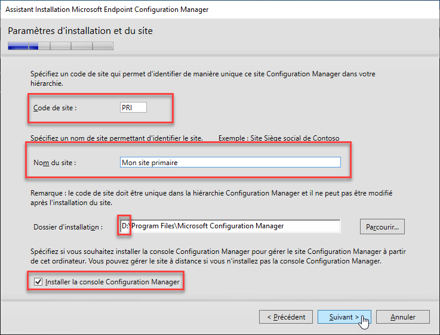

- [ ] À la page Installation du site principal, cochez **Installer le site principal en tant que site autonome**.

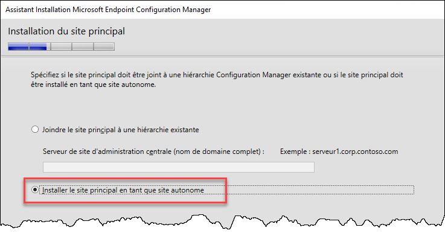

- [ ] À la page Informations sur la base de données, assurez-vous que les informations sur votre serveur SQL sont valides. Ça devrait être le cas automatiquement.

- [ ] À la page Paramètres du fournisseur SMS, cliquez Suivant.

- [ ] À la page Paramètres de communication de l'ordinateur client, cochez **Configurer la méthode de communication…** et **Les clients utiliseront HTTPS**…

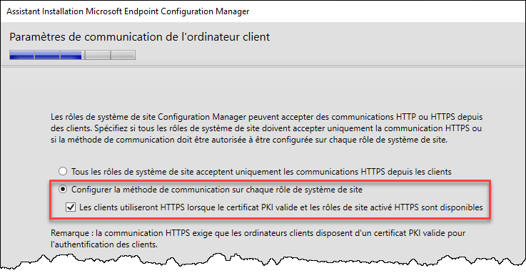

- [ ] À la page Rôle système de site, sélectionnez le **protocole de connexion client EHTTP** pour les rôles de point de gestion et de point de distribution.

:::info EHTTP et HTTPS
Dans ce laboratoire, il faut sélectionner EHTTP (et pas HTTPS), car il n'y a pas d'infrastructure PKI disponible dans votre environnement. EHTTP est une variante de HTTP mais qui utilise un certificat autosigné pour sécuriser la communication. Les échanges sont chiffrés mais il n'y a aucune authentification possible, contrairement à ce qu'offre HTTPS.

Dans un environnement réel, il est fortement encouragé de se doter d'une infrastructure PKI et forcer la communication client HTTPS dans toute l'infrastructure. En plus d'une meilleure sécurité, cela permet de desservir les clients déconnectés du réseau à travers Internet.
:::

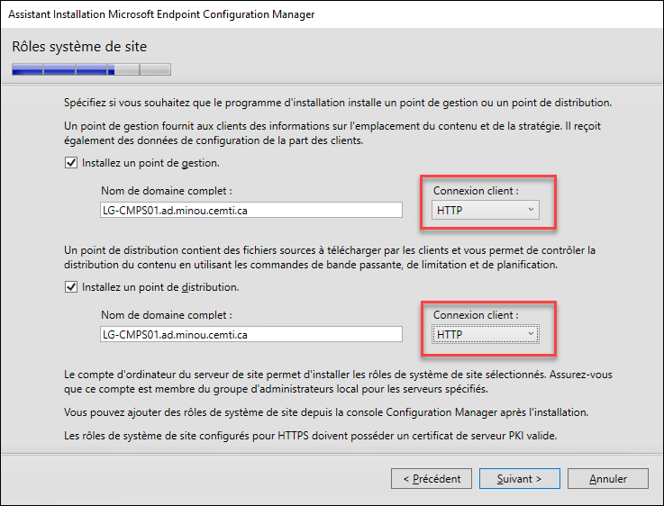

- [ ] À la page Configuration du point de connexion de service, cliquez Suivant.

- [ ] À la page Résumé des paramètres, cliquez Suivant.

- [ ] À la page Vérification de la configuration requise, assurez-vous qu'il n'y a **pas d'erreur**. 

> *Certains avertissements sont normaux, lisez-les pour votre information mais ils ne vous empêcheront pas de procéder à l'installation.*

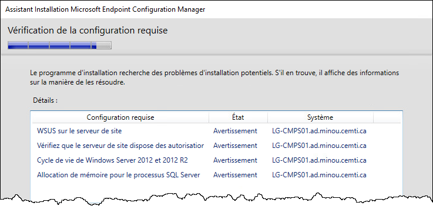

- [ ] Lorsque vous êtes prêt, cliquez sur **Commencer l'installation**.

> *Attention, l'installation est assez longue. Habituellement, elle dure entre 30 minutes et une heure.*

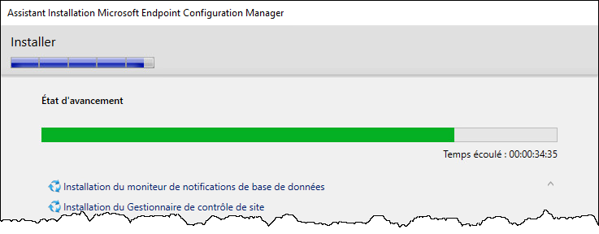

- [ ] Une fois terminé, redémarrez le serveur.

### Test de fonctionnement

Après l'installation de SCCM, vous ne devriez pas avoir de message d'erreur.

- [ ] Testez l'installation en démarrant la **console Configuration Manager**.

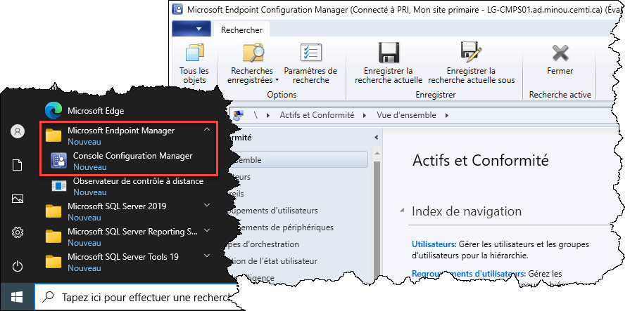

