Dans ce laboratoire, vous effectuerez la configuration initiale de ConfigMgr (SCCM) dans votre environnement virtuel. 

Vous devez minimalement disposer d'un environnement Active Directory comme celui-ci:

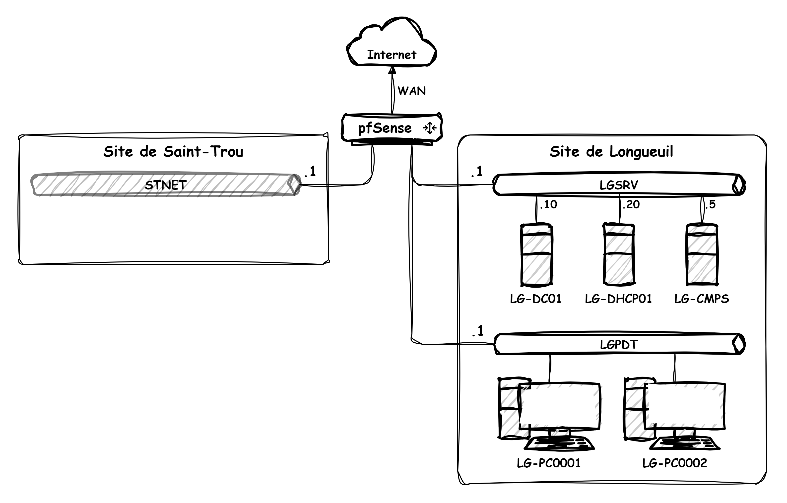

Ce laboratoire comporte quatre parties:

    • Partie 1: Mise en place de la découverte
    • Partie 2: Configuration des limites (boundaries)
    • Partie 3: Déploiement du client
    • Partie 4: Exploration de l'inventaire

Partie 1: Mise en place de la découverte

La découverte est le processus par lequel SCCM obtient de la visibilité sur le parc informatique de l'entreprise. SCCM se nourrit en bonne partie de l'information contenue dans Active Directory, notamment les machines, les groupes, les utilisateurs et les sites, ainsi que leurs attributs respectifs.

Lorsque la découverte est activée, SCCM va ponctuellement chercher l'information dans Active Directory, et retranscrit cette information dans sa base de données. On pourra ensuite se servir de ces données pour effectuer des requêtes dans la base de données.

On accède à la configuration des méthodes de découverte dans la section Administration de la console SCCM.

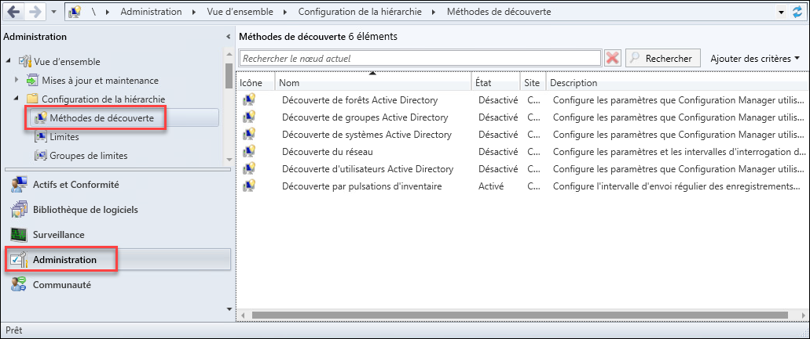

Voici les différentes méthodes de découverte qu'on peut utiliser pour nourrir la base de données d'SCCM:

Découverte de forêts AD	Collecte les informations de topologie dans la forêt AD, telles que les subnets et les sites
Découverte de groupes AD	Collecte les informations sur les groupes et leurs membres dans AD
Découverte de systèmes AD	Collecte les informations sur les machines (postes de travail, serveurs) dans AD
Découverte d'utilisateurs AD	Collecte les informations sur les comptes utilisateurs dans AD
Découverte par pulsation d'inventaire 	Définit les règles d'intervalle de communication du client
Découverte du réseau	Collecte les informations à partir de sources réseau non-AD (DHCP, équipement, etc.)

Configuration de la découverte de systèmes

La découverte de systèmes sert à obtenir sur Active Directory l'information sur les machines qui sont membres de Active Directory. Grâce à la découverte, SCCM peut connaître les machines qui existent sur le réseau avant même que le client SCCM soit installé. Par défaut, cette méthode est désactivée. On l'active à travers ses propriétés. 

Dans les propriétés, activez la découverte de systèmes, puis ajoutez un ou plusieurs emplacements dans AD pour cibler la recherche. Pour ce laboratoire, ajoutez l'OU qui contient des postes de travail.

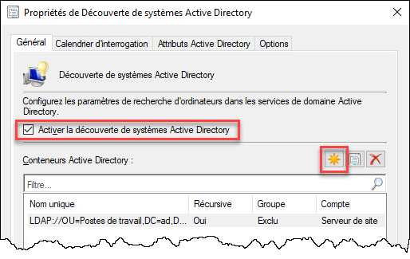

Chaque emplacement de recherche est identifié par son nom distinctif (Distinguished Name), que vous pouvez facilement sélectionner en cliquant sur Parcourir. Vous pouvez aussi décider si la recherche est récursive (c’est-à-dire qu'elle inclut aussi les objets des sous-conteneurs) et si les objets membres des groupes sont à découvrir aussi. Il est également possible de définir des exceptions. Finalement, il est possible d'utiliser un compte de service pour obtenir les droits en lecture dans AD, au lieu du compte machine du serveur. Généralement, on se contente des options par défaut.

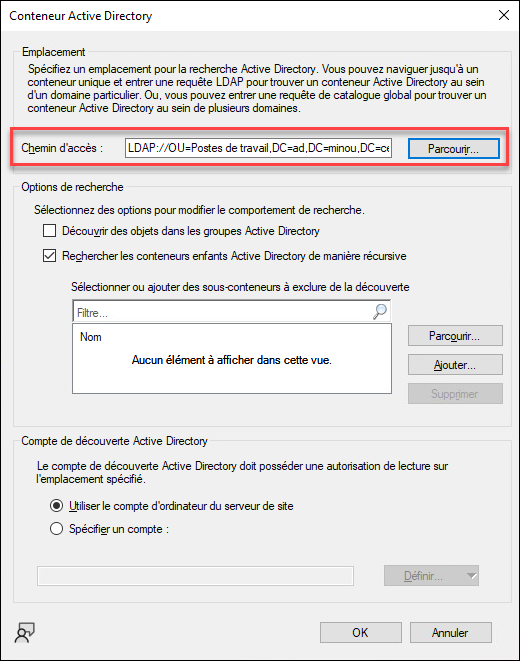

Dans l'onglet Calendrier d'interrogation des propriétés de découverte, on peut décider à quelle fréquence SCCM ira interroger Active Directory pour se mettre à jour. Il est habituellement souhaitable de cocher Activer la découverte delta, pour uniquement rechercher ce qui a changé depuis la dernière synchronisation, afin d'économiser la bande passante.

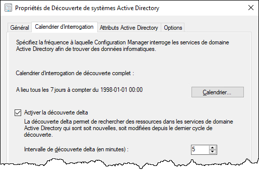

Dans l'onglet Attributs Active Directory, on peut définir quels attributs des comptes machine seront écrits dans la base de données. Il peut être tentant d'ajouter des attributs, mais il faut toujours garder en tête que plus on intègre d'attributs, plus la base de données grossit, alors il est souvent préférable de se contenter de ce dont on a besoin.

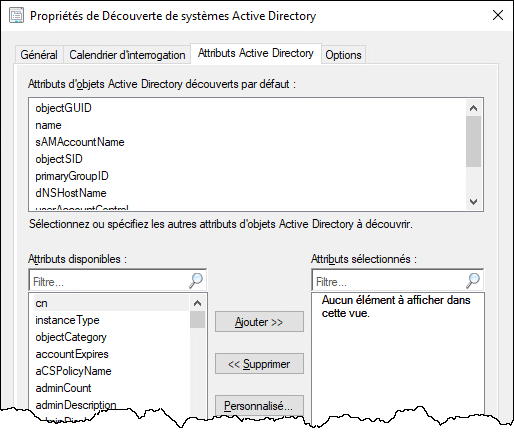

Finalement, dans l'onglet Options, on peut définir des règles d'exclusion de la découverte. C'est particulièrement pratique pour éviter que des machines qui ont été retirées de la circulation mais dont le compte machine n'a pas été détruit créent des objets fantôme dans SCCM, ce qui risquerait de fausser des rapports de déploiement. On peut donc exclure toutes les machines qui ne se sont pas authentifiées à AD pendant un certain nombre de jours.

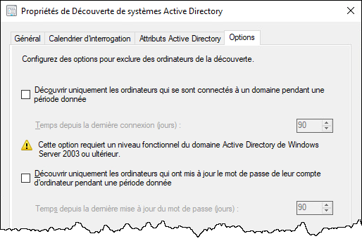

Lorsque vous avez terminé la configuration de la découverte des systèmes, vous pouvez lancer immédiatement la première découverte. Cliquez sur Oui. Il est aussi possible de forcer une découverte à tout moment, en cliquant-droit sur la découverte des systèmes. 

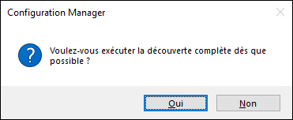

Vous devriez ensuite voir tous les postes de travail membres du domaine dans la section Actifs et conformité / Vue d'ensemble / Appareils.

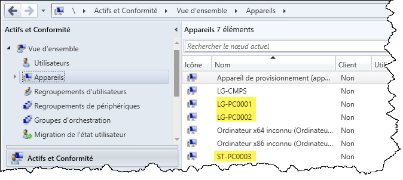

Note importante: Il faut toujours se rappeler que rien n'est instantané dans SCCM. Une fois la découverte lancée, il faut attendre quelques secondes ou quelques minutes (et parfois plusieurs minutes, dans un environnement de production) avant que la tâche soit accomplie, et il n'y a pas de rétroaction offerte par la console. Si vous ne voyez pas les objets immédiatement, rafraîchissez la console à l'occasion.

Mise en place des autres méthodes de découverte

De la même manière, activez la découverte des utilisateurs, des groupes et de la forêt.

Découverte de forêts Active Directory

La découverte de la forêt permet d'intégrer la topologie de la forêt Active Directory à la base de données. Cette méthode de découverte peut accélérer la création de limites à partir de la topologie des sites dans Active Directory. Cochez la case "Créer automatiquement les limites de plages d'adresse IP".

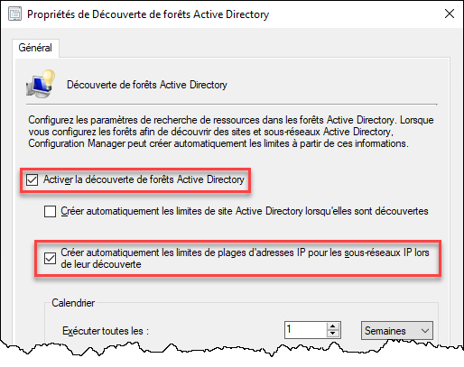

Découverte d'utilisateurs Active Directory

La découverte des utilisateurs permet d'intégrer la définition des comptes utilisateurs définis dans Active Directory au sein de la base de données de ConfigMgr. Lorsque vous activez cette méthode de découverte, fournissez le ou les chemins DN des OU qui contiennent les comptes utilisateurs que vous souhaitez découvrir.

Découverte de groupes Active Directory

La découverte des groupes permet d'ajouter aux ordinateurs et aux utilisateurs l'information sur les groupes desquels ces comptes sont membres dans Active Directory. Lorsque vous activez cette méthode de découverte, vous devez fournir un ou des emplacements DN vers les OU contenant les groupes dont vous souhaitez découvrir les membres. Il est préférable d'exécuter cette méthode après la découverte des systèmes et des utilisateurs. Vous n'aurez pas besoin de cette méthode de découverte pour faire ce laboratoire, alors ne l'activez pas.

Découverte par pulsations d'inventaire

La découverte par pulsation d'inventaire, aussi appelée heartbeat, est activée par défaut et sert à découvrir des machines qui possèdent déjà le client ConfigMgr. C'est utile si on installe le client manuellement sur un poste qui n'a pas encore été découvert par AD. Cette méthode de découverte devrait être active en tout temps, car elle aide au bon fonctionnement de ConfigMgr sur le long terme. 

Network Discovery

La découverte par le réseau est une fonctionnalité que nous n'utiliserons pas dans ce laboratoire. Cette méthode est moins intéressante que celles basées sur Active Directory, et sert à découvrir des machines qui ne sont pas membres du domaine à l'aide d'autres services réseau tels que DHCP ou SNMP.

Voir la documentation officielle des méthodes de découverte pour plus de détails.

Partie 2: Configuration des limites (boundaries)

Une infrastructure SCCM implique généralement d'importants transferts de données entre les serveurs et les machines du réseau (des applications, des mises à jour, voire des systèmes d'exploitation entiers). Il est donc essentiel d'éviter que les clients situés dans un site physique paralysent le lien WAN lors d'un déploiement, et pour ce faire, on dispose généralement des points de distribution SCCM dans chaque site physique. Pour s'assurer que les clients SCCM téléchargent le contenu sur le serveur le plus proche, SCCM doit être en mesure de connaître la topologie physique du réseau. Cette topologie prend la forme de limites (boundaries). La définition des limites est essentielle au bon fonctionnement d'SCCM, même s'il n'y a qu'un seul site.

Il y a deux éléments de configuration: les limites (boundaries) et les groupes de limites (boundary groups).

Limites

Les limites, ou boundaries, représentent une section du réseau: un subnet, un site AD ou une plage d'adresses IP. Généralement, dans un site physique, il y a plusieurs segments réseau. Au CÉGEP par exemple, chaque laboratoire informatique a son propre subnet. Dans une entreprise, il n'est pas rare de voir un subnet distinct pour chaque étage d'une tour à bureau. Tous ces subnets sont toutefois dans le même site physique. Dans SCCM, on représente chacun de ces segments par une limite distincte.

Pour définir les limites, il faut aller dans la section Administration / Vue d'ensemble / Configuration de la hiérarchie / Limites.

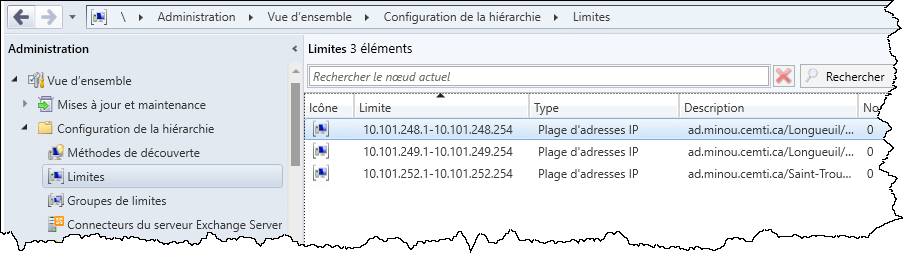

Si votre topologie des sites était bien définie dans Active Directory et que vous avez choisi de créer les plages d'adresses IP en fonction des sites dans la découverte de forêts, alors les limites correspondant à vos trois subnets devraient avoir été créées automatiquement. Sinon, vous devrez les définir manuellement.

Pour définir une limite, il suffit de cliquer-droit sur Limites et en créer une nouvelle. On peut aussi les importer de la topologie des sites définie dans AD, à l'aide de la découverte de forêt (AD Forest Discovery).

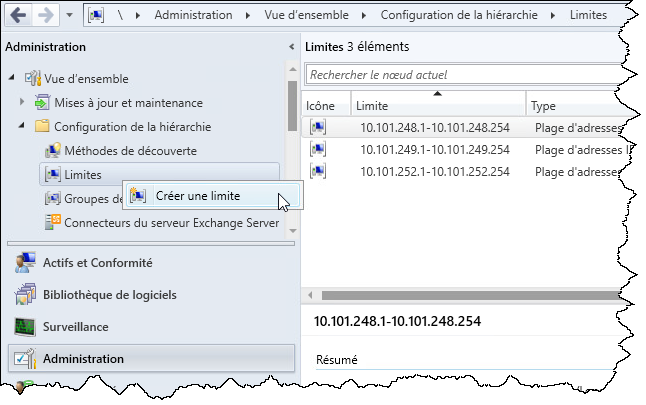

Il y a plusieurs manières de configurer une limite: un sous-réseau IP, un site AD, un préfixe IPv6 ou une plage d'adresses IP. Je vous recommande fortement de définir des plages d'adresses IP (IP address range).

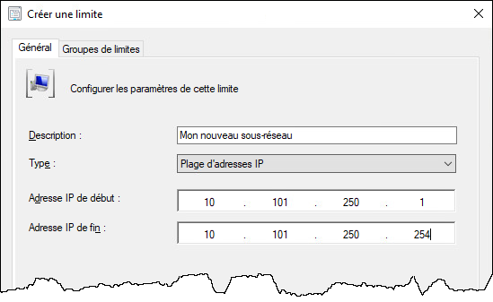

Groupes de limites

Les groupes de limites (boundary groups) représentent un ensemble de limites. Généralement, cela correspond à un site physique. Par exemple, au CÉGEP, les salles de laboratoire ont chacune leur subnet, mais disposent d'un lien très fort puisqu'elles sont toutes situées dans le même édifice. Par contre, les salles situées à l'ÉNA ne sont pas dans le même site physique. Les groupes de limites pourraient donc représenter le campus de Longueuil et l'ÉNA, et chacun serait associé aux limites correspondant aux salles de ce site.

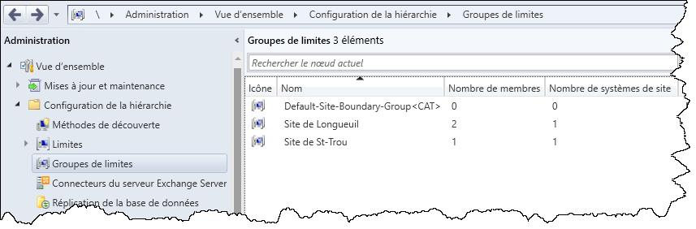

Un groupe de limites a deux fonctions principales:
    • Définir l'assignation à un site SCCM (le code à trois caractères). Même dans un environnement SCCM à un seul site, cette assignation est obligatoire.
    • Identifier les systèmes (principalement les points de distribution) desservant cette section du réseau.

La création d'un Boundary Group s'initie de la même manière que la création d'un boundary.

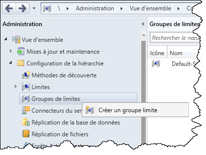

Donnez un nom (et accessoirement une description) à votre groupe. Il devrait identifier clairement le site qu'il représente. Ensuite, ajoutez-lui des limites.

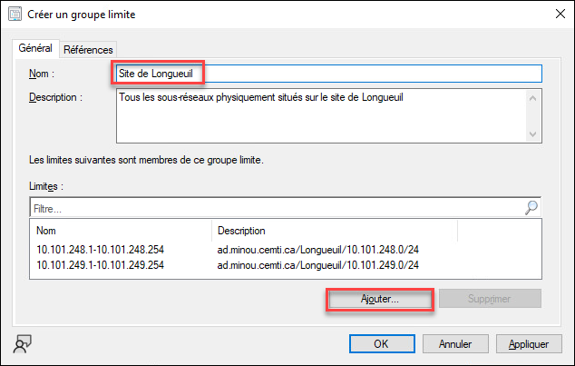

Dans l'onglet Références, cochez la case pour utiliser ce groupe afin d'assigner un site aux clients. Ajoutez aussi le système de site qui dessert ce groupe. Pour l'instant, il n'y a qu'un seul serveur dans votre infrastructure SCCM.

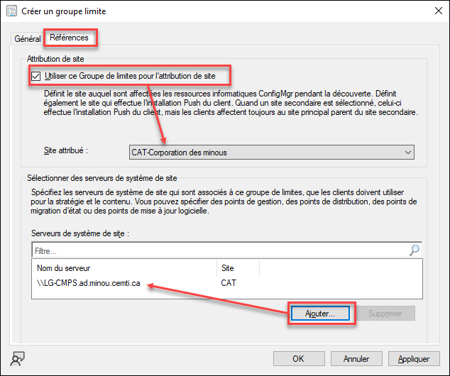

Une fois que vos limites et groupes de limites sont définis, vous êtes prêts à déployer le client.

Partie 3: Déploiement du client SCCM sur les machines du réseau

SCCM ne peut pas gérer le parc informatique sans au préalable installer un logiciel client sur les postes de travail et les serveurs. Une fois le client installé, il ira périodiquement communiquer à SCCM son état de configuration, et recevra une liste de commandes à effectuer (par exemple, une nouvelle application à installer).

Plusieurs méthodes d'installation du client sont disponibles. L'une des méthodes les plus pratiques, appelée Client-Push, consiste à "pousser" l'installation à distance sur les machines qui ont été découvertes via Active Directory. C'est un des rares scénarios où SCCM  "pousse" activement un déploiement. 

Prérequis

Il n'y a pas de magie. SCCM doit se plier aux même règles que l'administration de systèmes Windows à distance s'il veut pousser une installation:

- SCCM doit posséder un accès administrateur sur toutes les machines 
- Le pare-feu doit laisser passer l'administration à distance

Pour donner un accès administrateur à SCCM, il faut d'abord créer un compte de service sur AD. Un compte de service est un compte utilisateur qui sera strictement utilisé par SCCM. 

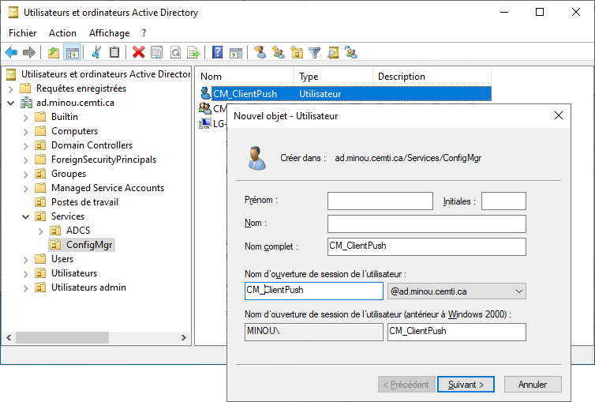

> Ce compte n'est pas destiné à un humain. Il est donc souhaitable de lui donner un mot de passe très complexe. Aussi, on pourrait vouloir que le mot de passe de ce compte n'expire jamais, qu'il n'ait pas le droit de modifier son propre mot de passe. Et bien sûr, il faut faire en sorte que le mot de passe ne doive pas être modifié au premier démarrage de session.

Tout comme un compte administrateur destiné à un humain, ce compte devra, directement ou par nesting de groupes, faire partie du groupe administrateur local des machines. Généralement, on utilise les GPO pour ceci, ainsi que pour ouvrir le pare-feu.

Les trois règles prédéfinies pour le pare-feu sont:

- Partage de fichiers et d'imprimantes (File and Printer Sharing)
- Infrastructure de gestion Windows (WMI) (Windows Management Instrumentation (WMI))
- Gestion à distance de Windows (Windows Remote Management)

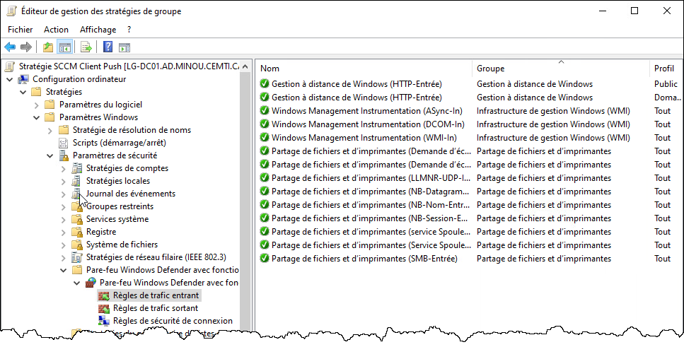

:::warning Attention! 
Il y a un bogue qui arrive parfois lorsqu'on crée un GPO avec des règles de pare-feu en même temps que des préférences. Je vous conseille de configurer la section du pare-feu, fermer l'éditeur, puis rouvrir le GPO pour configurer l'autre partie.
:::

Puis, on doit s'assurer que le compte de service soit membre du groupe des admins locaux.

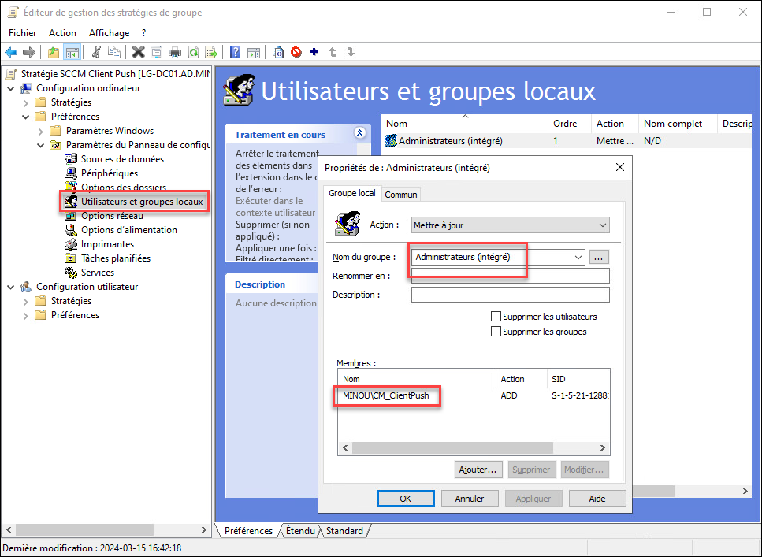

Fermez l'éditeur de GPO pour enregistrer le tout. Assurez-vous que le changement a bien été répliqué sur tous les contrôleurs de domaine, car il pourrait y avoir un délai (particulièrement à Saint-Trou).

> N'oubliez pas de forcer l'application des GPO avec la commande gpupdate, et de vérifier le résultat avec gpresult /r.

Configuration de Client Push

Maintenant que le compte de service est administrateur des machines, on peut configurer le poussage du client. Pour ce faire, naviguez dans Administration / Configuration de site / Sites. Vous pouvez accéder aux options de configuration de l'installation Client Push via le menu contextuel du site.

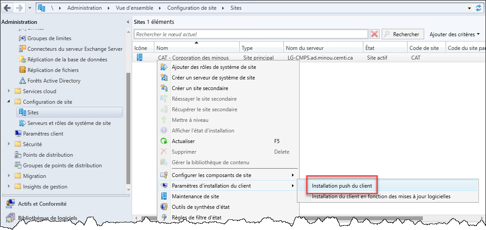

Dans l'onglet General, il est possible d'activer le déploiement automatique du client. Ce n'est habituellement pas recommandé, puisqu'il est souvent préférable d'intégrer l'installation du client dans l'image de base de Windows (ce que vous verrez plus loin dans le module). Aussi. Il est préférable de ne pas installer le client SCCM sur les contrôleurs de domaine. Tout cela est variable d'un environnement à l'autre, et cela dépend du contexte.

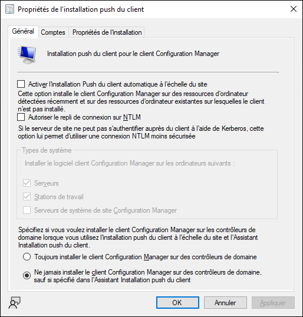

Dans l'onglet Comptes, vous devez définir le compte qu'SCCM devra utiliser pour obtenir les droits admin sur les machine afin de leur pousser le client. Si le compte n'a pas encore été défini dans SCCM, il faut le créer. L'option "Nouveau compte" désigne la création d'un objet pour le compte dans SCCM, et non la création d'un nouveau compte dans AD.

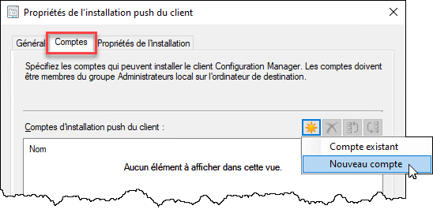

Entrez le nom du compte et le mot de passe. Si vous voulez, déroulez la section Vérifier et entrez un partage réseau qui servira de test. L'idée est de tester si ce compte est bel et bien capable de se connecter comme admin à une machine. On peut supposer que si le test fonction pour une machine, le déploiement devrait fonctionner pour toutes les machines ayant reçu le même GPO.

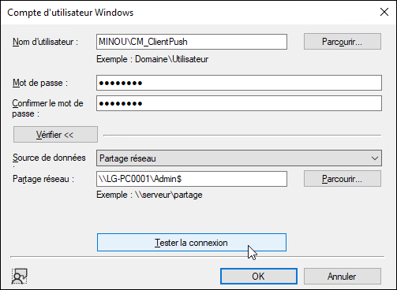

L'étape de vérification n'est pas obligatoire. Cependant, si vous l'omettez et qu'SCCM n'arrive pas à se connecter en administrateur à la machine, le déploiement échouera mais vous n'obtiendrez aucun message d'erreur. Pour éviter de devoir vous lancer dans une séance de débogage, je vous recommande fortement de faire cette vérification ici.

Une fois le compte créé dans SCCM, vous pouvez le modifier dans Administration / Vue d'ensemble / Sécurité / Comptes.

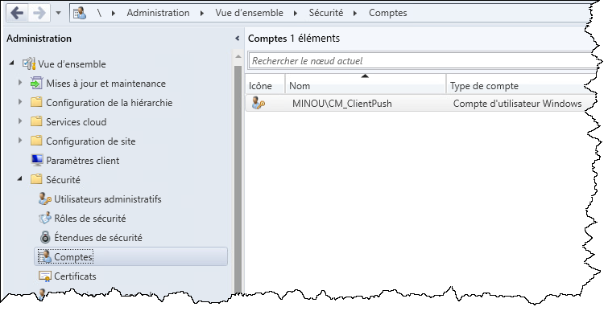

Déploiement du client

Dans la console, sous Actifs et conformité / Appareils, vous êtes maintenant en mesure de pousser le client. Vous devriez retrouver dans cette section la liste des machines qui ont été découvertes sur AD. Les machines dont le client n'est pas installé seront identifiées par la négative dans la colonne Client. Pour installer le client, Sélectionnez Installer le client dans le menu contextuel. Vous pouvez procéder à l'installation du client sur plusieurs machines en même temps en faisant une multi-sélection.

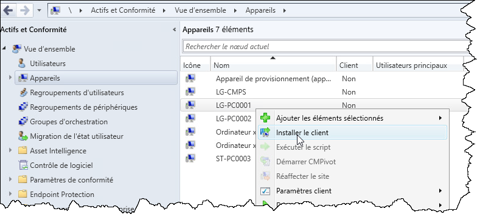

Vous pouvez définir quelques options.

Bien que ce soit tentant, ne cochez pas "Installer le logiciel client depuis un site spécifié" même si vous obtenez une erreur. Si SCCM se plaint que le client n'est pas défini dans un site, assurez-vous que le groupe de limites est bien assigné au site et que les limites sont bien définies également.

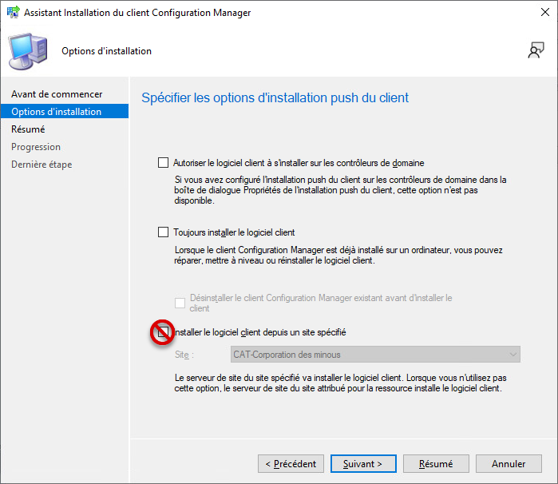

Vous devriez recevoir un message de succès. Ça ne veut pas dire que le client a été installé!

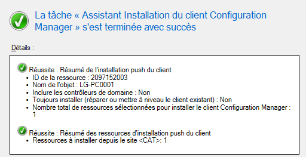

Pour vérifier si l'installation est démarrée est de consulter la liste des processus. Vous pouvez le faire sur la machine cible dans le gestionnaire de tâches, ou encore à distance avec PowerShell, PSExec, WMI ou d'autres outils similaires (pour ceux et celles qui ont suivi le cours d'automatisation). Si le processus CCMSETUP.EXE existe, c'est que le push a fonctionné: SCCM a réussi à démarrer le processus d'installation.

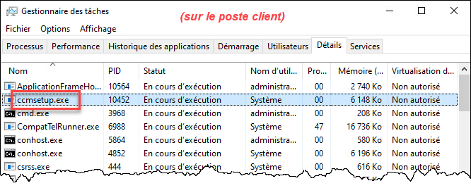

Quelques minutes plus tard, ce processus devrait laisser sa place à un autre processus, CCMEXEC.EXE.

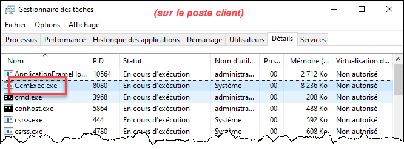

À ce stade, le client n'est pas tout à fait installé. Beaucoup d'étapes se complètent tranquillement en arrière-plan. Vous pouvez tout de même ouvrir la console du client SCCM en lançant la commande control smscfgrc. 

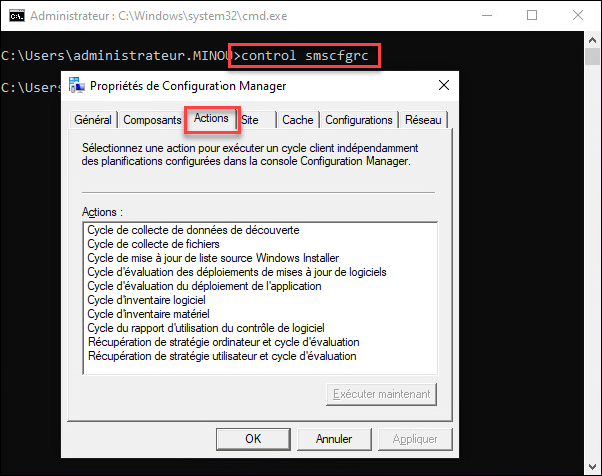

Lorsque 10 actions sont visibles dans l'onglet Actions, on peut considérer que l'installation du client est terminée. 

Du côté de la console SCCM, lorsque le client se rapporte pour la première fois à son point de gestion, l'information remonte dans la base de données, et on peut maintenant voir que le client est installé sur cette machine.

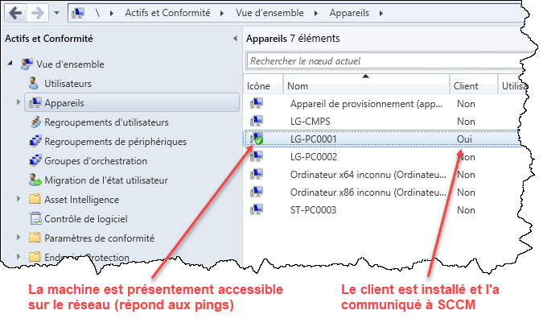

Journaux d'installation du client et dépannage

Que vous ayez besoin d'investiguer un problème d'installation du client ou que vous soyez seulement curieux du travail qui est fait en arrière-plan, vous pouvez consulter le log d'installation du client. Il y a deux endroits à consulter, le côté serveur et le côté client.

Du côté serveur, le fichier log du processus du push de client se nomme ccm.log sous \\NomDuServeurSCCM\sms_CodeDuSite\Logs. Vous pouvez y voir des erreurs de connexion ou d'authentification. C'est un bon log à consulter si, après avoir lancé le push de client sur une machine, vous ne voyez jamais le processus CCMSETUP.EXE apparaître dans le gestionnaire de tâches. Cela peut indiquer que le serveur SCCM est incapable de se connecter à la machine, de par une mauvaise configuration réseau ou DNS, une mauvaise configuration du pare-feu ou un problème de droits.

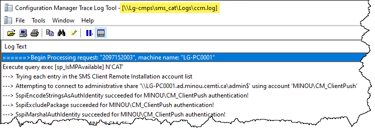

Si CCMSetup.exe démarre sur le client, mais je laisse jamais sa place à CCMExec.exe, vous en saurez plus du côté du client. Le log d'installation s'appelle ccmsetup.log se trouve sous C:\Windows\ccmsetup\Logs sur le client, mais vous pouvez y accéder à distance en passant par les partages administratifs (\\NomDuClient\Admin$\ccmsetup\logs). Il se peut que le processus d'installation démarre mais est incapable de trouver une source de contenu pour télécharger les composants logiciels dont il a besoin. La plupart du temps, ce problème vient d'une mauvaise configuration des groupes de limites. Vous en saurez plus en consultant le log.

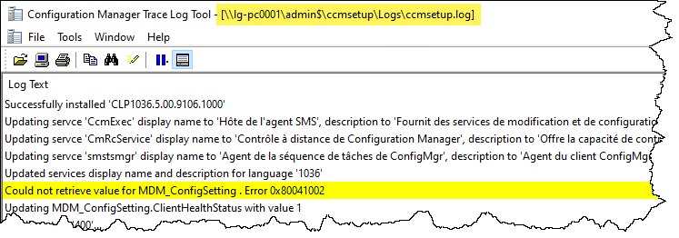

Pour consulter les logs, je vous recommande fortement d'utiliser l'outil CMTrace.exe. Il est disponible sur le serveur SCCM localement à l'emplacement où SCCM a été installé (sous D:\Program Files\Microsoft Configuration Manager\tools\ par exemple) ou accessible via le chemin UNC \\NomDuServeurSCCM\sms_CodeDuSite\tools.

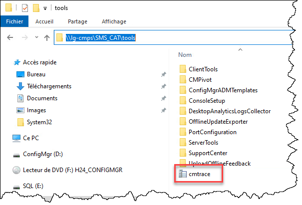

Partie 4: Exploration de l'inventaire

Vous pouvez dès maintenant consulter les données d'inventaire matériel et logiciel qui ont été envoyées par le client à SCCM. On y accède par le menu contextuel de l'appareil, dans Démarrer, puis Explorateur de ressources.

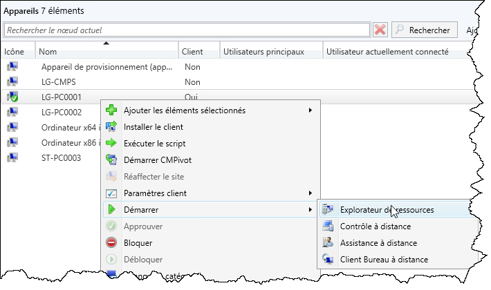

Dans l'explorateur de ressources, vous avez accès à toute l'information d'inventaire que SCCM possède sur ce client. Vous pouvez par exemple consulter la liste des applications installées. Nous en verrons davantage à ce sujet dans un cours ultérieur.

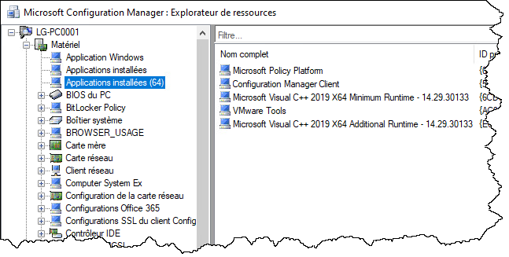

Note: Cela peut paraître étrange, mais SCCM considère que les applications installées font partie de l'inventaire matériel et non logiciel. En fait, les catégories d'inventaire (matériel vs. logiciel) portent à confusion et leur nom est mal choisi. L'inventaire matériel concerne les informations qui proviennent de WMI, alors que l'inventaire logiciel concerne les informations provenant du système de fichiers.