Dans ce laboratoire, vous rendrez l'application 7-Zip accessible aux utilisateurs des postes de travail. Ils seront en mesure d'installer cette application via Software Center, sans pour autant disposer de droits d'administration.

## Création du partage source

La première étape pour déployer une application par SCCM consiste à rendre le contenu (c'est-à-dire tous les fichiers nécessaires à l'installation du produit) accessible à SCCM. Il est obligatoire que ces sources soient accessible à SCCM via un partage de fichiers sur le réseau.

- [ ] **Créez un **partage de fichiers** qui contiendra les sources d'installation**

Ce partage peut être hébergé sur le serveur de site primaire SCCM, ou sur un autre serveur qui dispose d'une bonne capacité de stockage.

Il est important de s'assurer que le compte sur lequel opère SCCM possède des droits complets.

- Si le partage se trouve sur le serveur SCCM lui-même, la permission au compte SYSTÈME est suffisante.
- Si le partage se trouve ailleurs, il faut mettre le compte machine du serveur SCCM dans les permissions du partage ainsi que NTFS.
- Il ne faut pas oublier non plus que les administrateurs SCCM doivent aussi avoir des droits complets sur ce partage, car ils vont devoir y déposer des fichiers.

Ce partage doit être structuré de sorte que chaque version de chaque application soit contenu dans un répertoire séparé. **Ne mettez jamais tous les fichiers d'installation au même niveau dans le même répertoire!**

La structure pourrait ressembler à ceci:

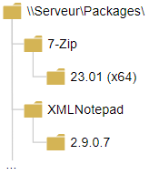

## Analyse de l'application

- [ ] **Téléchargez le package d'installation de 7-zip (x64) en format MSI.**

Sauvegardez-le dans un sous-répertoire de votre partage. Chaque application doit obligatoirement se trouver dans son propre sous-répertoire. Il est intéressant de se doter d'une structure logique afin d'éviter que les applications soient éparpillées un peu partout dans le partage.

Dans ce cas, **l'emplacement du contenu** correspond au répertoire mis en évidence ci-dessous.

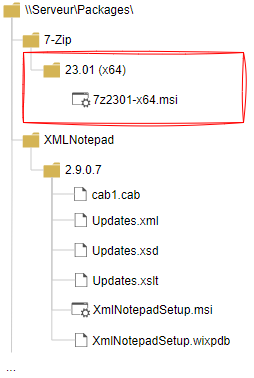

- [ ] **Trouvez la ligne de commande à utiliser pour l'installation et la désinstallation automatique.**

On souhaite que l'installation génère un log détaillé, et se déroule sans intervention ni interface graphique. Vous pouvez effectuer vos tests sur un poste de travail de test (un des PC de votre environnement, qui agira comme machine de test). Il faut évidemment lancer les commandes à partir d'une invite de commandes (cmd.exe) élevée (as admin).

Puisqu'il s'agit d'un fichier MSI, la ligne de commande devra commencer par `msiexec.exe`. Lancez la commande `msiexec.exe /?` pour obtenir la rubrique d'aide et la description de tous les paramètres en ligne de commande. Essentiellement, vous avez:

```text
/i monappli.msi ........................... Installation d'un fichier MSI (relatif  au 
                                            répertoire de travail)

/q ........................................ Fait une installation silencieuse (plusieurs
                                            variations existent)

/l*v "C:\Windows\Logs\monappli.log" ....... Écrit un journal détaillé dans le fichier 
                                            spécifié (le répertoire doit exister sur la 
                                            machine qui reçoit l'installation)

/norestart REBOOT=ReallySuppress .......... Ne pas redémarrer la machine même si c'est
                                            nécessaire pour compléter l'installation. 
                                            (Si l'opération se complète avec succès mais
                                            un redémarrage est nécessaire, le code de 
                                            retour sera 3010 au lieu de 0)

/x{guid} .................................. Désinstalle un logiciel installé par MSI
```

:question: **Quelles sont les commandes d'installation et de désinstallation de 7-zip?**

> *Indice: Pour la ligne de désinstallation, vous pouvez utiliser cet outil: https://www.nirsoft.net/utils/uninstall_view.html*

Créez un fichier texte `install.cmd` et un autre `uninstall.cmd` dans le répertoire de l'application pour vous rappeler ces deux commandes. Écrivez la ligne d'installation et la ligne de désinstallation dans ces fichiers. Ce n'est pas obligatoire, mais fortement suggéré. Ce sera plus facile à tester manuellement. On dépose souvent un fichier de documentation également (un fichier .txt, .md, .docx, etc.).

## Création de l'application dans SCCM

Maintenant que les sources sont sur un partage réseau, et que la "recette" d'installation est bien définie, il est maintenant temps de créer l'application dans SCCM.

- [ ] **Créez une nouvelle application dans la console SCCM**

Puisque cette application est disponible en format MSI, vous pouvez sélectionner le type Windows Installer et la création de l'application sera beaucoup plus simple!

:::info Chemin UNC obligatoire
Attention, vous devez obligatoirement spécifier le chemin UNC vers le package, par exemple:

```
\\LG-CMPS\Packages\7-Zip\23.01(x64)\7z2301-x64.msi
```
:::

## Distribution du contenu

- [ ] **Distribuez le contenu sur tous les points de distribution de votre environnement**

Dans votre cas, il n'y en a qu'un: c'est votre serveur principal!

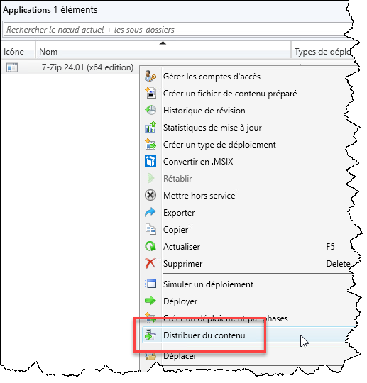

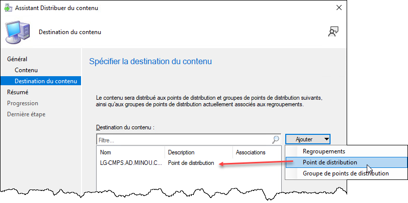

- [ ] **Assurez-vous que le contenu est bien distribué.**

Vous pouvez le voir dans le panneau en bas de l'application sélectionnée, ou encore dans la section **Surveillance** sous **État de distribution / État du contenu**.

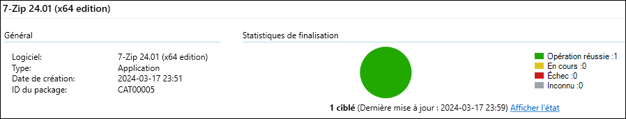

## Création d'un regroupement

Les **regroupements** (*collections*) se trouvent dans la section **Actifs et conformité**, sous **Regroupements de périphériques**. Dans ce laboratoire, vous vous concentrerez sur les regroupements de périphériques (*Device Collection*) uniquement.

- [ ] Créez un nouveau regroupement de périphériques pour le déploiement de 7-Zip.

Ce regroupement devra être **limité** par le regroupement *Tous les clients poste de travail et serveurs*.

Créez ce regroupement **sans aucune règle d'adhésion** pour l'instant. Il est plus facile d'ajouter des machines par la suite, à partir de la console.

Ajoutez-lui ensuite au moins un périphérique qui dispose du client SCCM.

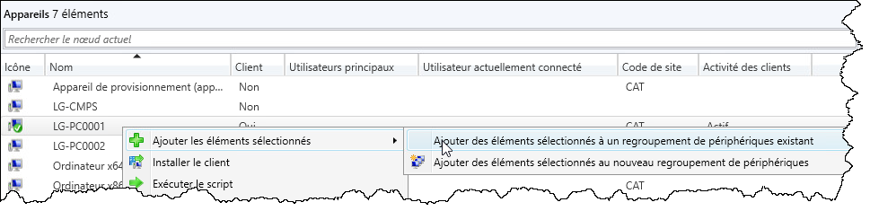

Ça peut prendre quelques secondes ou minutes pour que les membres se reflètent dans la collection. Il vous faudra parfois tenter de rafraîchir la console.

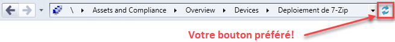

## Création d'un déploiement

Une fois que le regroupement et l'application sont prêts, le déploiement fera l'union entre les deux, et l'application sera déployée à tous les membres de la collection, suivant certaines règles qui seront définies dans le déploiement.

- [ ] Créez un déploiement

Vous pouvez le faire dans la console soit à partir de la collection, soit à partir de l'application. Dans les deux cas, vous aurez à décider d'un regroupement et d'une application.

> *Note: Si vous le faites à partir de l'application, assurez-vous de sélectionner Regroupements de périphériques.*

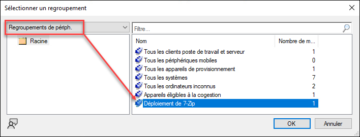

On souhaite un déploiement de type "Installer, Disponible" afin qu'elle puisse être installée par l'utilisateur à travers Software Center. On peut aussi laisser l'utilisateur réparer l'application.

## Installation sur la machine

- [ ] Sur le poste client, démarrez une session avec un utilisateur **ne disposant pas de droits d'administration**.

Le client SCCM rafraîchit sa stratégie client (client policy) à toutes les 60 minutes environ. Pour ne pas perdre de temps, on peut forcer une récupération avec le panneau de configuration SCCM (la commande `control smscfgrc`).

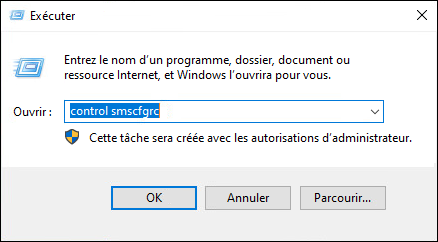

- [ ] Puis dans l'onglet **Actions**, sélectionnez **Récupération de stratégie ordinateur et cycle d'évaluation**, puis cliquez sur **Exécuter maintenant**.

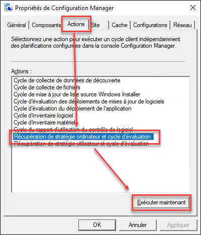

- [ ] Dans le **Centre logiciel** sur le poste client, accessible par le menu Démarrer, vous devriez voir une nouvelle application apparaître.

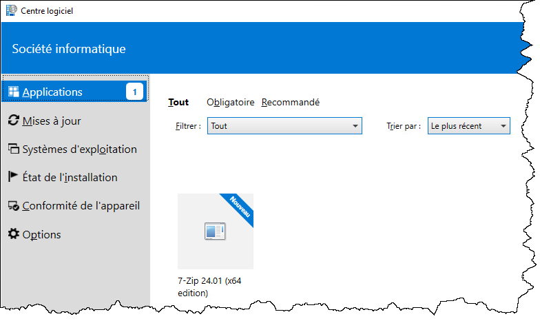

- [ ] Sélectionnez l'application et cliquez sur Installer. L'application devrait s'installer avec succès.

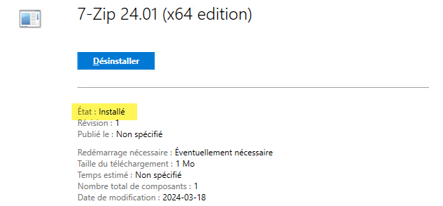
