Dans ce laboratoire, vous déploierez Notepad++ sur les clients SCCM. Contrairement à 7zip, Notepad++ n'est pas packagé en format MSI, alors le déploiement sera légèrement plus complexe.

## Analyse

- [ ] Premièrement, téléchargez le **programme d'installation de Notepad++ 64-bit** et stockez-le dans le partage de fichiers qui contient les sources: 

:link: https://notepad-plus-plus.org/downloads/

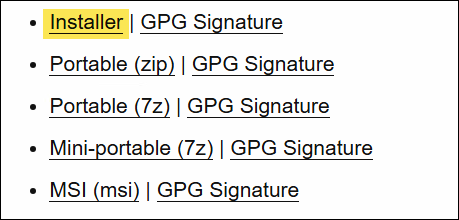

Note: Il existe une version MSI depuis peu de temps. Normalement, vous auriez avantage à privilégier ce format. Mais pour le bien de cet exercice, utilisez la version EXE (Installer)

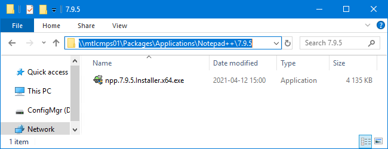

- [ ] Démarrez une console de commande (cmd) élevée en tant qu'administrateur. Elle vous servira à tester votre commande d'installation.

Note: SCCM va exécuter ses commandes dans le contexte SYSTEM, qui n'est pas le même que celui de l'utilisateur. La plupart du temps, ça ne fait pas de différence, mais il arrive qu'un installateur ne se comporte pas de la même manière en tant que SYSTEM, notamment parce que ce dernier ne dispose pas d'un profil utilisateur. Je vous encourage donc à élever votre console de commande en tant que SYSTEM avec l'outil PSExec. Pour ce laboratoire, ce n'est pas obligatoire, mais si ça vous intéresse, voyez la page "Élévation en tant que SYSTEM" dans la section Astuces pour apprendre à effectuer cette manipulation.

### Commande d'installation

Il y a plusieurs manières de trouver la commande d'installation. On peut par exemple essayer d'utiliser le switch /? pour obtenir la rubrique d'aide, mais dans le cas de Notepad++, ça ne fonctionne pas car . Il faut alors annuler l'installation.

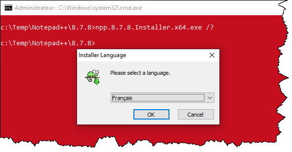

Vous pouvez vous aider de l'outil Universal Extractor 2. Téléchargez simplement l'outil et exécutez-le puis chargez le programme d'installation, en mode "scan". L'outil analyse son contenu et tente d'identifier le produit qui a été utilisé pour produire l'installateur (Inno, NSIS, InstallShield, etc.).

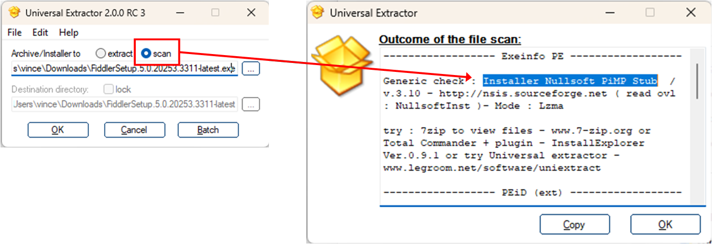

Mais il est intéressant d'aller sur la page de documentation de NSIS, le logiciel qui a servi à produire le programme d'installation. La documentation corrobore la suggestion fournie par l'outil.

:link: https://nsis.sourceforge.io/Docs/Chapter3.html#installerusage

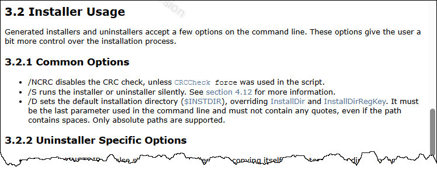

:::tip Conseil
Si vous voyez une option pour la journalisation (logging), il est recommandé de l'utiliser dans la commande d'installation. Spécifiez un emplacement local et absolu pour la sauvegarde du fichier (par exemple, C:\Windows\Logs\nomdelapplication-install.log). Dans l'exemple précédent, l'installateur (NSIS) ne semble pas supporter la journalisation, malheureusement.
:::

Essayez d'installer l'application de façon silencieuse à partir de votre invite de commande SYSTÈME et confirmez que l'application est bien installée (par exemple en cherchant son raccourci dans le menu Démarrer). **Assurez-vous qu'aucune interaction humaine n'est nécessaire!**

Notez la commande utilisée dans un fichier `install.cmd`.

### Commande de désinstallation

Un bon point de départ pour la désinstallation est d'installer l'application et constater la commande de désinstallation qui a été enregistrée dans la clé Uninstall du registre. Vous pouvez utiliser regedit mais je vous conseille d'utiliser l'outil [UninstallView de NirSoft](https://www.nirsoft.net/utils/uninstall_view.html).

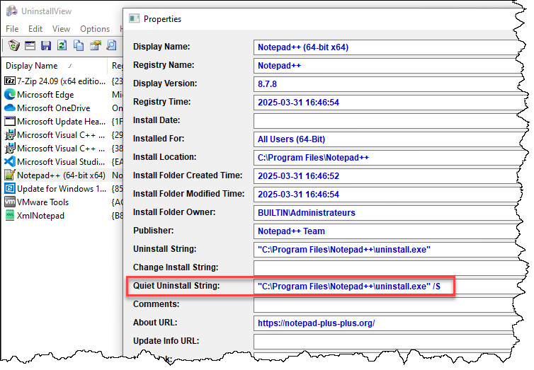

:::tip Conseil
Tout comme pour l'installation, je vous recommande de lire la documentation du produit ou de sa technologie d'installation à la recherche d'une option de journalisation (logging).
:::

Essayez de désinstaller l'application de façon silencieuse à partir de votre invite de commande SYSTÈME et confirmez que l'application n'est plus sur le système (par exemple en cherchant son raccourci dans le menu Démarrer). Assurez-vous qu'aucune interaction humaine n'est nécessaire!

Notez la commande utilisée dans un fichier `uninstall.cmd`.

### Méthode de détection

On doit maintenant trouver comment connaître si l'application est installée ou non. Généralement, on va privilégier le registre des applications de Windows. On peut, par exemple, considérer que si la clé `HKLM\Software\Microsoft\Windows\CurrentVersion\Uninstall\Notepad++` existe, alors Notepad++ est installé, sinon il ne l'est pas.

Notez que si c'est une application 32-bit, son enregistrement se trouve dans `HKLM\Software\Wow6432node`.

Pour identifier cette clé, vous pouvez utiliser l'outil [UninstallView de NirSoft](https://www.nirsoft.net/utils/uninstall_view.html).

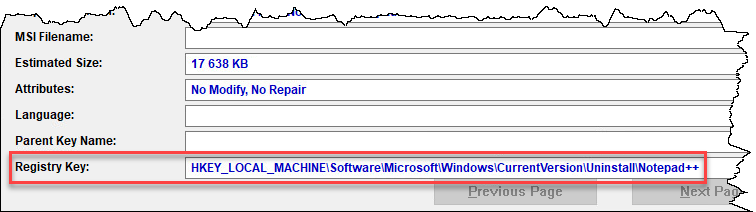

Si l'application ne s'enregistre pas dans la clé Uninstall, il faut alors trouver un autre moyen de la détecter, comme par exemple la présence d'un fichier exécutable dans `C:\Program Files\` ou `C:\Program Files (x86)`.

## Création de l'application dans SCCM

Dans la console SCCM, dans la section Bibliothèque de logiciels / Gestion des applications, cliquez-droit sur Applications et créez une nouvelle application.

Choisissez de spécifier manuellement les informations de l'application.

Dans la section Informations générales, spécifiez le nom de l'application, son éditeur et sa version. On peut trouver cette information sur le site du développeur, dans les propriétés de l'exécutable ou encore en regardant sur UninstallView. Peu importe, ici on ne fait que décrire l'application.

Ensuite, décrivez l'application pour le Software Center. Vous pouvez spécifier son nom, une description, et même son icône.

Pour l'icône, vous pouvez charger une image de votre choix, mais vous pouvez aussi installer l'application ou extraire son contenu puis charger l'icône du fichier EXE.

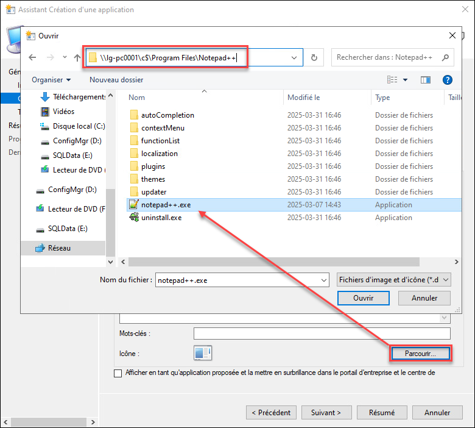

Créez un Type de déploiement et spécifiez "Programme d'installation de script". 

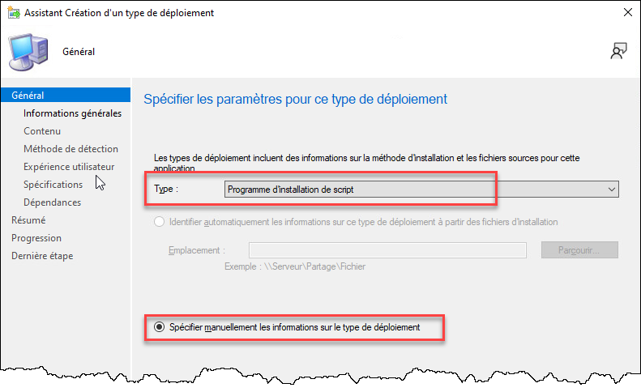

Donnez au type de déploiement un nom représentatif de l'application (par exemple, Notepad++ 64-bit)

L'emplacement du contenu devrait être le chemin UNC qui contient les fichiers d'installation. Par exemple

\\LG-CMPS\Packages\Applications\NotepadPlusPlus\8.7.5-x64\

Puis indiquez les commandes d'installation et de désinstallation. Considérez que le répertoire de travail sera le répertoire d'emplacement du contenu, donc utilisez autant que possible les chemins relatifs.

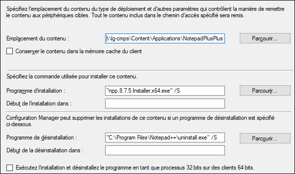

Dans l'exemple ci-dessus, la ligne de commande du programme d'installation utilise un chemin relatif, puisque le fichier se trouve dans le répertoire du contenu, qui sera téléchargé dans la cache SCCM du client. Par contre, pour le programme de désinstallation, on spécifie un chemin absolu parce que uninstall.exe se trouve dans le répertoire d'installation, localement sur la machine, et non dans le répertoire de contenu d'SCCM. Il est très important de faire cette distinction.


Spécifiez ensuite la méthode de détection. Cette méthode sera utilisée pour vérifier si l'application est déjà installée (donc pas besoin de la réinstaller) et aussi pour s'assurer que l'application s'est installée avec succès (la règle devrait donner FAUX avant l'installation et VRAI après).

Cela peut être une valeur simple (dans le registre ou le système de fichiers) ou encore quelque chose de plus complexe (exécution d'un script PowerShell ou VBScript). Et il peut y avoir une combinaison de plusieurs validations. Pour Notepad++, on va faire simple et vérifier l'existence de la clé de l'application dans Uninstall.

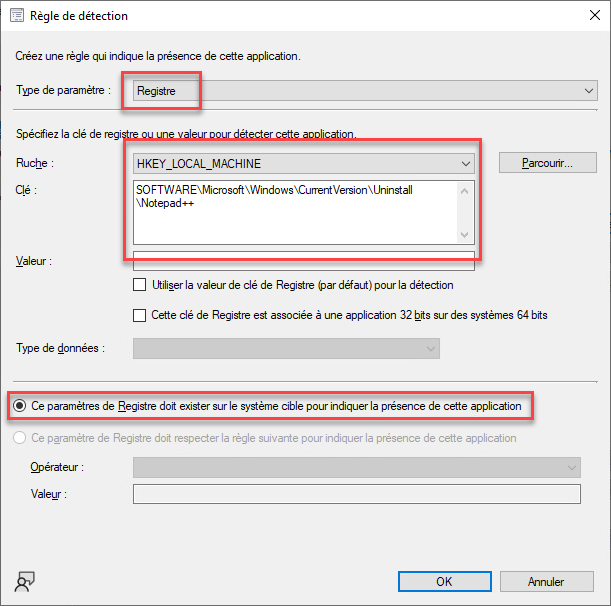

Vous pouvez cliquer sur Parcourir pour naviguer à distance dans le registre d'une machine sur laquelle l'application est installée. Son utilisation n'est pas obligatoire mais peut aider à bien écrire le chemin dans le registre sans avoir à installer l'application sur le serveur.

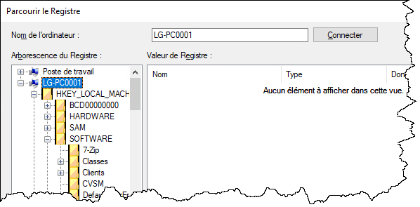

Cet outil a besoin que le service RemoteRegistry soit activé sur la machine cible. Ce service est désactivé par défaut sur les clients Windows, mais c'est possible de l'activer à distance avec PowerShell et WMI:

```powershell
gcim Win32_Service -ComputerName 'LG-PC0001' -Filter 'Name = RemoteRegistry' | % {
    $_ | icim -MethodName 'ChangeStartMode' -Arguments @{StartMode='Manual'}
    $_ | icim -MethodName 'StartService'
}
```

Spécifiez ensuite les paramètres d'expérience utilisateur. Cette étape est importante, car elle peut mener à des échecs d'installation.

Premièrement, le comportement d'installation doit être "Installer pour le système" puisque c'est une application qui est installée pour tous les utilisateurs et sera déployée sur des machines. Certaines applications sont déployées pour des utilisateurs, mais ce n'est pas le cas ici.

On souhaite aussi que l'application s'installe qu'un utilisateur ait ouvert une session ou non. Certaines applications doivent être installées seulement lorsqu'aucun utilisateur n'a de session ouverte (par exemple, une installation qui peut rendre l'utilisation du système instable) et certaines applications ont besoin que l'utilisateur soit devant son poste (par exemple, l'utilisateur doit entrer un mot de passe pendant l'installation). Ce sont des cas rares, généralement l'application peut être installée peu importe que l'utilisateur ait une session active ou non.

Et puisque c'est une installation silencieuse, on ne permettra pas aux utilisateurs d'interagir avec l'installation.

On peut aussi spécifier la durée maximale (l'installation sera annulée automatiquement si elle dépasse ce temps) et le temps d'installation estimé (seulement pour que l'utilisateur sache à quoi s'attendre).

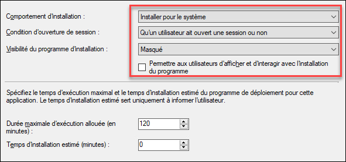

On peut ensuite définir des spécifications et des dépendances. Les spécifications sont des conditions: l'installation ne pourra pas démarrer si ces conditions ne sont pas respectées (par exemple, le système d'exploitation est en 64 bits). Les dépendances indiquent si une autre application doit être installée avant celle-ci (c'est utile lorsqu'un framework comme .NET et Java sont requis). Dans ce laboratoire, nous laisserons ces deux sections vides.

Complétez ensuite la création du type de déploiement et de l'application.

Et n'oubliez pas de distribuer le contenu!

## Déploiement

### Phase 1 (pilote)

Le déploiement de l'application se fait de la même manière que pour les applications MSI. Je vous invite à faire un déploiement en deux phases: une première phase pour tester sur un poste de travail, la deuxième pour déployer sur le reste de vos clients.

- Créez un regroupement de périphérique (device collection) comprenant un PC de test.

- Déployez l'application en mode "Disponible" à ce regroupement de périphériques afin de pouvoir mieux contrôler les installations et désinstallations. Cela va simplifier les tests.

- Démarrez le panneau de configuration SCCM (control smscfgrc) et lancez un cycle de synchronisation (dans l'onglet Actions). 

- Dans Software Center, testez l'installation et la désinstallation.

Attention, il va y avoir une erreur à la désinstallation! C'est donc risqué de déployer l'application dans ces conditions! Vive les tests!

### Problème de désinstallation

Vous n'êtes pas tenus de faire les étapes suivantes, c'est simplement une démonstration de la démarche d'analyse.

<details>
<summary>Étapes de diagnostic</summary>

On constate que lorsque la commande de désinstallation de Notepad++ silencieuse est lancée manuellement à partir d'une console de commande, le logiciel se désinstalle. Mais lorsque c'est SCCM qui lance cette commande, il rapporte une erreur.

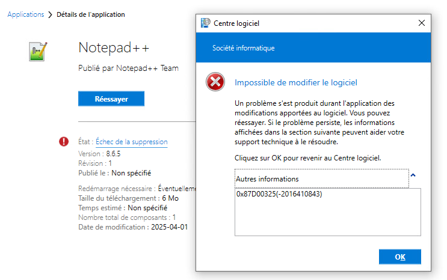

Premier constat: même si le Centre logiciel rapporte une erreur, Notepad++ semble néanmoins réellement désinstallé. Le raccourci est disparu du menu Démarrer et Notepad++ n'apparaît plus dans la liste des logiciels. Son répertoire d'installation, C:\Program Files\Notepad++, a aussi été effacé. SCCM semble d'être trompé!

Dans le message, il y a un code d'erreur. On peut aller le googler.

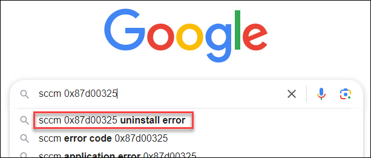

Certains articles parlent d'un problème de détection. Il semble que la désinstallation se soit faite correctement, mais ensuite, SCCM a tenté de redétecter l'application mais elle était toujours là. En regardant AppEnforce.log et AppDiscovery.log sur le client (fusionnés), c'est ce que ça suggère:

- L'application a été découverte (sa règle de découverte a testé positif) donc on peut désinstaller
- La commande de désinstallation a été exécutée
- Presque instantanément après, le processus a terminé avec le code 0 (ce qui signifie succès)
- Mais l'application a été découverte de nouveau. Ce n'est pas normal!

Voir l'article sur la fusion des logs avec CMtrace dans la section Astuces de ce bloc-notes pour plus de détails

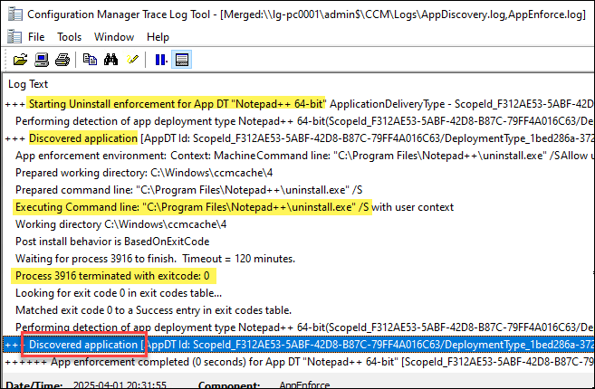

Quand on clique Réessayer dans le centre logiciel, le problème est corrigé. La détection est faite à nouveau, SCCM constate que l'application est déjà désinstallée, et le message d'erreur s'efface. C'est ce qu'on peut voir dans AppDiscovery.log lorsqu'on clique sur Réessayer:

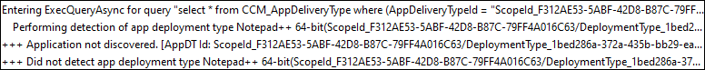

Mais qu'est-ce qui se passe au juste? Pour en savoir plus, on va regarder ce qui se passe avec Process Monitor. C'est un outil qui capture ce qui se passe dans Windows, un peu comme WireShark capture ce qui se passe sur le réseau.

Donc on démarre Procmon (la capture démarre automatiquement), puis on clique sur Désinstaller.

On peut voir que lorsque uninstall.exe a été exécuté, il a créé un autre processus, Un.exe, situé dans un répertoire temporaire. Dans la colonne Life Time, on peut voir que uninstall.exe s'est terminé tout de suite. Il semble que c'est Un.exe qui a fait le travail de désinstallation. Le programme de désinstallation fait cela pour pouvoir effacer uninstall.exe.

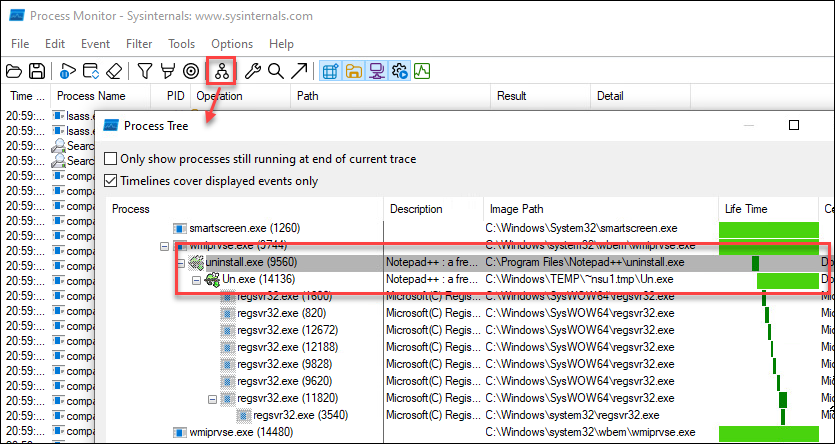

On peut donc deviner qu'il s'agit d'une situation de compétition (race condition): SCCM démarre le programme de désinstallation, attend qu'il termine, puis relance sa méthode de détection. Mais puisque c'est un autre programme qui se charge de la désinstallation, SCCM ne le sait pas et tente de vérifier la désinstallation de l'application pendant que Un.exe est en train de la désinstaller. Cela semble être spécifique à Notepad++ (et peut-être d'autres applications packagées avec NSIS).

Sachant cela, on peut peaufiner la recherche. On tombe assez facilement sur cet article:

:link: https://discourse.psappdeploytoolkit.com/t/notepad-uninstall-successful-software-center-shows-failed/970

Cet article fait référence à la documentation de NSIS qui spécifie (de manière pas super claire) qu'on doit utiliser l'argument _?= pour éviter la copie du fichier temporaire.

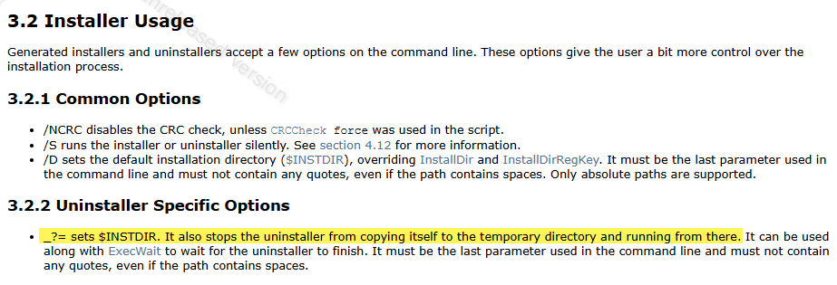

La commande de désinstallation serait donc:

```text
"C:\Program Files\Notepad++\uninstall.exe" /S _?=C:\Program Files\Notepad++
```

On peut la tester dans une console de commande (élevée en tant que SYSTÈME de préférence)

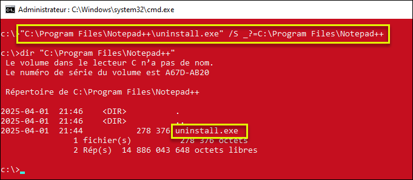

Mais évidemment, uninstall.exe n'a pas pu s'effacer lui-même puisqu'il était en cours d'exécution.

On va donc devoir faire un script! Rien de compliqué, on doit seulement enchaîner quelques commandes:

- La commande de désinstallation
- Supprimer uninstall.exe
- Supprimer le dossier

On pourrait le faire en PowerShell, mais comme c'est très simple, on peut très bien le faire en Batch (.cmd).

L'analyse est terminée, on a trouvé une commande qui fonctionne. Faites les étapes suivantes dans votre laboratoire!

</details>

À l'aide d'un éditeur de texte, créez un petit script (uninstall.cmd) dans un répertoire temporaire (par exemple C:\temp).

```batch title="uninstall.cmd" showLineNumbers
"C:\Program Files\Notepad++\uninstall.exe" /S _?=C:\Program Files\Notepad++
del /Q "C:\Program Files\Notepad++\uninstall.exe"
rd /S /Q "C:\Program Files\Notepad++"
```

Assurez-vous d'activer l'affichage des extensions de fichiers dans l'explorateur de fichiers, sinon vous risquez de vous retrouver avec un fichier nommé uninstall.cmd.txt, qui ne fonctionnera pas tel qu'attendu.

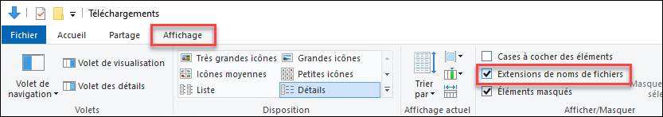

On réinstalle Notepad++ et on teste localement le script. Effectivement, le logiciel s'installe, puis le ménage est fait par la suite. On risque d'avoir un meilleur succès avec cette méthode.

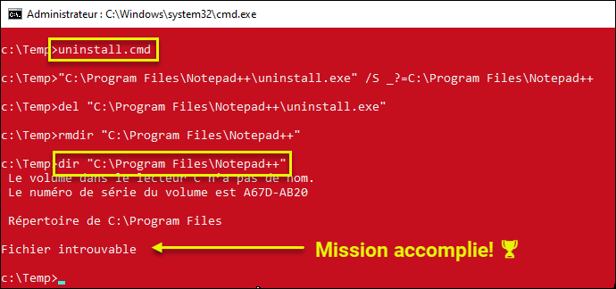

De retour sur le serveur SCCM, on ajoute le script dans le répertoire d'installation de Notepad++.

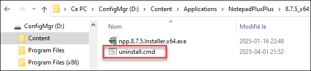

Dans la console SCCM, on va modifier la commande de désinstallation.

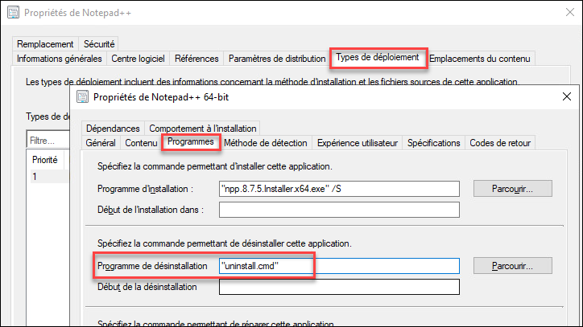

Et comme le contenu a changé (on a ajouté un fichier dans le répertoire), il faut mettre à jour le contenu sur le(s) point(s) de distribution.

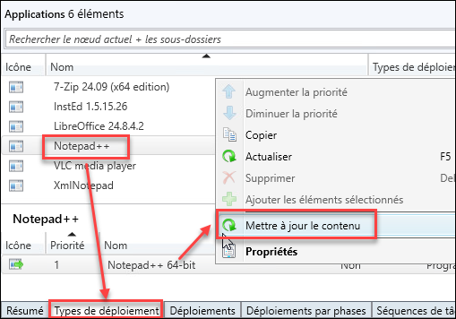

On attend quelques minutes que le changement soit effectif et que le contenu soit à jour (5 à 10 minutes), puis sur le client on peut forcer une Récupération de stratégie ordinateur. On devrait voir que le numéro de révision a changé. Il devrait être équivalent à celui indiqué dans les propriétés de l'application dans la console SCCM.

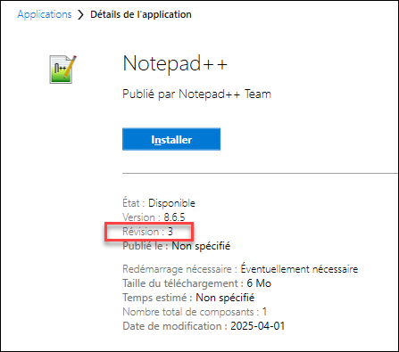

On ressaie l'installation et la désinstallation. Les deux devraient fonctionner à présent.

### Phase 2: Production

Maintenant que tous les problèmes sont réglés dans la phase de test, on peut maintenant déployer sur l'ensemble du parc.

- [ ] Créez un regroupement de déploiement avec toutes les machines de production. Pour l'instant, on va faire des règles d'adhésion directes.

- [ ] Créez un nouveau déploiement associé à cette collection, mais cette fois-ci en mode "obligatoire" pour que l'installation soit automatique et obligatoire.

- [ ] Sur une machine visée par le déploiement, lancez un cycle de "récupération de stratégie ordinateur" et attendez une minute ou deux. L'application devrait s'installer immédiatement sans passer par Software Center.
