<details>
<summary>Un mot sur l'architecture du processeur et le bitness des applications</summary>

De nos jours, la majorité des postes de travail et serveurs Windows opèrent sur une architecture x64 (aussi nommée x86-64 ou amd64). C'est une architecture qui utilise des adresses mémoire et des registres de données de 64 bits, développée par AMD en se basant sur l'architecture Intel i386 (aussi appelée x86). On ne doit pas la confondre avec IA-64 (Intel Itanium, utilisé par certains serveurs et discontinué depuis 2020) ou arm64 (principalement utilisé sur les téléphones et tablettes, mais peu sur les PC classiques). 

Pour fonctionner, une application doit être compilée pour une architecture de processeur spécifique, car le code exécutable est composé d'instructions pour le processeur. Historiquement, Windows existait en version 64-bit (x64) et en version 32-bit (x86), mais depuis plusieurs années, seule la version 64-bit est supportée. La plupart des applications disponibles pour Windows existent dans les deux formats, 64-bit et 32-bit. Il est normalement obligatoire que tout code exécutable soit compilé pour l'architecture du processeur, mais il y a une exception: l'architecture x64 possède un mode d'émulation x86. On peut donc exécuter une application 32-bit sur un système 64-bit, pour autant que le système d'exploitation permette cette émulation. 

La plupart des éditions de Windows (mis à part quelques éditions spécialisées comme Windows IoT et Windows PE) offrent cette émulation grâce à son sous-système WoW64 (Windows on Windows 64). Cela assure la compatibilité avec des vieilles applications (appelées applications patrimoniales, ou legacy apps en anglais) qui n'existent pas pour l'architecture x64. Pour les faire fonctionner, WoW64 expose un "faux système d'exploitation" pour ces applications. Essentiellement, le programme 32-bit, lorsqu'il est exécuté, voit ceci:

- Le répertoire C:\Program Files vu par le programme est en fait `C:\Program Files (x86)`
- La clé de registre `HKLM\SOFTWARE` est en fait `HKLM\SOFTWARE\wow6432node`

</details>

## Partie 1: InnoSetup (VS Code)

Dans cet exercice, vous allez automatiser l'installation de Visual Studio Code. Mais on souhaite que l'application s'installe comme si on avait coché toutes ces cases (qui ne sont pas cochées par défaut). Aussi, lorsque VS Code a terminé son installation, il démarre automatiquement; on veut éviter cela.

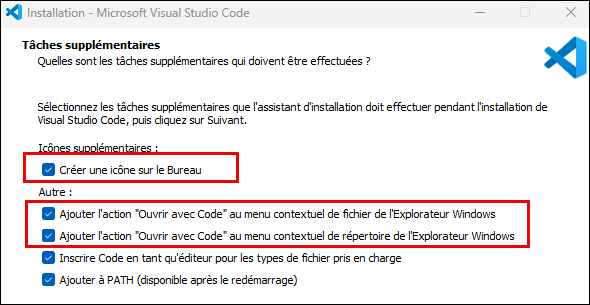

### Obtention des sources

Il faut aller sur la page de téléchargement: https://code.visualstudio.com/download.

Malheureusement, il n'y a pas de paquet MSI, vous allez donc devoir opter pour un paquet EXE.

Sélectionnez le paquet à télécharger:

- **Ne cliquez pas sur le bouton de téléchargement principal**. On doit choisir un paquet plus adapté pour les déploiements d'entreprise
- Système d'exploitation **Windows 10/11**
- **System Installer** : c'est plus simple pour SCCM d'installer pour le système (on ne fait pas de déploiements dans les profils utilisateurs)
- Architecture **x64** : vos VM roulent sur des processeurs Intel x64

Sauvegardez ce paquet dans votre structure partagée comme pour les autres applications.

### Analyse

Il faut d'abord déterminer le type d'installateur. Vous pouvez aller lire la documentation ou demander à l'IA, mais voici un outil qui va vous aider, [Universal Extractor](https://github.com/Bioruebe/UniExtract2/releases).

Lancez l'outil en mode SCAN et sélectionnez le fichier EXE d'installation. Analysez le rapport. Vous déterminez que c'est InnoSetup.

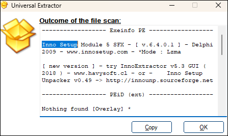

Dans la documentation d'InnoSetup, vous trouvez le détail des arguments en ligne de commande. https://jrsoftware.org/ishelp/topic_setupcmdline.htm

On arrive donc avec une ligne de commande qui ressemble à:

```text
VSCodeSetup-x64-x.xx.x.exe /verysilent /norestart /log="C:\Windows\Logs\VSCodeSetup-Install.log"
```

Cependant, cette commande a plusieurs problèmes:

- Elle n'enregistre pas VS Code dans le menu contextuel de l'explorateur
- Elle ne crée pas automatiquement un raccourci sur le bureau
- Elle cause le démarrage automatique de VS Code après l'installation, ce qui ne fait aucun sens avec SCCM

On doit trouver une méthode pour modifier le comportement de l'installation. Avec InnoSetup, le plus simple est de générer un fichier de réponses.

:::warning
Notez que cette technique ne fonctionne qu'avec InnoSetup. Chaque technologie de packaging a ses particularités. D'où l'importance de bien identifier la technologie d'installation.
:::

### Création du fichier réponse

Pour créer le fichier réponse, vous allez devoir installer manuellement VS Code sur un poste (ou, puisque c'est un environnement de test, sur votre serveur SCCM directement).

Premièrement, copiez le fichier d'installation dans un répertoire local sur le disque (par exemple, `C:\Temp`).

Dans une **console de commande élevée** en tant qu'administrateur, déplacez-vous dans le répertoire où se trouve le paquet et lancez la commande suivante:

<ConsoleWindow title="Administrateur: CMD" backgroundColor="#000000">
```
PS D:\Apps\VSCode> VSCodeSetup-x64-x.xx.x.exe /saveinf="vscode.inf"
```
</ConsoleWindow>

Puis faites **l'installation manuellement** en cochant toutes les cases. Cela installera le logiciel sur l'ordinateur mais créera également un fichier `vscode.inf`. Ce fichier identifie toutes les options spécifiées à l'installation.

Désinstallez ensuite Visual Studio Code de cet ordinateur (passez par l'outil APPWIZ.CPL ou UninstallView, c'est plus facile).

Puis tentez une installation automatique en incluant le fichier de réponse:

<ConsoleWindow title="Administrateur: CMD" backgroundColor="#000000">
```
PS D:\Apps\VSCode> VSCodeSetup-x64-x.xx.x.exe /loadinf="vscode.inf" /verysilent /norestart /log="C:\Windows\Logs\VSCodeSetup-Install.log"
```
</ConsoleWindow>

Il devrait y avoir un raccourci sur le bureau ainsi que l'enregistrement dans les menus contextuels. Mais ça n'empêche pas que VSCode démarre automatiquement après l'installation. En fouillant dans la documentation, on trouve un autre argument qui bloque ce mécanisme. La commande complète est:

<ConsoleWindow title="Administrateur: CMD" backgroundColor="#000000">
```
PS D:\Apps\VSCode> VSCodeSetup-x64-x.xx.x.exe /loadinf="vscode.inf" /mergetasks="!runcode" /verysilent /norestart /log="C:\Windows\Logs\VSCodeSetup-Install.log"
```
</ConsoleWindow>

### Déploiement dans SCCM

Une fois la commande d'installation trouvée, il vous suffit de trouver la commande de désinstallation et la méthode de détection. Utilisez les techniques vues précédemment.

:::warning
La méthode de désinstallation de Notepad++ ne s'applique pas à cette application. L'installateur de Notepad++ est basé sur NSIS et l'argument `?_=` n'est pas pris en charge par les autres technologies, comme InnoSetup. Chaque technologie a sa propre syntaxe et ses propres façons de faire.
:::

## Partie 2: MSI + MST (Cisco Jabber)

Dans cet exemple, vous devez déployer Cisco Jabber.

### Obtention des sources

Le paquet d'installation de Jabber se trouve ici: https://www.webex.com/downloads/jabber.html

Il s'agit d'un paquet MSI. Mais il y a un petit problème: lorsqu'on installe Jabber, un raccourci se crée sur le bureau automatiquement, mais vous souhaiteriez que ce raccourci ne se crée pas. Vous allez devoir modifier le comportement de l'installation pour omettre cette étape.

Puisqu'il s'agit d'un MSI, vous allez devoir définir un **fichier de transformation** (MSI Transform, ou MST).

### Édition de MSI/MST

Il existe plusieurs outils sur le marché qui permettent de modifier un fichier MSI. Les principaux demandent une licence et sont assez complexes à utiliser, mais deux sont gratuits: Orca (de Microsoft), qui est assez capricieux, et InstED, plus simple d'utilisation. Dans cet exemple, vous utiliserez InstED.

Premièrement, téléchargez et installez InstED sur votre poste (ou le serveur SCCM si vous préférez): https://instedit.github.io/instedit_site/download.html.

Démarrez InstED et ouvrez le paquet MSI de Jabber (menu File / Open). Vous voyez ici toutes les tables. (Pour rappel, un fichier MSI est en quelque sorte une mini base de données).

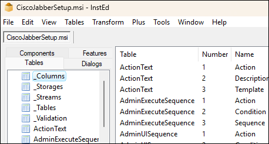

Créez un nouveau fichier de transformation (**Menu Transform / New Transform**) et donnez-lui le même nom que le paquet d'installation, mais avec l'extension MST plutôt que MSI (dans ce cas, le fichier s'appelle **CiscoJabberSetup.mst**). Sauvegardez ce fichier dans le même répertoire que le fichier MSI.

Vous pouvez ensuite modifier ce que vous voulez dans le MSI. Toutes les modifications seront enregistrées dans le MST (c'est en quelque sorte le delta par rapport au fichier original). Comme vous pouvez le deviner, il suffit de trouver la partie responsable de créer un raccourci sur le bureau et la supprimer.

Tous les raccourcis se trouvent dans la table Shortcut. On peut facilement remarquer quelle entrée crée un raccourci sur le bureau. Il vous suffit de supprimer cette entrée.

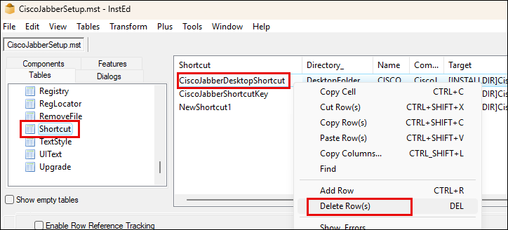

Une fois supprimée, la ligne apparaît en jaune (elle existe encore dans le MSI, mais le MST la supprime). Sauvegardez le fichier MST (menu File / Save) et ne cochez aucune case.

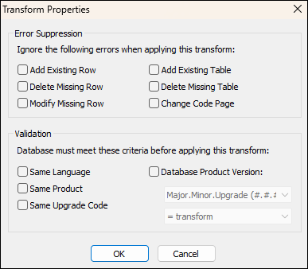

Testez l'installation de Jabber dans une ligne de commande élevée, en spécifiant le fichier MST:

<ConsoleWindow title="Administrateur: CMD" backgroundColor="#000000">
```
PS D:\Apps\CiscoJabber> msiexec.exe /i "CiscoJabberSetup.msi" /q TRANSFORMS="CiscoJabberSetup.mst"
```
</ConsoleWindow>

L'installation devrait se faire sans créer le raccourci sur le bureau. Si tout est beau, créez l'application et le déploiement dans SCCM en incluant les deux fichiers (le MSI et le MST) et en spécifiant le MST en argument à la ligne de commande.

## Partie 3: PSAppDeployToolkit (np++)

Une pratique largement répandue en entreprise consiste à standardiser le packaging logiciel au moyen d'un script appelé "wrapper". PowerShell App Deployment Toolkit est de loin le plus populaire. Voici un petit aperçu de sa mise en œuvre.

:::warning
Ce tutoriel est fait pour la version 4 de PSADT. Cette version est radicalement différente de la version 3. Certaines entreprises fonctionnent toujours avec la version 3, donc attention de bien suivre les standards de l'entreprise si vous souhaitez appliquer cette méthode professionnellement.
:::

### Installation de PSADT

Installez PSAppDeployToolkit sur votre ordinateur. Dans le laboratoire, pour simplifier les choses, vous pouvez l'installer directement sur le serveur SCCM. Pour ce faire, il suffit d'ouvrir une invite PowerShell et de lancer la commande suivante:

<ConsoleWindow title="Administrateur: Windows PowerShell" backgroundColor="#012456">
```powershell
PS C:\> Install-Module -Name PSAppDeployToolkit -Scope CurrentUser
```
</ConsoleWindow>

### Création du template

Ensuite, pour chaque application, il faut créer un *template* avec la commande `New-ADTTemplate`. Par exemple, si votre structure de répertoire est `D:\Apps\Nom_de_l'application\Version`, vous pouvez créer un *template* ainsi:

<ConsoleWindow title="Administrateur: Windows PowerShell" backgroundColor="#012456">
```powershell
PS C:\> New-ADTTemplate -Destination "D:\Content\Applications\NotepadPlusPlus" -Name "8.7.5"
```
</ConsoleWindow>

Cette commande a pour effet de créer la structure de répertoire suivante:

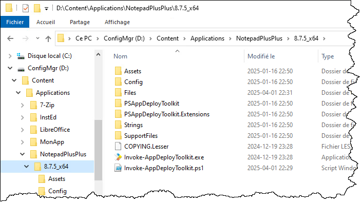

Copiez les fichiers nécessaires à l'installation dans le répertoire **Files**. Cela peut être un simple fichier MSI ou un setup.exe, pour les applications les plus simples à installer.

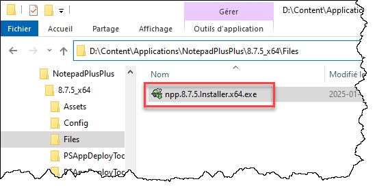

Dans un éditeur de texte ou un éditeur de code supportant PowerShell (comme PowerShell_ISE ou Visual Studio Code), ouvrez le fichier Invoke-AppDeployToolkit.ps1.

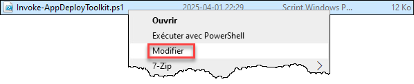

Il suffit ensuite de modifier le script d'installation avec les commandes d'installation et de désinstallation.

### Personnalisation de l'installation

Localisez le commentaire `## MARK: Variables` et modifiez la variable `$adtSession` afin de spécifier le nom de l'application, du développeur, sa version, etc.

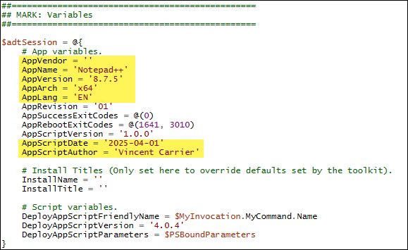

Vous trouverez dans le script les sections Install, Uninstall et Repair. Chacune de ces sections sont divisées en séquences de trois étapes (par exemple, pre-install, install, post-install).

- Localisez dans le script le commentaire `## MARK: Install`. Juste sous le commentaire *\<Perform Installation tasks here\>*, inscrivez la ou les commandes d'installation. Pour lancer un programme exécutable, la commande à utiliser est: `Start-ADTProcess`. Et pourquoi pas aussi créer un raccourci sur le bureau de tous les utilisateurs à l'aide de `New-ADTShortcut`!

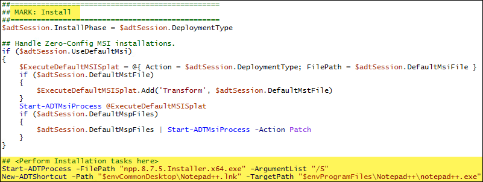

:::warning
L'argument FilePath est relatif au répertoire Files dans la structure de PSADT.
:::

:::tip Zero-Config MSI
Si le fichier est un MSI, il n'y a rien à changer dans le script car PSADT est capable de localiser automatiquement le fichier MSI à installer s'il se trouve dans le répertoire `Files`. De plus, s'il y a aussi un fichier MST qui porte le même nom que le MSI, il sera automatiquement appliqué. 

Mais si vous préférez un meilleur contrôle de l'installation, vous pouvez utiliser la commande Start-ADTMsiProcess.
:::

Faites la même chose dans la section `## MARK: Uninstall`. Et tel qu'identifié précédemment, il faut faire le nettoyage du répertoire dans Program Files puisque Uninstall.exe ne peut se supprimer lui-même. On en profite aussi pour supprimer le raccourci du bureau.

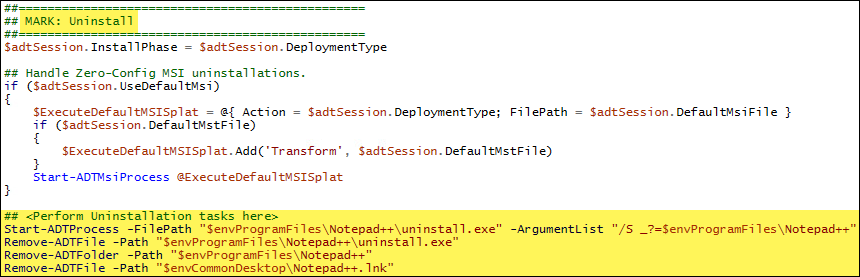

:::tip
Les commandes `Remove-ADTFile` et `Remove-ADTFolder` servent respectivement à effacer un fichier et un dossier. Plusieurs commandes sont offertes par PSADT. Consultez la documentation du produit pour plus de détails: https://psappdeploytoolkit.com/docs/reference 
:::

Testez l'installation sur une machine de test en double-cliquant sur Invoke-AppDeployToolkit.exe. Il y aura une petite interface graphique. En fouillant un peu dans le script et dans la documentation du produit, vous pouvez la personnaliser.

Pour lancer le déploiement par ligne de commande, il suffit d'exécuter Invoke-AppDeployToolkit.exe avec les options suivantes:

- **DeploymentType** : Install | Uninstall | Repair
- **DeployMode** : Interactive | Noninteractive | Silent
  - **Interactive**: montre toute l'interface graphique, permet à l'utilisateur de voir la progression et reporter l'installation
  - **Noninteractive**: montre à l'utilisateur la progression de l'installation et des messages mais aucune interaction n'est requise de sa part
  - **Silent**: installation complètement silencieuse et invisible

Par exemple:

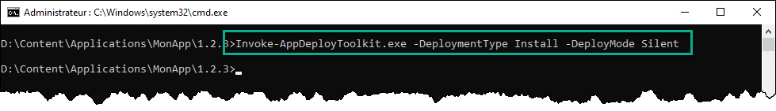

Une fois testé, dans SCCM, il suffit de modifier les commandes pour passer par Invoke-AppDeployToolkit.exe avec les bons paramètres. Ça se fait dans le Type de déploiement de l'application.

```cmd title="Commande d'installation:"
Invoke-AppDeployToolkit.exe -DeploymentType Install -DeployMode Noninteractive
```

```cmd title="Commande de désinstallation:"
Invoke-AppDeployToolkit.exe -DeploymentType Uninstall -DeployMode Noninteractive
```

:::tip
On peut utiliser le mode Interactive si on veut permettre à l'utilisateur de repousser à plus tard (jusqu'à concurrence de 3 fois), Noninteractive si on veut que l'utilisateur voit la progression de l'installation, ou Silent si on souhaite que l'utilisateur ne voit rien du tout.
:::

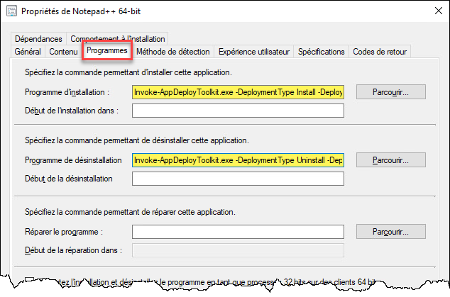

Si on veut que l'utilisateur voit la progression de l'installation (les modes Interactive ou NonInteractive), il faut aussi permettre l'interactivité dans l'onglet Expérience utilisateur

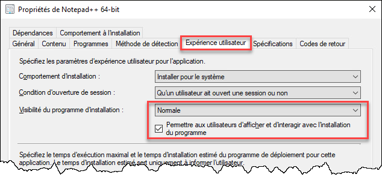

Vous trouverez les logs d'installation générés automatiquement par PSAppDeployToolkit sous `C:\Windows\Logs\Software`.

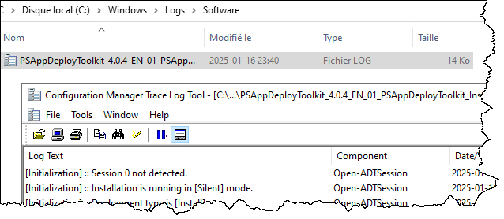

Une fois le package testé, configurez votre type de déploiement avec cette commande (et la commande équivalente pour la désinstallation) et assurez-vous de mettre à jour le contenu du point de distribution. Puis testez votre déploiement par SCCM

Pour en savoir plus, vous pouvez vous référer à ce site: https://psappdeploytoolkit.com/docs/reference

### Injection de préférences

Dernière chose, il arrive parfois qu'on souhaite modifier le comportement par défaut de l'application. La méthode varie d'une application à l'autre, et ça nécessite de l'analyse et de la recherche. Dans le cas de Notepad++, la configuration est enregistrée dans un fichier XML situé dans le profil de l'utilisateur sous `C:\Users\...\AppData\Roaming\Notepad++`.

Par exemple, si on souhaite que Notepad++ soit en français et que les mises à jour automatiques soient désactivées, on va effectuer la configuration manuellement dans l'application, puis récupérer le fichier de configuration.

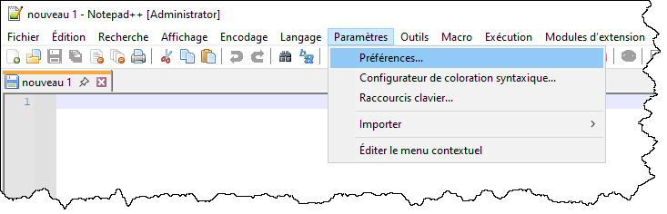

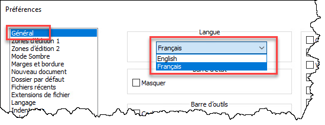

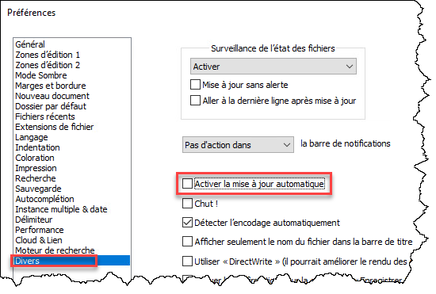

Et ensuite on ferme Notepad++ pour enregistrer les changements.

:::tip Astuce: Process Monitor (procmon)
Si vous ne savez pas où sont les fichiers de configuration, vous pouvez utiliser l'outil [**Process Monitor** (procmon)](https://learn.microsoft.com/en-us/sysinternals/downloads/procmon). C'est une sorte de Wireshark mais pour les fonctions internes de Windows. Téléchargez l'outil sur un poste de test sur lequel Notepad++ est installé. Démarrez une capture puis ouvrez les options de Notepad++. Effectuez le changement de configuration décrit ci-haut et ensuite fermez la capture. Vous pouvez ensuite ajouter des filtres pour ne montrer que ce que notepad++.exe a écrit. Cet outil est pratique pour révéler l'emplacement des fichiers de configuration et des logs, entre autres.

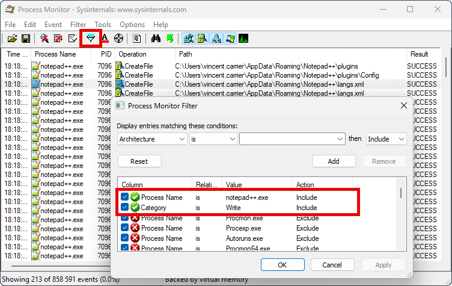
:::

On va ensuite ajouter une étape à l'installation pour copier ces deux fichiers dans le profil de tous les utilisateurs (existants et futurs). Tout d'abord, il faut ajouter les fichiers au contenu de l'application (dans le répertoire Files).

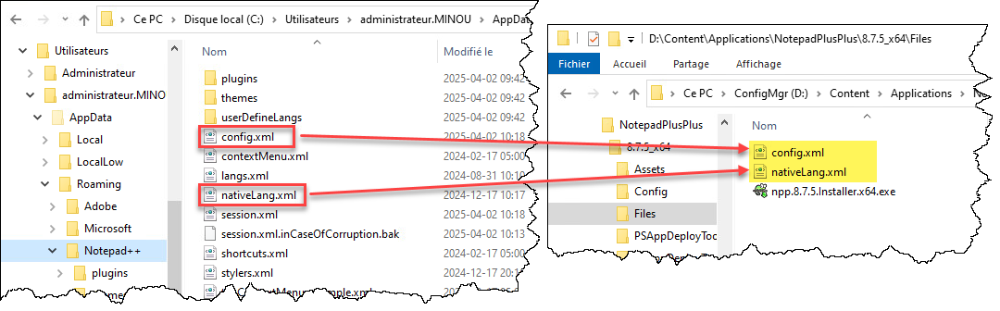

Puis on ajoute la copie de ces fichiers dans le script d'installation, juste après l'exécution de la commande d'installation.

```powershell
$Fichiers = @(
    "$($adtSession.DirFiles)\config.xml",
    "$($adtSession.DirFiles)\nativeLang.xml"
)
Copy-ADTFileToUserProfiles -Path $Fichiers -Destination "AppData\Roaming\Notepad++"
```

Voici un aperçu de la section installation complète:

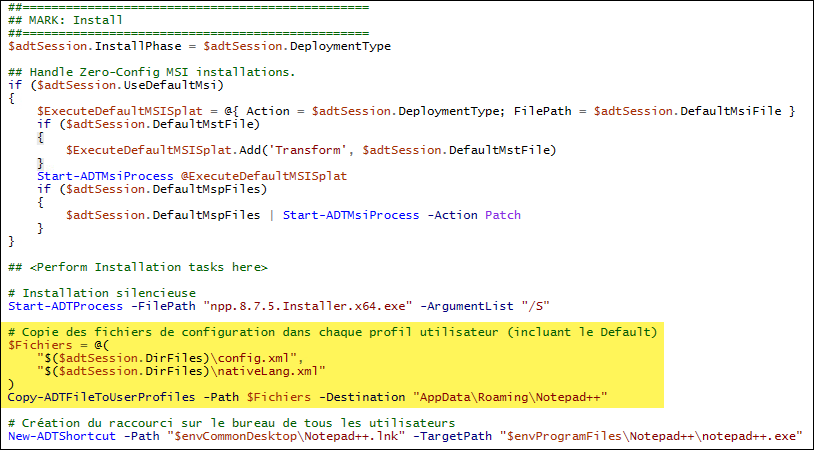

Une fois ce changement apporté, vous pouvez tester en supprimant le répertoire `C:\Users\nomdutilisateur\AppData\Roaming\Notepad++` puis en relançant le script d'installation. Notepad++ devrait démarrer en français et l'option de mise à jour automatique devrait être désactivée.

### Mise à jour du contenu

Pour que cela fonctionne sous SCCM, chaque fois qu'il y a une modification dans les fichiers source, n'oubliez pas de **mettre à jour le contenu dans la console SCCM** (cela se fait en cliquant sur l'application, puis sur l'onglet Types de déploiement en bas de la console). Attendez 5-10 minutes, puis déclenchez la récupération de stratégie utilisateur sur le client. Tentez d'installer et de désinstaller le logiciel.
