## Partie 1: Point de distribution

Dans ce laboratoire, vous devrez monter le point de distribution pour desservir les clients situés à Saint-Trou. Vous devrez créer les deux machines suivantes:

| Nom       | Système d'exploitation | Adresse IP relative | Commutateur virtuel |
| --------- | ---------------------- | ------------------- | ------------------- |
| ST-CMDP   | Windows Server         | .5                  | SaintTrou-NET       |
| ST-PC0003 | Windows 11             | *(dhcp)*            | SaintTrou-NET       |

Dans ce nouveau *setup*, les clients situés à Saint-Trou continueront à échanger avec le serveur principal (plus précisément, son rôle de point de gestion) pour les stratégies (*policies*), les pulsations (*heartbeat*), les informations d'inventaire, etc., mais lorsqu'elles devront télécharger du contenu, ce sera par le point de distribution local de Saint-Trou. Cela évitera d'engorger le réseau étendu lors des déploiements, qui peuvent exiger des téléchargements importants par un grand nombre de machines dans un court laps de temps.

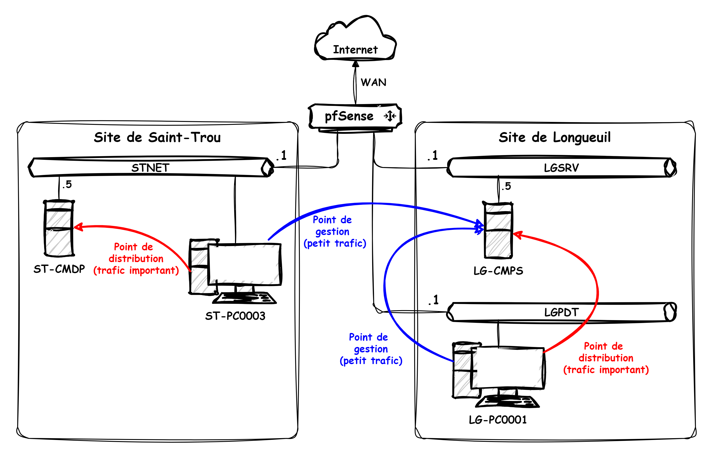

### Montage du serveur

Premièrement, à partir du modèle de **Windows Server**, créez un nouveau serveur qui agira comme point de distribution SCCM pour le site de Saint-Trou. Côté matériel, ajoutez-lui un **deuxième disque dur de 200 Go** et connectez sa carte réseau dans le commutateur virtuel associé au site de **Saint-Trou**.

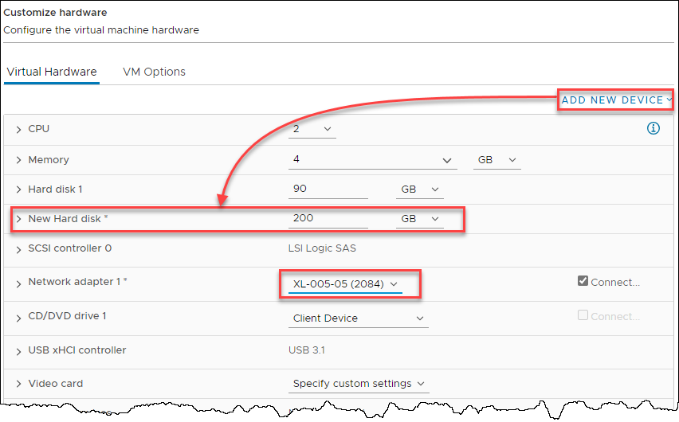

:::warning
N'oubliez pas d'activer, initialiser et formater en NTFS le nouveau disque dans l'utilitaire de gestion des disques (diskmgmt.msc). Cette étape ne se fait pas automatiquement.
:::

Le serveur obtiendra automatiquement une adresse par DHCP, mais donnez-lui plutôt une adresse statique d'hôte .5 ainsi que la configuration réseau appropriée pour Saint-Trou (passerelle, masque, résolveur principal au contrôleur de domaine de Saint-Trou). Renommez cette machine **ST-CMDP** et joignez-la au domaine. Disposez le compte ordinateur de ce serveur dans le même OU que le serveur de site primaire.


Pour des fins de simplicité, vous pouvez démarrer une session en tant qu'un administrateur du domaine (mais pas l'administrateur local!)

### Installation du client SCCM

On va vouloir installer le client SCCM sur ce serveur afin de le gérer. La manière la plus efficace de le faire est le push de client, puisque tout est déjà en place.

Premièrement, assurez-vous que le GPO qui configure les clients pour le push de client s'applique sur le serveur. Vous pouvez le vérifier avec la commande `gpresult /r /scope computer` à partir d'une invite de commande élevée.

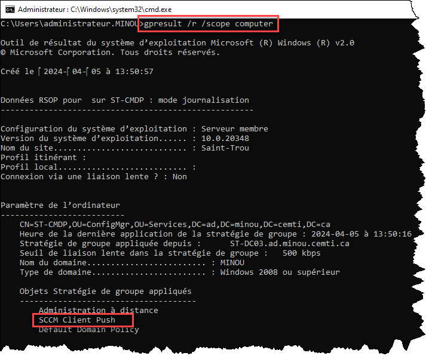

:::tip
Si le GPO ne s'applique pas, assurez-vous de le lier à l'OU dans lequel se trouve le compte ordinateur du serveur. Forcez une réplication au besoin pour mettre à jour le contrôleur de domaine de Saint-Trou, et faites un `Gpupdate` sur le serveur, puis utilisez `Gpresult` pour confirmer.
:::

Ensuite, vérifiez si vous voyez le nouveau serveur dans les **appareils** sous Actifs et conformité. Si ce n'est pas le cas, forcez une découverte de systèmes pour que SCCM aille regarder dans le domaine pour apprendre l'existence du nouveau serveur.


Si ça ne fonctionne toujours pas, il se peut que les règles de découverte n'incluent pas l'OU dans lequel se trouve le serveur. Assurez-vous de l'ajouter dans la liste de **découverte de système**.

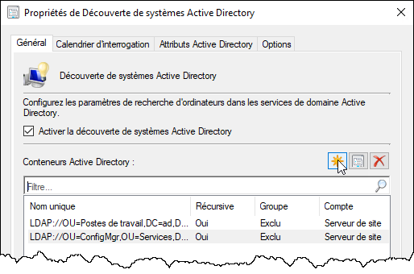

Une fois le serveur visible dans la liste des appareils, installez-lui le client SCCM. Vous pouvez utiliser le *Client Push* (mais toute autre méthode d'installation du client pourrait tout aussi bien fonctionner).


Laissez une minute ou deux pour que l'installation se termine. Vous devriez voir le processus ccmexec.exe dans le gestionnaire de tâches, et la console SCCM devrait rapporter **Oui** dans la colonne **Client** de la section **Appareils**.

### Installation des prérequis

Quelques opérations sont nécessaires afin de préparer le serveur à assumer un rôle SCCM. Vous devez les faire sur le nouveau serveur qui sera votre point de distribution de Saint-Trou.

Assurez-vous que le **compte machine du serveur de site primaire SCCM est administrateur** de ce serveur. C'est important, car c'est le service SCCM qui se connecte à distance sur le serveur afin de le configurer pour qu'il devienne un point de distribution.

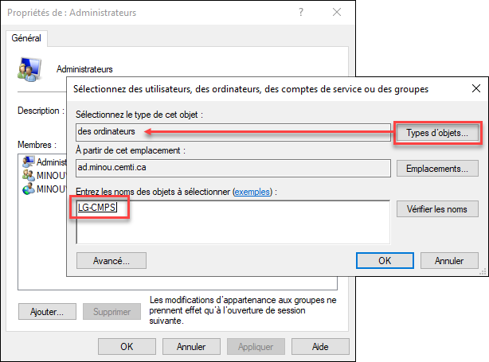

Créez un fichier vide nommé `NO_SMS_ON_DRIVE.SMS` à la racine du C:\ (et à la racine de tout volume sur lesquels vous ne souhaitez pas qu'SCCM stocke son contenu)

<ConsoleWindow title="Administrateur: Windows PowerShell" backgroundColor="#012456" noCopy="true" wrap="none">
```text
PS C:\> New-Item C:\NO_SMS_ON_DRIVE.SMS -ItemType File

    Répertoire : C:\

Mode              LastWriteTime      Length Name
----              -------------      ------ ----
-a----      2026-11-23    11:02           0 NO_SMS_ON_DRIVE.SMS
```
</ConsoleWindow>

Ajoutez les fonctionnalités **BITS** et **Remote Differential Compression**. Vous pouvez le faire par PowerShell ou encore par l'interface graphique du gestionnaire de serveur.

```powershell
Add-WindowsFeature RDC, BITS
```

Puis installez le **rôle IIS**. On veut s'assurer que certains éléments soient installés également: **l'authentification Windows**, les **extensions ISAPI**, la **compatibilité de métabase IIS 6** et la compatibilité avec le **service WMI IIS 6**. Voir la documentation de Microsoft pour plus de détails sur les exigences de configuration.

```powershell
Add-WindowsFeature Web-Windows-Auth, Web-ISAPI-Ext, Web-Metabase, WebWMI -IncludeManagementTools
```

### Ajout du rôle de DP

Dans la console SCCM sous **Administration / Configuration de site**, créez un nouveau **système de site** (*Site System Server*) afin de lui attribuer un rôle SCCM.

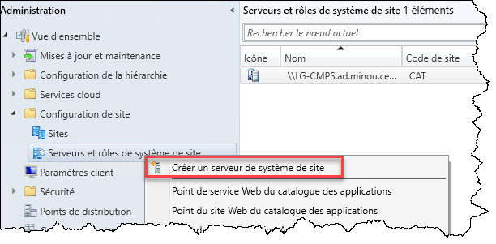

Indiquez à quel serveur confier le rôle, et de quel site SCCM il doit faire partie.


Gardez les options par défaut à la page de configuration du proxy (il n'y en a pas). Puis sélectionnez le ou les rôles à confier au serveur. Dans ce cas, ce sera uniquement le rôle de point de distribution.


Choisissez d'installer IIS automatiquement si ce n'est pas déjà fait.


À l'étape Communication, laissez le protocole HTTP standard, et optez pour le certificat auto-signé. Pour pouvoir utiliser HTTPS, on doit avoir une infrastructure PKI dans notre environnement TI, ce qui dépasse les limites de ce cours.

Sélectionnez ensuite le volume par défaut sur lequel sera stocké le contenu. Il faut faire bien attention que les lettres soient celles du lecteur dans lequel on souhaite stocker le contenu.


:::warning
Si sur votre serveur le D: correspond à un autre lecteur (le lecteur DVD par exemple), ça ne fonctionnera pas. Donc soit vous changez la lettre des lecteurs, soit vous choisissez une autre lettre ici.
:::

Laissez les options par défaut dans étapes "point de distribution d'extraction", "Paramètres PXE", "Multidiffusion" et "Validation du contenu".

À l'étape "Groupes de limites", associez ce serveur au groupe de limites du site de Saint-Trou. Cela va diriger les clients vers ce point de distribution lorsque leur adresse IP sera situé dans les limites de Saint-Trou, et cela évitera donc d'engorger le lien inter-site lors de déploiements.

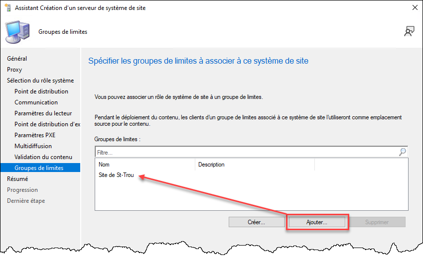

Une fois terminé, vous pouvez suivre le déploiement du point de distribution dans les logs du serveur principal SCCM. Regardez **distmgr.log** pour plus de détails.


Assurez-vous aussi que le seul point de distribution qui soit associé au **groupe de limites de Saint-Trou** soit ce point de distribution!

:::warning
Avant de modifier le groupe de limites, assurez-vous que le point de distribution a bien été installé en confirmant le succès de l'opération dans **distmgr.log**.
:::


### Déploiement à Saint-Trou

Prenez un PC de test et connectez-le dans le réseau de Saint-Trou. Ce PC ne doit pas avoir reçu le déploiement d'une application (par exemple, 7-zip).

Sélectionnez une application à déployer, et distribuez le contenu sur le point de distribution (clic droit sur l'application, distribuer du contenu). Ajoutez le point de distribution à la liste.


Puis attendez que le contenu soit bien distribué. Vous pouvez le voir dans la section Surveillance de la console SCCM, sous État de distribution / État du contenu. La console montre le nombre de points de distribution ciblés, et la proportion de ceux qui ont reçu le contenu. Dans ce cas, l'application est ciblée sur 2 points de distribution: le serveur principal et le point de distribution de Saint-Trou. Si le diagramme montre des échecs, on peut obtenir davantage d'informations en cliquant sur le lien Afficher l'état.


Ajoutez un poste de travail situé à Saint-Trou dans le regroupement (collection) de déploiement de cette application, puis lancez un Machine Policy Cycle.


Dans le Centre logiciel, installez l'application. Elle devrait s'installer avec succès.

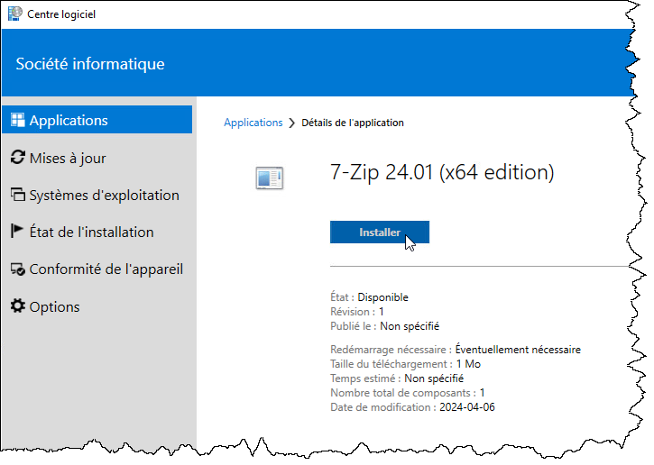

Si le déploiement reste pris à "Téléchargement 0%", la cause la plus probable est que le point de distribution est mal configuré ou que le contenu n'a pas été distribué avec succès.

### Validation

Pour confirmer que le déploiement s'est bien fait à partir du point de distribution de Saint-Trou, regardez dans les fichiers log **CAS.log** et **ContentTransferManager.log** sur le client.

Dans **CAS.log**, vous trouverez la liste des points de distribution qui ont été proposés au client pour le téléchargement du contenu à installer.

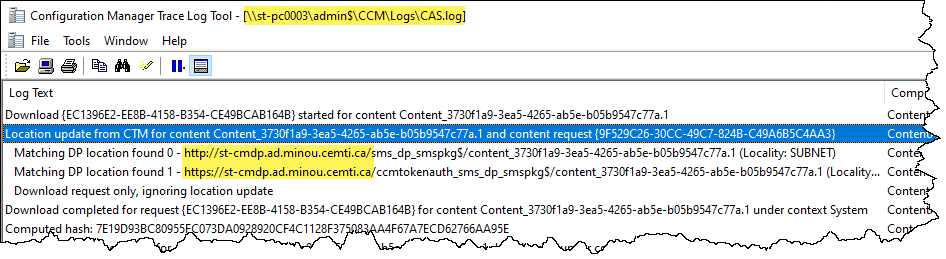

Dans **ContentTransferManager.log**, vous devriez trouver la preuve que le client a téléchargé les sources à partir du DP de Saint-Trou, et non du serveur de Longueuil.


:::info Logs côté serveur
Pour investiguer les logs du côté du point de distribution, ils sont dans le répertoire `D:\SMS_DP$\sms\logs` sur le point de distribution (la lettre pourrait être différente).
:::

## Partie 2: Adhésion dynamique

### Formuler une requête

Il est possible de passer des requêtes à SCCM afin d'obtenir une liste d'objets (généralement des ordinateurs) selon certains critères. Toute donnée d'inventaire peut servir de critère dans la requête. Par exemple, on pourrait dresser la liste:

- de tous les ordinateurs portables
- de tous les ordinateurs d'un fabricant et modèle spécifique
- de tous les ordinateurs qui ont une version spécifique de Notepad++
- de tous les ordinateurs qui ont moins de 16 Go de mémoire vive
- etc.

Pour cet exercice, vous devez obtenir la liste de **tous les clients SCCM de type Poste de travail (en omettant les serveurs)**.

Pour définir une requête, naviguez dans la section **Surveillance / Requêtes** et créez une nouvelle requête.

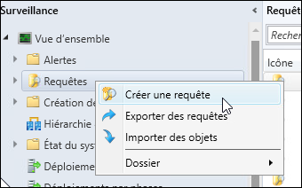

Donnez un nom significatif à la requête. Puisque nous souhaitons seulement inclure les clients SCCM, choisissez de limiter au regroupement Tous les clients poste de travail et serveur. Puis cliquez sur Modifier l'instruction de la requête.

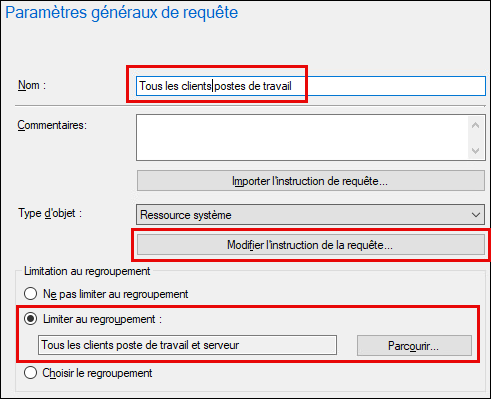

Les requêtes sont faites dans le langage WQL, proche du SQL. Mais pour simplifier la construction des requêtes, la console SCCM offre un outil graphique. Dans l'onglet Général, on sélectionne les informations qu'on souhaite obtenir. Dans notre exemple, on ne choisira que le nom d'hôte. Cliquez sur le bouton de création de nouvel élément.

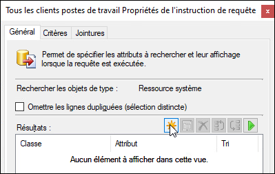

Vous devez sélectionner une classe et un attribut. La classe Ressource système contient de l'information de base sur le client SCCM (le nom de la machine, la version du client, etc.). Sélectionnez le Nom comme attribut. Si vous le souhaitez, vous pouvez ajouter de nouveaux champs à afficher dans les résultats de requête.

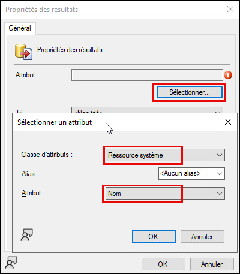

Ensuite, définissez les critères. Ce sont des règles qui doivent être vraies pour que l'élément soit retenu dans les résultats. Dans l'onglet Critères, créez un nouveau critère.

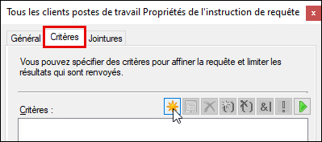

Pour cette requête, nous voulons retenir uniquement les postes de travail. Dans l'inventaire matériel se trouve la classe Système d'exploitation, qui correspond à la classe WMI `Win32_OperatingSystem`. Son attribut Type de produit correspond à la propriété `ProductType`. Selon la documentation de Windows, et comme on peut l'observer ci-dessous, la valeur de `ProductType` peut prendre une valeur de 1 à 3:

| ProductType | Description |
| --- | --- |
| **1** | Poste de travail (Windows 10, Windows 11…) |
| **2** | Contrôleur de domaine |
| **3** | Serveur membre du domaine (mais pas un contrôleur de domaine) |

On peut l'observer au moyen de la commande `Get-CimInstance`:

<ConsoleWindow title="Windows PowerShell" backgroundColor="#012456" wrap="character" noCopy="true">
```text
PS C:\> gcim Win32_OperatingSystem -ComputerName LG-PC0001, LG-DC01, LG-CMPS |
>> select PSComputerName, ProductType

PSComputerName ProductType
-------------- -----------
LG-PC0001                1
LG-DC01                  2
LG-CMPS                  3
```
</ConsoleWindow>

Par conséquent, pour obtenir les postes de travail seulement, il suffit de définir comme critère que le type de produit soit **égal à 1**.

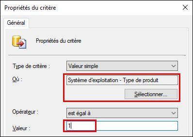

Là aussi, on pourrait définir plusieurs critères. Il est possible de faire des groupements de critères et appliquer des opérateurs logiques. Mais dans le cas qui nous concerne, une seule condition suffit.

Cliquez sur le bouton ci-dessous pour **tester votre requête** (il faut ensuite cliquer sur le bouton **Exécuter**). Vous devriez voir uniquement vos PC (LG-PC0001, LG-PC0002 et ST-PC0003).

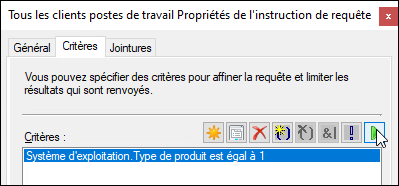

Vous pouvez aussi voir la requête WQL qui a été construite par cet outil en cliquant sur le bouton **Afficher la requête**.

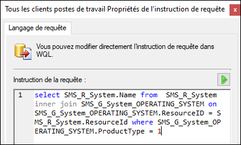

Vous pouvez exécuter la requête à tout moment une fois définie.

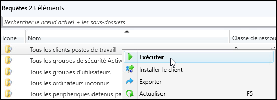

### Créer une règle dynamique

Vous pouvez définir un **regroupement** dont l'adhésion est contrôlée **dynamiquement par une requête**. Ainsi, il n'est plus nécessaire d'ajouter de manière statique des ordinateurs dans le regroupement; le tout sera fait automatiquement par une requête. Ici, nous voulons un regroupement qui contient **tous les postes de travail possédant le client SCCM** (en excluant les serveurs).

D'abord, **créez un nouveau regroupement de périphériques**. Donnez-lui un nom et une limitation. Comme nous voulons uniquement des ordinateurs qui ont le client SCCM, l'adhésion sera limitée à Tous les clients poste de travail et serveurs.

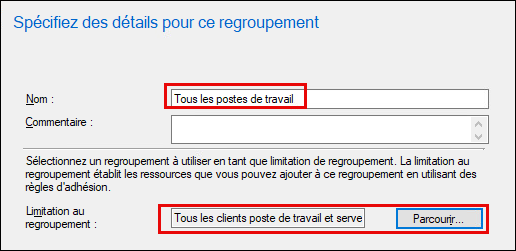

Créez ensuite une règle d'adhésion, de type **Règle de requête**.

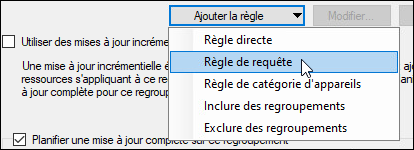

Donnez un nom significatif à la règle. Puisque vous avez déjà défini une requête qui donne la liste des clients postes de travail, vous pouvez simplement **l'importer**.

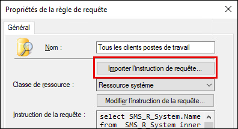

Vous devriez ensuite voir seulement vos postes de travail comme **membres du regroupement** (il se peut qu'il faille attendre quelques minutes avant que le changement ne soit effectif).

Notez que les membres du regroupement ne seront pas rafraîchis en temps réel. Par défaut, les regroupements sont mis à jour à chaque 7 jours, mais vous pouvez modifier cette intervalle. Vous pouvez également utiliser des mises à jour incrémentielles, qui sont plus réactive. Sachez cependant que plus la réévaluation des membres se fait fréquemment, plus cela risque d'affecter la performance de SCCM.

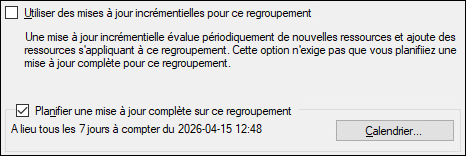

Il est toujours possible de réexécuter à la demande les règles d'adhésion d'un regroupement spécifique.

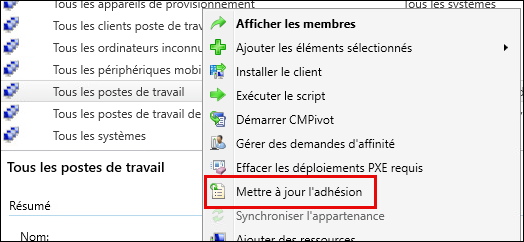

### Règle dans un regroupement

Il est également possible de définir une règle d'adhésion dynamique directement dans un regroupement. Pour cet exemple, il vous faut créer un regroupement basé sur tous les postes de travail mais contenant uniquement les postes affectés à Longueuil. 

:::info Note
Il y a deux manières de voir cette demande, et cela dépend du contexte. On pourrait souhaiter avoir tous les postes **présentement** à Longueuil, ou tous les postes **affectés** à Longueuil. Par exemple, si un employé de Saint-Trou s'en va travailler à Longueuil pendant une semaine, doit-on considérer son portable comme en étant un de Saint-Trou ou un de Longueuil.

Pour cette demande, on va considérer qu'un poste de Longueuil est un poste affecté à Longueuil, peu importe où il se trouve dans le temps. On va donc utiliser son nom d'hôte pour déterminer son site d'attache: `LG-` pour les machines à Longueuil et `ST-` pour les machines à Saint-Trou.
:::

Premièrement, il vous faut **créer un nouveau regroupement** et le limiter à un regroupement plus grand. Comme vous avez déjà un regroupement contenant tous les postes de travail, et que vous voulez les postes de travail de Longueuil qui en sont un sous-ensemble, vous pouvez simplement **limiter au regroupement Tous les postes de travail**. Cela simplifiera la requête.

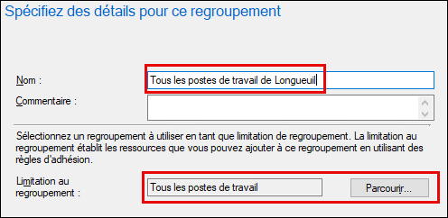

Faites une règle d'adhésion de type Requête. Donnez-lui un nom (dans ce cas, ce sera toutes les machines dont le nom commence par `LG-`).

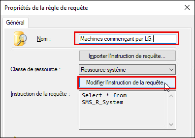

Créez un critère basé sur l'attribut **Nom** de la classe **Ressource système** (soit le nom d'hôte) dont la valeur est similaire à `LG-%` (rappel: **%** en SQL/WQL est le caractère *wildcard*).

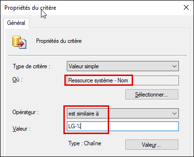

Enregistrez le regroupement. Après quelques minutes, vous devriez voir uniquement les postes de Longueuil dans le regroupement. Ce regroupement peut être utilisé pour recevoir des déploiements.

### Regroupements opérationnels

Il existe un script produit par la communauté pour créer des regroupements dynamiques répondant à des besoins fréquents. Utilisez-le dans votre environnement et observez le résultat.

Suivez les étapes décrites dans [**ce guide**](/astuces/09).

## Partie 3: Outil ClientCenter

Si vous avez le temps, essayez l'outil Client Center. Il permet un contrôle du client SCCM à distance. C'est très pratique pour le dépannage.

Suivez les étapes décrites dans [**ce guide**](/astuces/10).
