Dans ce laboratoire, vous allez installer et configurer un poste de travail Windows 10 de référence afin de constituer une image de base. Puis, vous allez produire un fichier de réponse Unattend.xml et généraliser votre image à l'aide de l'utilitaire Sysprep. Ensuite, vous allez produire un ISO Windows PE et vous en servir pour capturer cette image dans un fichier WIM. Finalement, vous allez appliquer cette image à un nouveau poste de travail.

:::info Important avant de commencer...
Assurez-vous d'avoir connecté votre poste de laboratoire dans votre VLAN LGPDT, puis connectez-vous à votre serveur SCCM au moyen de RDP. 

[**Référez-vous à ce tutoriel.**](/astuces/15)
:::

## Mise en place des outils

Pour réaliser ce laboratoire, vous aurez besoin d'une machine sur laquelle a été installé Windows ADK. Ce kit est composé de deux parties, **qui devraient déjà être installées sur votre serveur SCCM**:

- Windows ADK
- Windows PE add-on for the Windows ADK

Ces deux kits peuvent être téléchargés ici: https://docs.microsoft.com/fr-ca/windows-hardware/get-started/adk-install

:::warning
Pour ce laboratoire, les étapes qui utilisent les outils contenus dans le ADK peuvent être faites dans votre serveur SCCM (LG-CMPS), puisque le ADK y a déjà été installé pour vous. Dans un environnement réel cependant, il est conseillé d'effectuer les étapes sur un autre ordinateur plutôt que directement sur le serveur.
:::

## Création d'une VM de référence

Dans Labinfo, créez une nouvelle VM connectée à votre réseau **Longueuil-PDT**. Sélectionnez **VMXNET3** comme modèle d'adapteur réseau (c'est un modèle de carte réseau plus performant). **N'utilisez pas un modèle de VM, vous devrez installer Windows 10 à la main avec le ISO**!

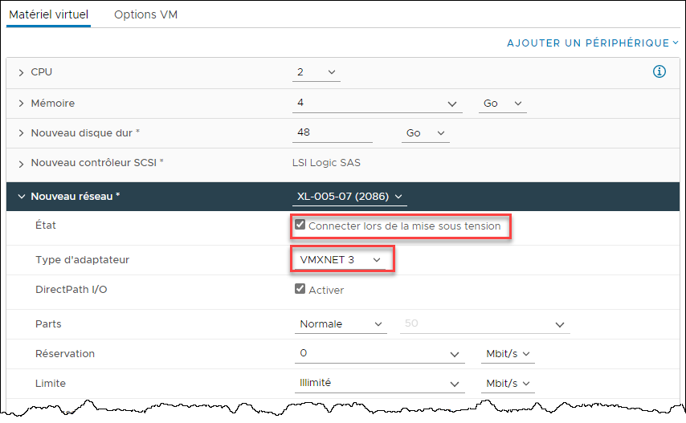

Installez-lui **Windows 10 Éducation en français** à l'aide du médium d'installation officiel de Microsoft. Vous pouvez utiliser le fichier **ISO** disponible sous **ED5DEPINFO\Logiciels\MS**. Insérez simplement le ISO dans le lecteur DVD de la machine virtuelle.

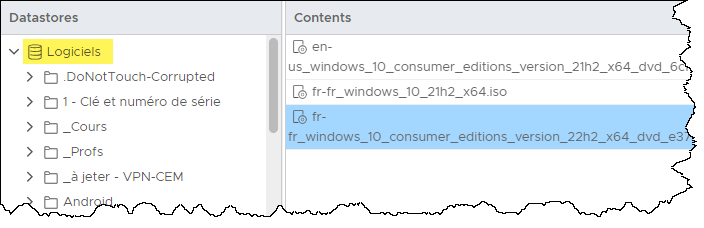

:::warning
**N'utilisez pas Windows 11**, c'est plus compliqué en raison de la compatibilité avec Labinfo. Installez **Windows 10 22H2**.
:::

Ensuite, appliquez les modifications suivantes à votre machine:

- Installez les **VMware Tools** à partir de l'interface de VMware
- Installez **7-Zip manuellement** (sans SCCM) et démarrez-le une fois (cela activera les extensions dans le menu contextuel du shell)
- Ajoutez un **raccourci vers 7-Zip sur le bureau**
- Installez toutes les **mises à jour** de Windows les plus récentes
- Ne **joignez PAS** cette machine au domaine

Pendant que les mises à jour se téléchargent et s'installent, continuez le reste du laboratoire. On reviendra plus tard sur cette VM.

## Préparation du domaine

L'image que vous allez construire va joindre la machine au domaine automatiquement. Vous devrez donc créer un compte sur votre domaine disposant de droit de **jonction au domaine**.

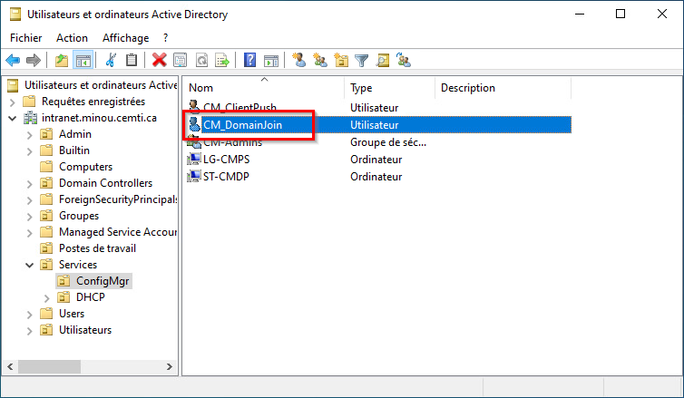

Déléguez des droits dans l'OU qui doit contenir les postes de travail. Vous devez déléguer les droits de création de compte machine dans cet OU. [**Suivez cette procédure**](/tutos/14) si vous ne vous souvenez plus comment faire.

## Création du fichier unattend.xml

Le fichier réponse `unattend.xml` est requis pour automatiser certaines parties du processus d'installation de Windows (qui habituellement sont manuelles ou doivent être faites après l'installation de Windows).

:::warning
Cette partie du laboratoire est assez complexe, et ce cours n'a pas pour but de tout expliquer la structure de ce fichier. Ce que vous devez en retenir, c'est l'utilité de ce fichier dans l'automatisation de l'installation de Windows sur des systèmes d'entreprise.
:::

Cette partie peut se faire **sur le serveur SCCM principal**.

Commencez par obtenir les **sources d'installation de Windows**. Insérez le ISO que vous avez utilisé pour installer Windows dans votre machine maîtresse à l'étape précédente.


Créez un répertoire sur le disque où se trouve le contenu de SCCM, et copiez-y tout le contenu du DVD de Windows. Le répertoire devrait ressembler à ceci.

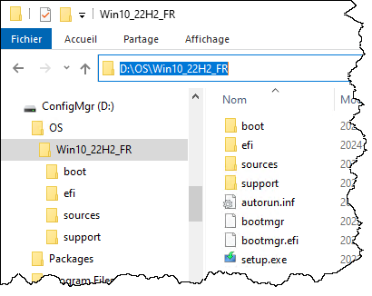

Ensuite, démarrez l'application Windows System Image Manager (SIM). Dans le menu Démarrer, elle apparaît sous le nom: **Assistant Gestion d'installation**.

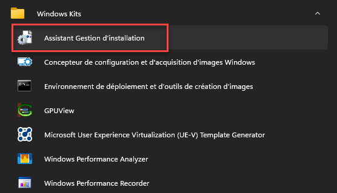

Windows SIM est l'outil qui vous aidera à construire votre fichier réponse, qui procurera toutes les réponses au processus d'installation de Windows. Comme le format de ce fichier dépend de la version de Windows, il faut d'abord charger le catalogue des composants à partir d'une image existante.

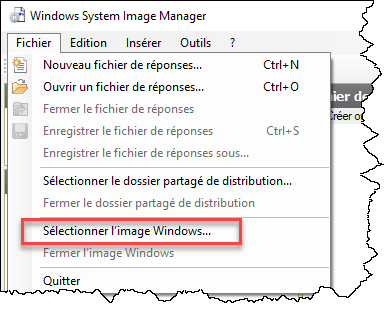

L'image que vous devez charger est le fichier **install.wim**, dans le répertoire **sources** du médium d'installation.

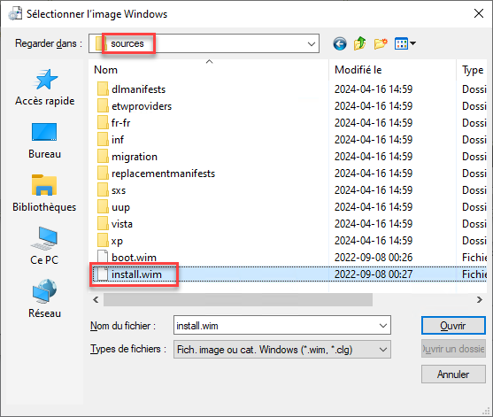

Si c'est la première fois que vous chargez cette image, l'outil devra analyser son contenu et créer un catalogue, ce qui peut prendre quelques minutes.

Une fois terminé, créez un nouveau fichier réponse.

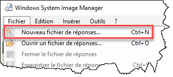

Dans le panneau **Fichier de réponses** (*Answer File*), vous pourrez voir les différentes passes du processus d'installation. Dans le panneau **Image Windows**, vous trouverez les différents composants configurables. Il suffit d'ajouter les composants voulus dans les passes souhaitées pour définir leurs propriétés. Faites attention au préfixe, sélectionnez toujours ceux commençant par **amd64**, et non ceux débutant par wow64.

Par exemple, le composant `amd64_Microsoft-Windows-International-Core` définit la configuration des paramètre régionaux, comme la langue du système, le format de nombres et de dates, la configuration du clavier, etc. Vous pouvez l'ajouter dans la **passe 4 (specialize)** ou encore **7 (oobeSystem)**. Je recommande de l'ajouter à la passe 7, soit juste avant que l'installation soit terminée.

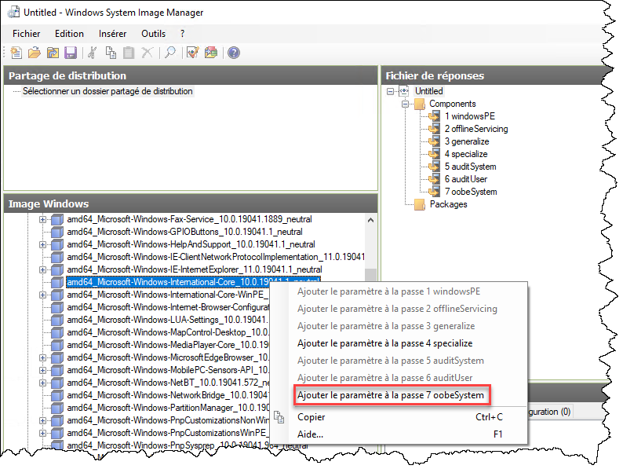

Une fois le composant ajouté, vous pouvez lui affecter des propriétés. Les champs que vous laissez vides resteront configurés avec les paramètres par défaut de Windows.

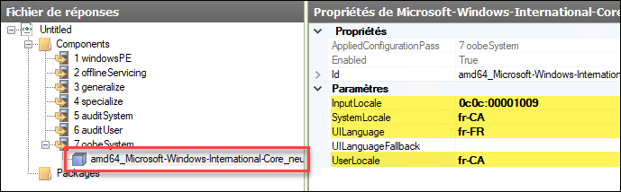

Dans l'exemple ci-dessus, voici les propriétés définies:

| Propriété | Valeur | Commentaires |
| --- | --- | --- |
| **InputLocale** | `0c0c:00001009` | La configuration du clavier. `0c0c` représente la culture (Français Canada) et `00001009` représente la disposition des touches sur le clavier (Français (Canada)). Pour la disposition Canadien Multilingue, le code est `00011009`. |
| **SystemLocale** | `fr-CA` | La culture du système (pour les applications non-unicode) |
| **UserLocale** | `fr-CA` | La culture en vigueur pour les utilisateurs du système (par défaut) |
| **UILanguage** | `fr-FR` ou `en-US`, selon la langue de l'image | La langue du système. Ici, on la laisse à la langue de l'image de référence. On aurait pu injecter un pack de langue pour changer la langue d'affichage, mais nous ne verrons pas ça dans ce cours. |

De la même manière, ajoutez et configurez les composants ci-dessous.

### Passe 7: oobeSystem

#### Microsoft-Windows-Shell-Setup (7 oobeSystem)

Ce composant et ses sous-composants contrôlent la manière dont le shell est configuré lors de l'installation de Windows.

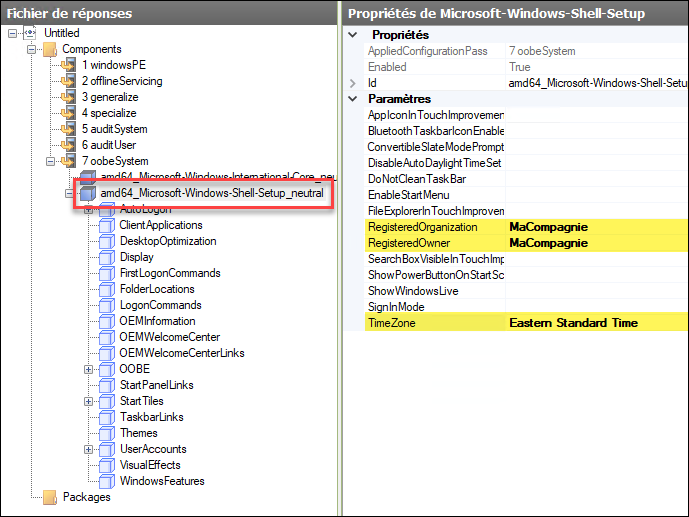

| Propriété | Valeur | Commentaires |
| --- | --- | --- |
| **RegisteredOrganisation** | Le nom de votre compagnie | Ce paramètre sert à afficher le nom de la compagnie dans les informations système de l'ordinateur. Il est complètement optionnel et n'a pas d'effet réel sur le comportement du système. |
| **RegisteredOwner** | Le nom de votre compagnie | Idem |
| **TimeZone** | Eastern Standard Time | Voir dans la documentation pour le nom des différents fuseaux horaires |

:link: [Microsoft-Windows-Shell-Setup | Microsoft Docs](https://docs.microsoft.com/en-us/windows-hardware/customize/desktop/unattend/microsoft-windows-shell-setup)

#### Microsoft-Windows-Shell-Setup\OOBE (7 oobeSystem)

Ce composant contrôle le déroulement de l'OOBE (Out-Of-Box-Experience), soit les questions qui sont posées à l'utilisateur à la fin de l'installation. 

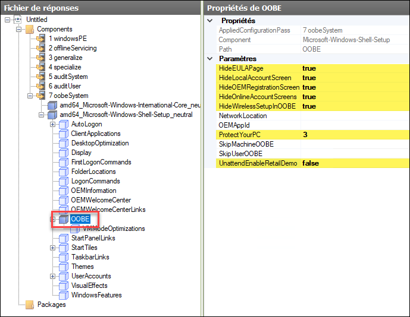

| Propriété | Valeur | Commentaires |
| --- | --- | --- |
| **HideEULAPage** | True | Cache l'écran d'acceptation de l'entente de licence |
| **HideOEMRegistrationScreen** | True | Cache l'écran d'enregistrement |
| **HideOnlineAccountScreens** | True | Cache l'écran qui invite l'utilisateur à s'authentifier avec son compte Microsoft |
| **HideWirelessSetupInOOBE** | True | Saute l'écran de configuration sans fil |
| **ProtectYourPC** | 3 | Saute l'écran "protégez votre PC" |
| **UnattendEnableRetailDemo** | False | Active le mode démo (on ne veut pas ça) |

:link: [OOBE | Microsoft Docs](https://docs.microsoft.com/en-us/windows-hardware/customize/desktop/unattend/microsoft-windows-shell-setup-oobe)

#### Microsoft-Windows-Shell-Setup\UserAccounts\AdministratorPassword (7 oobeSystem)

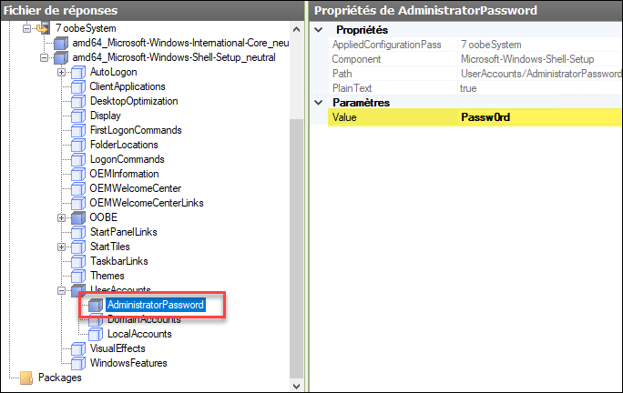

| Propriété | Valeur | Commentaires |
| --- | --- | --- |
| **Value** | *Le mot de passe* | Ce sera le mot de passe du compte administrateur local |

Note: Ce n'est pas une très bonne pratique de laisser un mot de passe admin en texte clair. Normalement, on va utiliser d'autres moyens plus sécuritaires pour spécifier le compte admin local (par exemple, LAPS) pour remplacer ce mot de passe temporaire par un mot de passe robuste et unique, on encore on va désactiver le compte d'administrateur local à la première occasion (par GPO par exemple). Pour ce laboratoire, on va faire ça simple et laisser ce mot de passe.

:link: [AdministratorPassword | Microsoft Docs](https://docs.microsoft.com/en-us/windows-hardware/customize/desktop/unattend/microsoft-windows-shell-setup-useraccounts-administratorpassword)


### Passe 4: specialize

#### Microsoft-Windows-Shell-Setup (4 specialize)

Ce composant comprend aussi des propriétés qui affectent la passe de spécialisation (ce qui se passe pendant le premier démarrage après que l'image Windows ait été appliquée). 

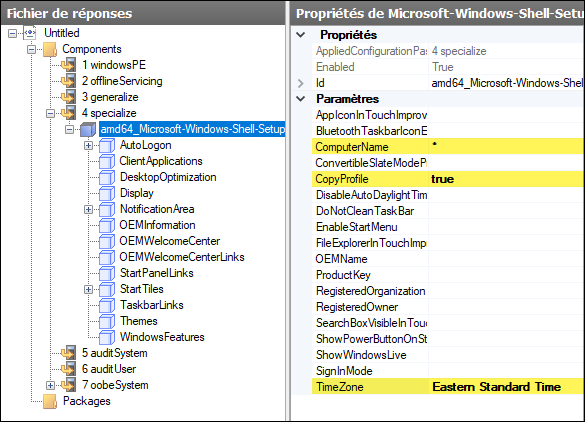

| Propriété | Valeur | Commentaires |
| --- | --- | --- |
| **ComputerName** | * | L'astérisque signifie que le nom du poste sera autogénéré. |
| **CopyProfile**  | True | Copie le profil courant dans C:\Users\Default User afin de servir de base à tous les nouveaux utilisateurs du système. |
| **TimeZone** | Eastern Standard Time | Voir dans la documentation pour le nom des différents fuseaux horaires |

:link: [Microsoft-Windows-Shell-Setup | Microsoft Docs](https://docs.microsoft.com/en-us/windows-hardware/customize/desktop/unattend/microsoft-windows-shell-setup)

#### Microsoft-Windows-UnattendedJoin (4 specialize)

Ce composant permet la jonction automatique au domaine. Celle-ci a lieu pendant la passe de spécialisation. On peut spécifier l'OU dans lequel créer le compte machine.

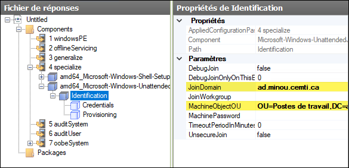

| Propriété | Valeur | Commentaires |
| --- | --- | --- |
| **JoinDomain** | ad.votredomaine.cemti.ca | Le nom FQDN du domaine Active Directory |
| **MachineObjectOU** | OU=Postes de travail, DC=ad, DC=votredomaine, DC=cemti, DC=ca | Le distinguished name de l'unité d'organisation où créer le compte ordinateur dans le domaine |

Dans le sous-composant Credentials, vous devez spécifier les informations du compte de service pour la jonction au domaine. Évidemment, ce n'est pas idéal d'avoir un mot de passe en clair, mais dans notre cas on n'a pas vraiment le choix.

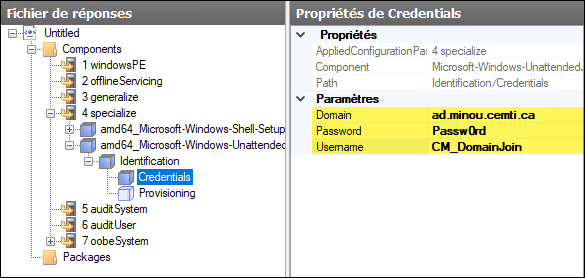

| Propriété | Valeur | Commentaires |
| --- | --- | --- |
| **Domain** | ad.votredomaine.cemti.ca | Le nom DNS complet du domaine |
| **Password** | Passw0rd | Le mot de passe du compte |
| **Username** | CM_DomainJoin | Le nom du compte qui possède des droits de jonction au domaine dans l'OU spécifié |

#### Microsoft-Windows-Deployment\RunSynchronous (4 specialize)

Le composant RunSynchronous sert à exécuter des commandes lors de n'importe quelle passe. On peut lui ajouter des commandes en cliquant-droit sur le composant. 

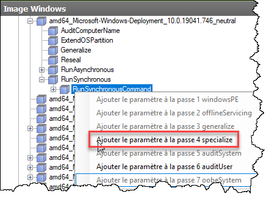

Chaque commande est exécutée en séquence, dans l'ordre spécifié. Ce sont des commandes classiques qui sont attendues ici, pas des commandes PowerShell.

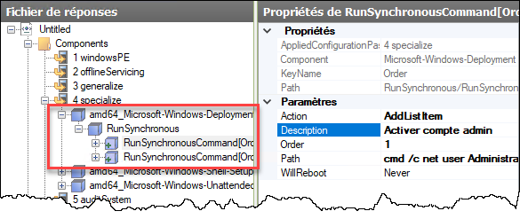

Les deux commandes ici servent à activer le compte local **Administrateur** (qui est désactivé par défaut sous Windows 10) et sauter l'écran de l'OOBE qui oblige à créer un compte utilisateur avec un mot de passe et des questions de sécurité.

| Order | Description | Path |
| --- | --- | --- |
| **1** | Enable local admin | `cmd /c net user Administrateur /active:yes` |
| **2** | Skip user creation | `reg add HKLM\Software\Microsoft\Windows\CurrentVersion\Setup\OOBE /v UnattendCreatedUser /t REG_DWORD /d 1 /f` |

:::warning
S'il s'agit de Windows en anglais, le nom du compte sera `Administrator`.
:::

Puis finalement, sauvegardez le fichier **unattend.xml** quelque part dans le partage de fichiers, afin qu'il puisse être récupéré par le réseau.

## Création d'un ISO Windows PE

Windows PE est une version miniature de Windows comprenant uniquement le strict nécessaire pour démarrer une installation de Windows. C'est d'ailleurs ce qui démarre lorsque vous bootez sur le ISO vanille de Windows et qui démarre l'assistant d'installation. Vous pouvez générer vous-mêmes votre propre ISO bootable.

:::tip Outils
Il existe des outils qui facilitent ce processus, tels que [Rufus](https://rufus.ie/fr/) ou [WonderISO](https://www.sysgeeker.com/iso-burner.html), mais dans ce laboratoire, on va le faire à la main, avec les outils de déploiement officiels de Microsoft!
:::

Démarrez d'abord la console de commande de l'ADK (Deployment and Imaging  Tools Environment) en tant qu'administrateur. C'est simplement une console CMD classique mais avec certaines variables d'environnement prédéfinies pour aider à l'utilisation des outils de l'ADK.

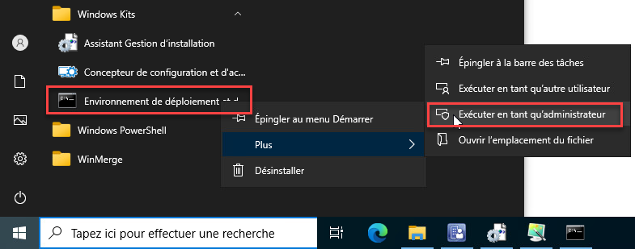

Tout d'abord, choisissez un emplacement sur votre disque où stocker les fichiers de l'image WinPE pour l'architecture amd64 (par exemple, D:\WinPE\amd64). Lancez la commande:

```cmd
copype amd64 C:\WinPE\amd64
```

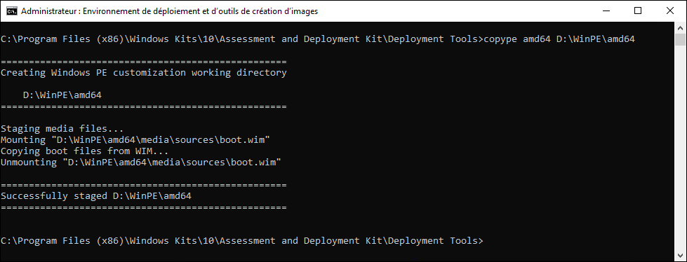

Cette commande produit trois répertoires

- **bootbins** : Contient les éléments bootables pour le micrologiciel UEFI (anciennement nommé *fwfiles*)
- **media** : Contient les fichiers source de Windows PE. Le fichier `boot.wim` se trouve dans `.\media\sources`
- **mount** : Ce répertoire est vide et servira à monter l'image `boot.wim` afin d'y apporter des modifications

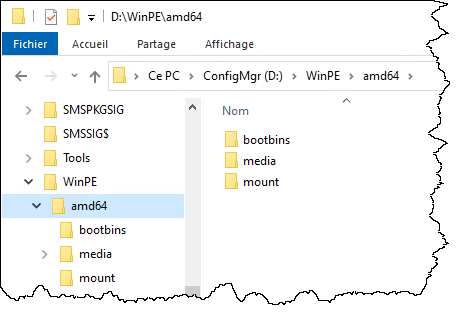

Malheureusement, Windows PE ne possède pas de driver compatible avec les cartes réseau virtuelles VMXNET3 par défaut. Il va donc falloir modifier l'image de Windows PE pour ajouter ce driver.

```cmd
dism /mount-wim /wimfile:D:\WinPE\amd64\media\sources\boot.wim /index:1 /mountdir:D:\WinPE\amd64\mount
```

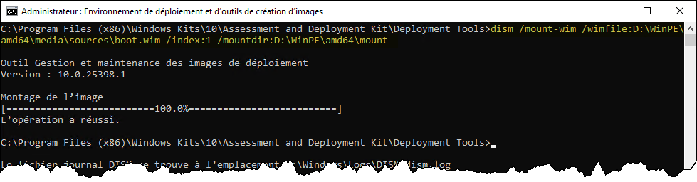

Cette commande a pour effet de monter le contenu du fichier `boot.wim` dans un dossier du système de fichiers afin d'y apporter des modifications.

Une fois l'image montée, injectez le driver pour VMXNET3. Si vous utilisez une VM sur laquelle vous avez installé les **VMware Tools**, les drivers se trouvent dans `C:\Program Files\Common Files\VMware\Drivers\vmxnet3\Win8`

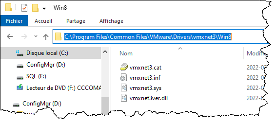

Voici la commande pour les injecter dans l'image WinPE.

```cmd
dism /image:D:\WinPE\amd64\mount /add-driver /driver:"C:\Program Files\Common Files\VMware\Drivers\vmxnet3\Win8" /recurse
```

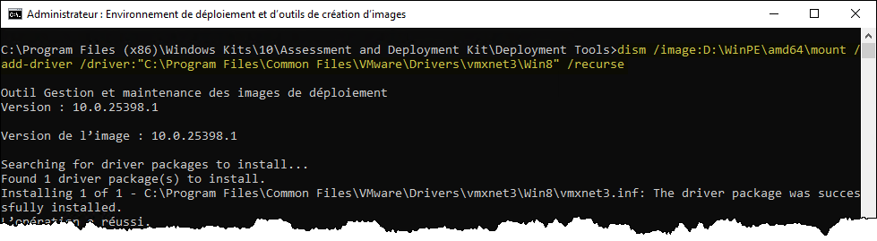

Une fois la commande terminée, le driver a été ajouté au fichier Wim. Il suffit ensuite de sauvegarder et démonter l'image.

```cmd
dism /unmount-image /mountdir:D:\WinPE\amd64\mount /commit
```

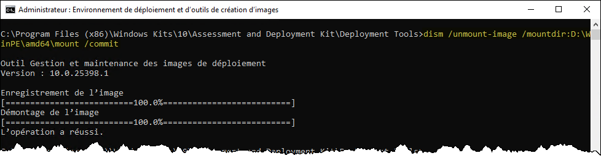

Finalement, votre fichier boot.wim modifié, il ne vous reste qu'à produire un fichier ISO bootable.

```cmd
oscdimg -n -h -bD:\WinPE\amd64\bootbins\efisys.bin D:\WinPE\amd64\media D:\WinPE\amd64\winpe-amd64.iso
```

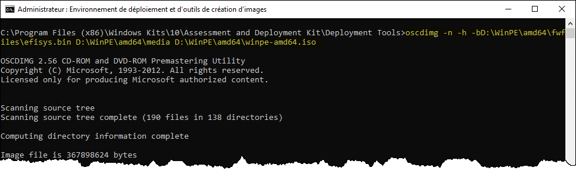

:::info Étape spécifique à Labinfo
L'étape suivante est spécifique à l'environnement du Collège; dans un réseau normal, vous pourriez simplement écrire l'image WinPE sur une clé USB et booter avec celle-ci. Mais Labinfo ne permet pas de booter par USB, donc on n'a pas le choix que de recourir à ce stratagème.

Pour pouvoir booter votre VM avec ce ISO, vous devez le déposer dans un emplacement accessible par Labinfo, dans le réseau du CEGEP. Puisque Labinfo est déconnecté des infrastructures intranet du CÉGEP, vous devez vous transférer le fichier ISO, soit par un service exposé sur Internet (par exemple, OneDrive ou Google Drive) ou à travers le client RDP. C'est là que se connecter par RDP devient intéressant. Vous pouvez simplement copier-coller votre fichier ISO de votre VM vers votre poste de laboratoire. Pour démarrer une session RDP vers votre serveur, [suivez ce tutoriel](/astuces/15). Déposez-le ensuite dans le répertoire à votre nom sur `\\ED5DEPINFO\PartageLabinfo`.
:::

## Préparation de l'image pour la capture

De retour à votre **machine de référence**. Les mises à jour devraient être terminées. Redémarrez complètement la VM pour que toutes les mises à jour soient bien appliquées. 

Avant toute chose, il se peut qu'on doive procéder à un nettoyage. Certaines applications du Store sont installées pour l'utilisateur, et il faut les désinstaller. Par exemple, avec une image française sous Windows 10, un LanguageExperiencePack vient s'installer automatiquement, et celui-ci empêche l'exécution de Sysprep. Il faut donc désinstaller le package.

On le fait avec ces commandes PowerShell:

<ConsoleWindow title="Windows PowerShell" backgroundColor="#012456" >
```text
PS C:\> Get-AppxPackage -AllUsers *LanguageExperiencePack* | Remove-AppxPackage -AllUsers
PS C:\> Get-AppxPackage -AllUsers *Microsoft.BingSearch* | Remove-AppxPackage -AllUsers
```
</ConsoleWindow>

Connectez-vous au partage de fichiers où vous avez déposé votre fichier unattend.xml. Cette machine n'est pas membre du domaine, alors vous allez devoir vous authentifier avec votre compte du domaine afin d'accéder au partage.

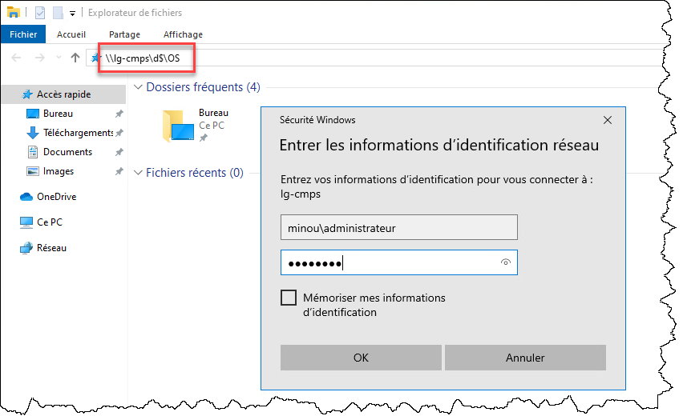

Localisez le fichier **unattend.xml** et copiez-le sur le bureau. Puis **déplacez** ce fichier de votre bureau dans **C:\\Windows\\System32\\Sysprep\\**. Vous aurez besoin d'élever vos privilèges. (Vous ne pouvez pas copier directement du partage à System32 puisque le compte du domaine qui accède au partage n'est pas admin local de la machine, c'est pour ça qu'il faut procéder en deux étapes.)

:::danger Important! Snapshot pré-Sysprep
Mettez la VM hors tension (*shutdown*) et faites un *snapshot* avant de poursuivre. Appelez cette sauvegarde **Avant Sysprep**. Puis redémarrez la VM.
:::

Démarrez une console de commande (cmd) en tant qu'administrateur et naviguez sous `C:\Windows\System32\Sysprep`. Puis, lancez la commande Sysprep. **Ne la lancez surtout pas sur le serveur SCCM!!!**

<ConsoleWindow title="Administrateur: cmd" foregroundColor="lightgray">
```cmd
¶(#aaaaaa)C:\Windows\System32\Sysprep>¶ sysprep.exe /generalize /oobe /shutdown /unattend:.\unattend.xml
```
</ConsoleWindow>

<details>
<summary>Légende - sysprep.exe</summary>
| Option | Description |
| --- | --- |
| **/generalize** | La couche matérielle sera remise à zéro, afin que l'image soit appliqué à une machine différente |
| **/oobe** | Au prochain démarrage, la machine sera prête à l'emploi pour un utilisateur final |
| **/shutdown** | Une fois l'opération terminée, la machine se mettra hors tension afin de pouvoir être clonée |
| **/unattend** | Le fichier réponse sera chargé, et contrôlera le déroulement de l'installation de Windows |
</details>

Une fois Sysprep terminé, la machine se fermera toute seule. **Ne la démarrez surtout pas!!!**

:::danger Important! Snapshot post-Sysprep
Avant de démarrer la VM, faites un autre *snapshot*. Appelez cette sauvegarde **Après Sysprep**.
:::

:::info Erreurs

Si vous obtenez ce message, c'est qu'il y a eu un problème. Parfois c'est une application qui est restée installée pour l'utilisateur seulement.

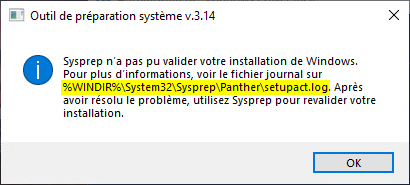

Pour en avoir le coeur net, ouvrez le fichier LOG mentionné dans le message, puis allez vers la fin du fichier et portez attention aux erreurs. Si vous avez un message du type: "Package nomdupackage was installed for a user, but not provisioned", vous pouvez copier le nom du package (avant la version).

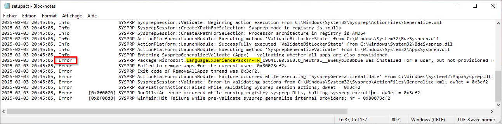

Puis désinstallez l'application dans une console PowerShell en mettant une * après le nom. Comme ceci:

<ConsoleWindow title="Administrateur: Windows PowerShell" backgroundColor="#012456" >
```text
PS C:\> Get-AppxPackage -AllUsers "Microsoft.LanguageExperiencePackfr-FR*" | Remove-AppxPackage -AllUsers
```
</ConsoleWindow>

Puis relancez sysprep. Il se pourrait que vous deviez répéter l'opération avec d'autres paquets. Prenez-les en note, au cas où vous deviez recommencer.

**N'oubliez pas de prendre un snapshot après que Sysprep ait réussi et éteint la machine.**
:::

## Tester l'image

Puisque Sysprep a préparé le système pour le clonage, si vous démarrez la même machine, elle se comportera comme un nouveau système. Mais le clonage est une opération assez longue. Vous pouvez donc sauver du temps et démarrer la VM d'origine pour tester (elle se comportera de la même manière qu'une VM clonée). 

Vous pouvez voir les différentes étapes de l'installation:

- Passe de spécialisation (écran noir)
  - Détection du matériel
  - Détermination du nom d'hôte
  - Jonction au domaine
  - Lancement des commandes pour réactiver le compte administrateur
- Redémarrage
- Passe oobeSystem (écran bleu)
  - Configuration de la langue et du fuseau horaire
  - Automatisation des questions d'installation (vie privée, télémétrie, etc.)
- Terminé! On peut maintenant se loguer!

Si vous êtes capable de vous loguer avec un compte du domaine, votre modèle est fonctionnel. Vous pouvez maintenant procéder au clonage. Vous n'avez qu'à restaurer le snapshot "après Sysprep" et poursuivre.

## Capturer l'image

C'est le moment de procéder à la capture.

:::danger
Il ne faut surtout pas démarrer Windows à cette étape-ci. Windows se réinstallera complètement dès son prochain redémarrage. C'est ce qu'on appelle la spécialisation. Donc jusqu'au prochain démarrage, Windows est dans un état transitoire, et c'est dans cet état qu'on veut capturer l'image.

Si vous démarrez Windows par accident, vous devez restituer le **snapshot après Sysprep**.
:::

Pour capturer l'image, il faut booter cette machine dans WinPE. Pour ce faire, dans l'interface vSphere, connectez le fichier ISO au lecteur DVD virtuel.

Bootez votre VM avec le **ISO WinPE** que vous avez généré précédemment. Il sera sous la banque de données **share-etudiants**.

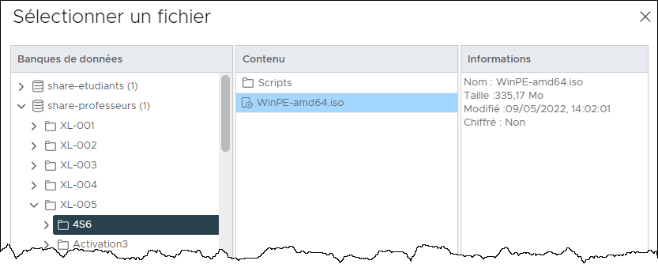

Puis, démarrez la VM dans le firmware et choisissez de booter sur le lecteur DVD virtuel. Cela aura pour effet de démarrer dans Windows PE, ce qui vous présentera seulement une ligne de commande.

<center>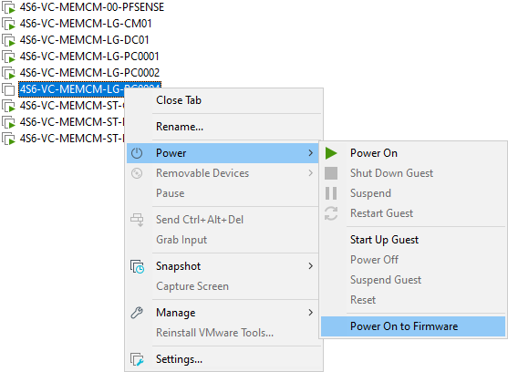</center>

Dans Windows PE, connectez-vous sur un partage réseau où vous possédez des droits d'écriture, afin de sauvegarder le fichier WIM capturé.

<ConsoleWindow title="Administrator: X:\windows\system32\cmd.exe" foregroundColor="lightgray" >
```text
¶(#aaaaaa)X:\Windows\System32>¶ ¶(yellow)net use z: \\lg-cmps\d$¶
Enter the user name for 'lg-cmps': DOMAINE\Administrateur
Enter the password for lg-cmps:
The command completed successfully.
```
</ConsoleWindow>

Puis procédez à la capture de l'image à l'aide de la commande DISM.

```cmd
dism.exe /capture-image /imagefile:z:\chemin\vers\win10_capture.wim /capturedir:c:\ /name:win10_capture
```

<ConsoleWindow title="Administrator: X:\windows\system32\cmd.exe" foregroundColor="lightgray" wrap="none">
```text
¶(#aaaaaa)X:\Windows\System32>¶ md Z:\OS\Capture

¶(#aaaaaa)X:\Windows\System32>¶ ¶(yellow)dism /capture-image /imagefile:Z:\OS\Capture\Win10_capture.wim /capturedir:D:\ /name:Win10_Capture¶

Deployment Image Servicing and Management tool
Version: 10.0.25398

Saving image
[==========================100.0%==========================]
The operation completed successfully.
```
</ConsoleWindow>

<details>
<summary>Légende - dism.exe</summary>
| Option | Description |
| --- | --- |
| **/capture-image** | Indique que la commande sera utilisée pour effectuer une capture d'image |
| **/imagefile** | Le chemin complet du fichier WIM à produire |
| **/capturedir** | Le chemin racine de l'installation de Windows à capturer |
| **/name** | Le nom de l'image |
</details>

À ce point-ci, votre image personnalisée a été capturée en WIM. Il ne vous reste qu'à l'appliquer sur des machines.


## Appliquer l'image

Avant toute chose, sur votre **serveur de site primaire SCCM**, [:link: suivez ce lien](https://learn.microsoft.com/fr-ca/windows-hardware/manufacture/desktop/oem-deployment-of-windows-desktop-editions-sample-scripts?view=windows-10) et **téléchargez les exemples de scripts** (le lien est vers le début de l'article). Copiez le contenu du répertoire **Deployment** contenu dans le fichier Zip (2 fichiers .bat  et 8 fichiers .txt) dans un répertoire partagé sur le serveur. Pour simplifier, vous pouvez le mettre n'importe où sur le disque du serveur puisque vous pourrez y accéder par les partages administratifs (D$).

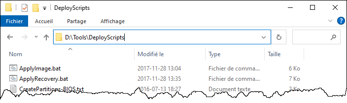

Créez une **nouvelle VM dans Labinfo**, pour y tester votre nouvelle image. Connectez un adapteur **VMXNET3** à votre réseau **Longueuil-PDT**. N'installez pas de système d'exploitation et n'utilisez pas un modèle de VM.

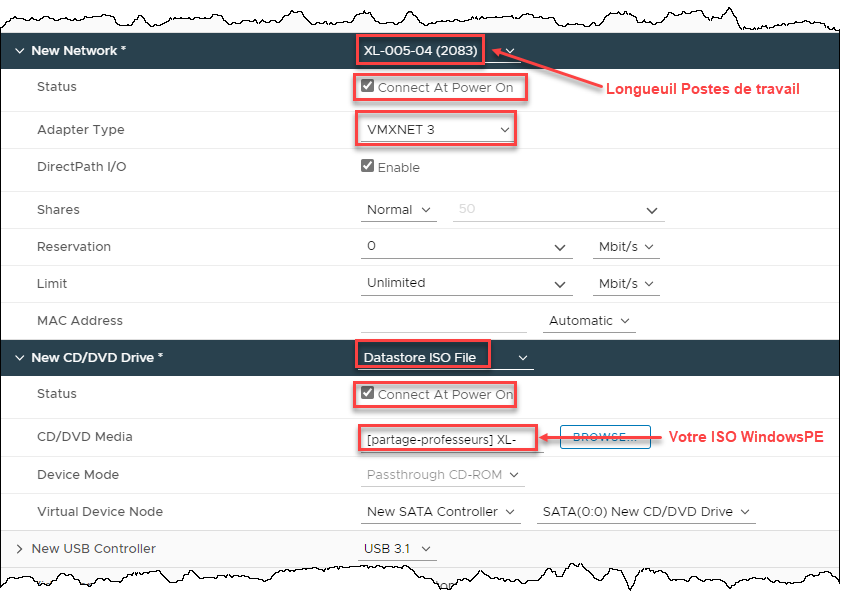

Bootez votre VM avec le **ISO WinPE** que vous avez généré précédemment (même procédé qu'à l'étape précédente). Mappez un lecteur réseau sur un chemin partagé dans votre réseau afin d'accéder à l'image à appliquer. Déplacez-vous dans le répertoire où se trouve les scripts de déploiement et lancez la commande suivante:

```cmd
ApplyImage.bat Z:\chemin\vers\win10_capture.wim
```

<ConsoleWindow title="Administrator: X:\windows\system32\cmd.exe" foregroundColor="lightgray" >
```text
¶(#aaaaaa)X:\Windows\System32>¶ ¶(yellow)net use z: \\lg-cmps\d$¶
Enter the user name for 'lg-cmps': DOMAINE\Administrateur
Enter the password for lg-cmps:
The command completed successfully.


X:\Windows\System32> Z:

Z:\> cd Tools\DeployScripts

Z:\Tools\DeployScripts> ¶(yellow)ApplyImage.bat Z:\OS\Capture\Win10_capture.wim¶

¶(#aaaaaa)(...)¶
```
</ConsoleWindow>

Le script vous posera quelques questions. Il faut répondre avec un N ou un Y majuscule:

| Question | Réponse |
| --- | --- |
| Ajouter la partition de restauration (recovery)? | **N** |
| Confirmer que le disque sera effacé? | **Y** |
| Déployer Compact OS (avec compression)? | **N** |
| Extended Attributes? | **N** |

:::info Remarque
L'application de l'image se fait à l'aide d'une commande Dism assez simple. Ce qui est plus complexe, par contre, c'est la configuration des partitions, puisqu'une image Wim ne décrit que la partition système de Windows (le C:\). C'est pourquoi je vous encourage à utiliser ce script, qui automatise ce processus.
:::

Finalement, lancez la commande `exit` pour redémarrer.

Windows devrait s'installer sur la VM sans aucune interaction, être membre du domaine, posséder un compte admin local et avoir les VMware Tools et 7-Zip préinstallés.

:::info Dépannage
Si pendant le processus de spécialisation de Windows (après le redémarrage) vous obtenez un message d'erreur ou que la machine reste coincée sur un écran noir indéfiniment, il est probable que l'image soit corrompue ou que le fichier **unattend.xml** comporte des erreurs. Si ça vous arrive, restituez le snapshot avant Sysprep, vérifiez le contenu de **unattend.xml** (surtout les informations de jonction au domaine: nom distinctif de l'OU, mot de passe du compte de jonction, etc.) et refaites un Sysprep avec le nouveau fichier.

Pour accélérer le testage, vous pouvez simplement faire un nouveau snapshot après Sysprep et redémarrer la même VM, ça évite de devoir recapturer et réappliquer.
:::
