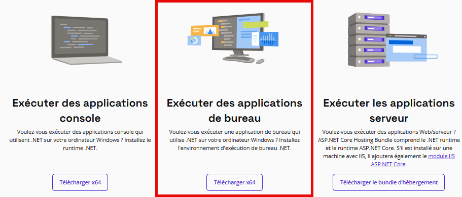
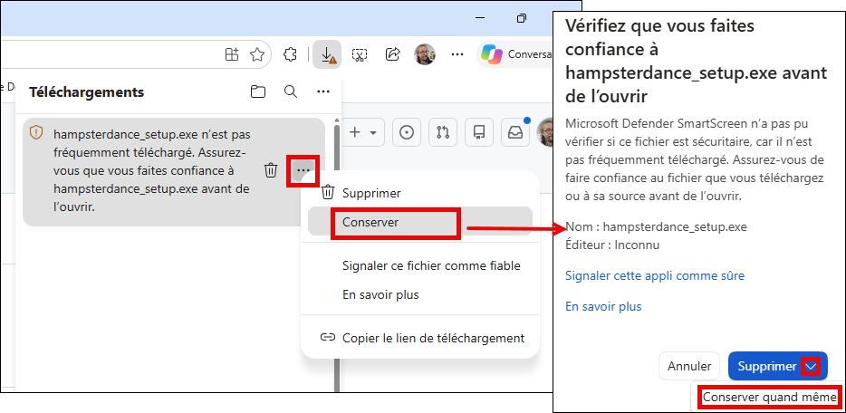

Dans ce travail valant **15%** de la note, vous devez démontrer au professeur que vous êtes en mesure de procéder au déploiement d'applications.

## Éléments évalués

### Infrastructure

Vous devez avoir installé votre point de distribution dans le site de Saint-Trou tel qu'indiqué dans le laboratoire 07.

### Applications

Vous devez créer deux applications dans SCCM. Pour les commandes d'installation et de désinstallation et les méthodes de détection, vous pouvez rechercher sur Google ou sur l'IA ou encore utiliser les outils d'analyse vus en classe. Vous devez utiliser [PSAppDeployToolkit version 4](https://psappdeploytoolkit.com/) pour les deux applications.

Toutes ces applications doivent être distribuées sur les deux points de distribution.

#### Windows Desktop Runtime 8.0

- Lien pour le téléchargement: :link: https://dotnet.microsoft.com/fr-fr/download/dotnet/8.0/runtime
- Télécharger le package pour exécuter des **applications de bureau**

#### HampsterDance 1.0

- Lien pour le téléchargement: :link: https://github.com/vcarrier/hampsterdanceapp/releases/latest
- Création d'un raccourci sur le bureau
- Dépendance: Windows Desktop Runtime 8.0
  - Si les runtimes ne sont pas installés, faites en sorte qu'ils soient installés automatiquement au moment de l'installation de HampsterDance

:::warning
Il se pourrait que votre navigateur vous donne une alerte de sécurité lorsque vous tenterez de télécharger HampsterDance 1.0, car cette application est (tristement) méconnue du grand public. Ignorez simplement les mises en gardes et optez pour conserver le paquet d'installation.

:::

### Déploiement

L'application **HampsterDance** doit être déployée dans un regroupement de machines qui contient **tous les postes de travail** de votre environnement de façon à ce qu'elle puisse être installée à la demande de l'utilisateur par le **Centre Logicie**l.

Ne déployez pas Windows Desktop Runtimes; celle-ci sera installée automatiquement via la dépendance.

## Déroulement de l'évaluation

Vous avez jusqu'au cours 8 pour montrer votre travail au professeur. Pour la correction, vous devez préparer les éléments suivants:

- Sur un poste de Saint-Trou:
  - Démonstration de l'installation de HampsterDance via le Centre Logiciel
  - Le log CAS.LOG dans CMTrace
  - Démonstration du lancement de HampsterDance à partir du menu Démarrer
  - Démonstration de la désinstallation de HampsterDance via le Centre Logiciel
- Sur le serveur SCCM
  - Les propriétés des applications HampsterDance 1.0 et Windows Desktop Runtime 8.0
  - Le répertoire contenant les fichiers sources des deux applications
  - Les propriétés du déploiement de HampsterDance
  - Les membres du regroupement
  - Le log distmgr.log dans CMTrace
  - Le contenu du répertoire C:\Windows\ccmcache\
- Sur le point de distribution
  - La console IIS
  - La racine du lecteur D:\

## Critères d'évaluation

| Critère                                           | Pondération   | *A*   | *B*   | *C*   | *D*   | *E*   |
| :------------------------------------------------ | :------------ | ----- | ----- | ----- | ----- | ----- |
| [Application: Desktop Runtime](#crit-runtimes)    | 4 points      | *4,0* | *3,2* | *2,4* | *1,6* | *0,0* |
| [Application: HampsterDance](#crit-hampster)      | 5 points      | *5,0* | *4,0* | *3,0* | *2,0* | *0,0* |
| [Déploiement de l'application](#crit-deploiement) | 2 points      | *2,0* | *1,6* | *1,2* | *0,8* | *0,0* |
| [Point de distribution de St-Trou](#crit-dp)      | 3 points      | *3,0* | *2,4* | *1,8* | *1,2* | *0,0* |
| **Total**                                         | **15 points** |       |       |       |       |       |

Légende

| Niveau                          | Description                                               | Coefficient |
| :------------------------------ | :-------------------------------------------------------- | ----------- |
| **A** *(Excellent)*             | Tous les critères sont respectés avec pas ou peu d'erreur | 1,0         |
| **B** *(Bien)*                  | Quelques erreurs mais répond au besoin dans l'ensemble    | 0,8         |
| **C** *(Passable)*              | Ne répond pas à l'entièreté des critères                  | 0,6         |
| **D** *(Problématique)*         | Seule une minorité des objectifs sont atteints            | 0,4         |
| **E** *(Nettement insuffisant)* | Ne répond pas du tout ou très peu au besoin               | 0,0         |

### Application: Desktop Runtime (4 pts) {#crit-runtimes}

- Les fichiers source sont corrects et bien organisés
- La commande d'installation est correcte
- La commande de désinstallation est correcte
- La méthode de détection est correcte
- L'installation est fonctionnelle
- L'application est distribuée sur tous les points de distribution
- Utilisation correcte de PSADT

### Application: HampsterDance (5 pts) {#crit-hampster}

- Les fichiers source sont corrects et bien organisés
- La commande d'installation est correcte
- Un raccourci vers l'application est créé sur le bureau
- La commande de désinstallation est correcte
- La méthode de détection est correcte
- La dépendance est correctement configurée
- L'application est distribuée sur tous les points de distribution
- Utilisation correcte de PSADT

### Déploiement de l'application (3 pts) {#crit-deploiement}

- Le regroupement est correctement configuré
- Il contient tous les postes de travail et seulement les postes
- L'application HampsterDance est correctement déployée
- Le déploiement est en mode Disponible

### Point de distribution (3 pts) {#crit-dp}

- Le client SCCM y est correctement installé
- Un disque secondaire existe et porte la lettre D:\
- Le rôle de point de distribution est fonctionnel
- Son nom d'hôte et sa configuration sont conformes au devis
- Il dessert correctement le groupe de limites de Saint-Trou
