## Méthode graphique

- [ ] Tout d'abord, vous devez installer le système d'exploitation Windows Server 2022 sur une machine virtuelle. 

> *Vous pouvez cloner le modèle `MODELE_WindowsServer2022_Datacenter_x64_FR`.*

- [ ] Configurez l'adresse IP de votre serveur. Un contrôleur de domaine doit obligatoirement avoir une adresse IP statique. (Raccourci: ncpa.cpl)

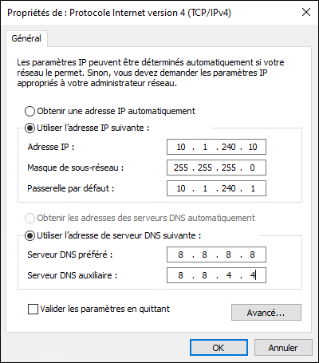

:::tip
Si vous configurez des résolveurs DNS, ceux-ci seront automatiquement enregistrés comme redirecteurs lors de l'installation du service DNS.
:::

- [ ] Renommez votre serveur. Un redémarrage du système sera nécessaire. (Raccourci: sysdm.cpl)

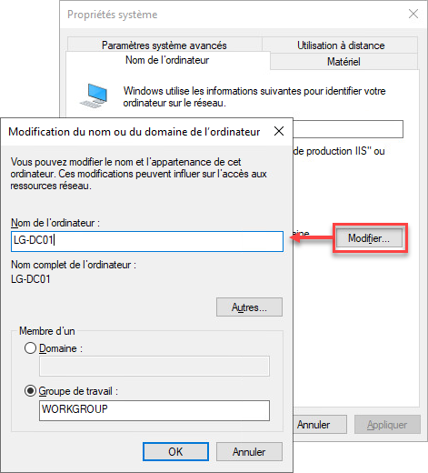

- [ ] Installez le rôle Services AD DS à partir du gestionnaire de serveur. Choisissez d'installer les consoles également.

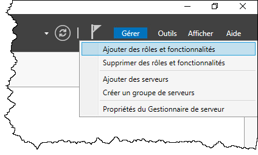

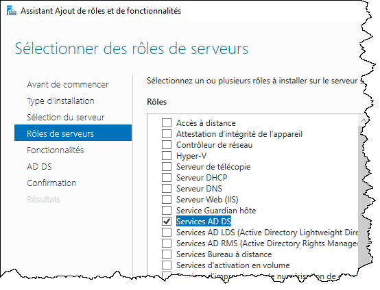

- [ ] Une fois les services installés, effectuez la promotion du serveur en contrôleur de domaine.

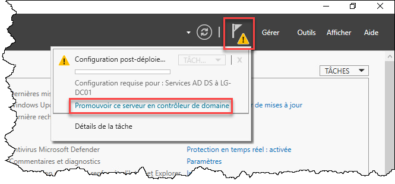

- [ ] Choisissez d'ajouter une nouvelle forêt et donnez-lui son nom de domaine.

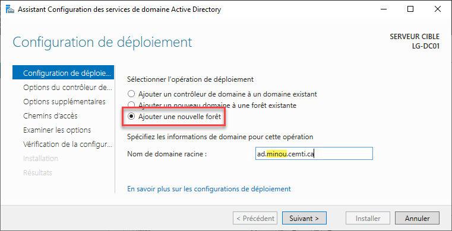

- [ ] Entrez un mot de passe de récupération (DSRM)

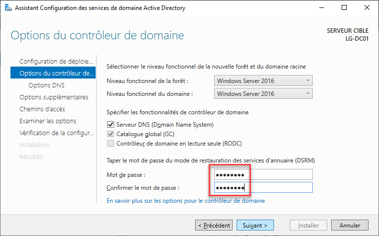

- [ ] Vous ne pourrez pas créer une délégation DNS, car vous êtes dans un environnement isolé. C'est normal.

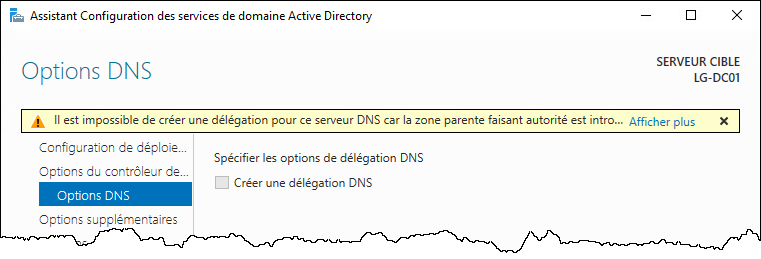

- [ ] Entrez le nom de domaine NetBIOS. Par défaut, le premier bloc de l'adresse DNS est suggéré, mais vous pouvez le changer. Essayez de trouver le nom qui décrit le mieux votre domaine.

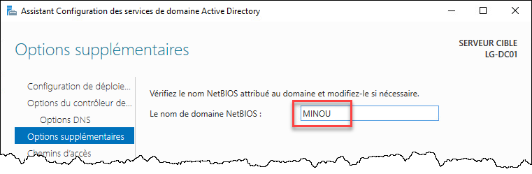

- [ ] Vous avez la possibilité de changer les chemins d'accès. Gardez les options par défaut.

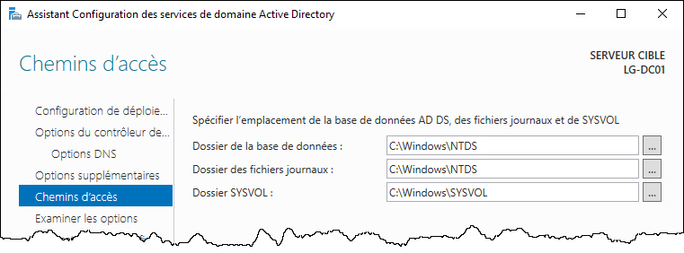

- [ ] Vous pouvez ensuite passer en revue les différentes options sélectionnées avant les appliquer.

:::tip
Vous pouvez cliquer sur "Afficher le script" pour voir comment le faire en PowerShell.

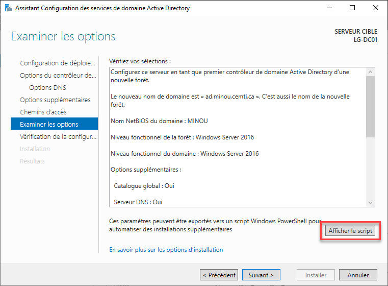
:::

- [ ] Passez en revue les avertissements. Puis cliquez sur Installer. Votre serveur redémarrera après l'opération.

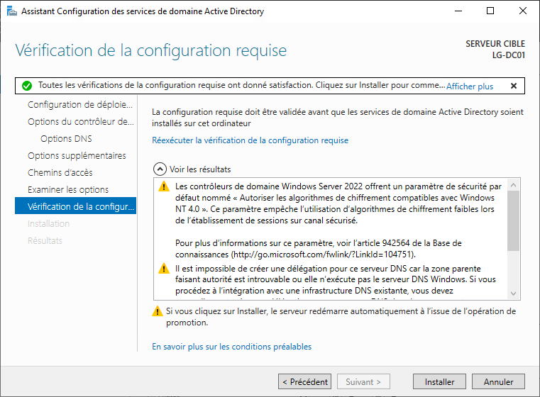

## Méthode PowerShell

Il est possible de joindre une machine au domaine avec des commandes PowerShell.

- [ ] D'abord, si la machine doit posséder une adresse IP statique, vous pouvez configurer la carte réseau.

```powershell
New-NetIPAddress -IPAddress "10.1.240.10" -PrefixLength 24 -AddressFamily "IPv4" `
            -DefaultGateway "10.1.240.1" -InterfaceAlias "Ethernet0"

Set-DnsClientServerAddress -InterfaceAlias "Ethernet0" ` 
            -ServerAddresses "8.8.8.8", "8.8.4.4"
```

- [ ] Avant d'effectuer la promotion, il faut d'abord installer le rôle.

```powershell
Install-WindowsFeature -Name AD-Domain-Services -IncludeManagementTools
```

- [ ] Pour effectuer la promotion, la commande est assez complexe. Mais vous pouvez générer un script en passant par l'interface graphique.

```powershell
Import-Module -Name ActiveDirectory

$ForestParams = @{
    DomainName = 'ad.minou.cemti.ca'
    DomainNetbiosName = 'CEMTI'
    SafeModeAdministratorPassword = ConvertTo-SecureString "Passw0rd" -AsPlainText -Force
    CreateDnsDelegation = $false
    DatabasePath = 'C:\Windows\NTDS'
    DomainMode = 'WinThreshold'
    ForestMode = 'WinThreshold'
    InstallDns = $true
    LogPath = 'C:\Windows\NTDS'
    NoRebootOnCompletion = $true
    SysvolPath = 'C:\Windows\SYSVOL'
    Force = $true
}

Install-ADDSForest @ForestParams

Restart-Computer
```
