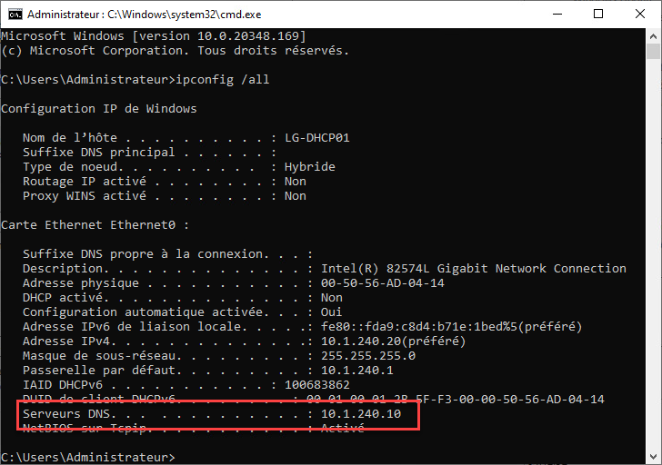
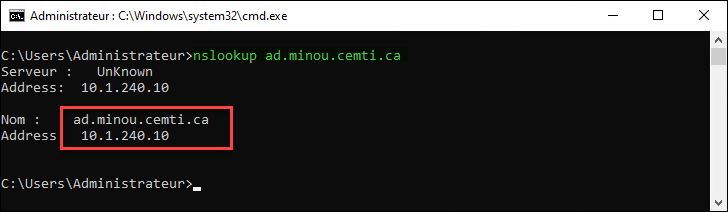
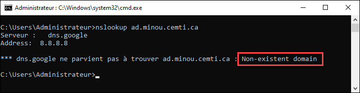
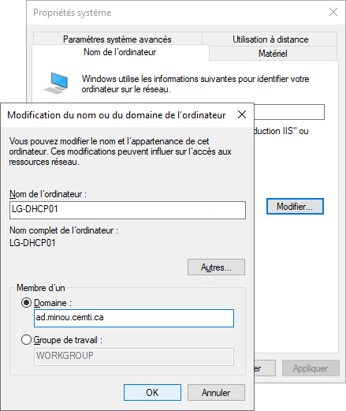
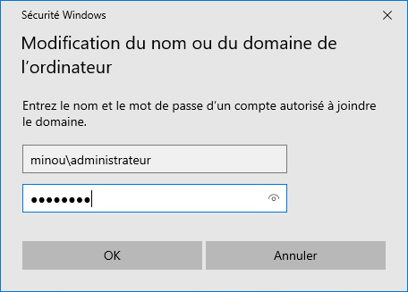
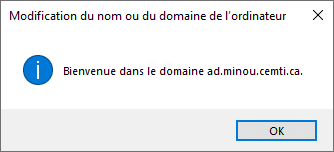
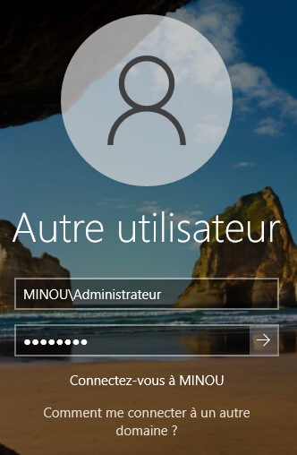

## Méthode graphique

Pour joindre une machine au domaine, il est impératif de pouvoir résoudre le nom du domaine. Vos contrôleurs de domaine généralement des serveurs DNS qui sont autoritaires de la zone de votre domaine Active Directory, alors on désigne un contrôleur de domaine (ou plusieurs) comme résolveur DNS.

:::warning Attention!
Ne mettez pas de serveurs publics (comme 8.8.8.8) comme résolveur secondaire!
:::



Il est également possible de tester la résolution de domaine avec la commande nslookup.



Si la requête donne une erreur, la configuration DNS est déficiente.



Pour joindre la machine au domaine, il suffit d'aller dans les propriétés système (sysdm.cpl) et inscrire le nom DNS du domaine. 



Vous devrez vous authentifier à l'aide d'un compte du domaine autorisé.



Vous obtiendrez un message de confirmation, puis votre machine devra redémarrer.



Vous êtes maintenant en mesure de démarrer une session à l'aide d'un compte du domaine.

:::info Ouverture de session en admin du domaine
Pour démarrer une session avec le compte Administrateur du domaine, il faut spécifier le nom du domaine. Sans le nom de domaine, l'authentification se fera avec le compte Administrateur local.


:::

## Méthode PowerShell

Vous pouvez utiliser PowerShell pour tester si le domaine est accessible.

```powershell
Resolve-DnsName -Name "ad.minou.cemti.ca"
```

Lorsque tout est conforme, il vous suffit de lancer la commande PowerShell suivante pour effectuer la jonction du domaine. En spécifiant l'argument -NewName, vous renommez la machine en même temps.

```powershell
Add-Computer -NewName LG-PC0001 -DomainName ad.minou.cemti.ca -Restart
```

Vous pouvez même spécifier l'OU dans lequel le compte ordinateur sera créé. Vous devez le fournir sous forme de chemin DistinguishedName.

```powershell
Add-Computer -DomainName ad.minou.cemti.ca -OUPath "OU=Test,DC=ad,DC=minou,DC=cemti,DC=ca"
```
