## Méthode graphique

Sur le serveur qui offrira le service DHCP, dans le gestionnaire de serveur, ajoutez le rôle de serveur DHCP.


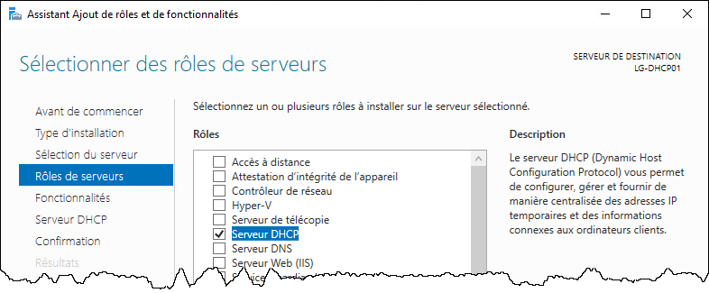

Ouvrez le gestionnaire DHCP à partir du gestionnaire de serveur (ou avec la commande dhcpmgmt.msc)

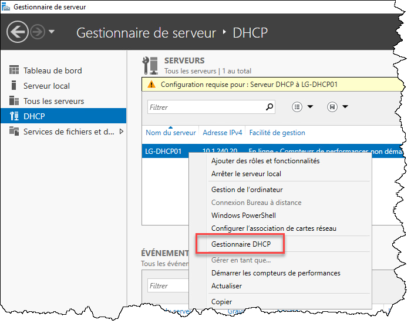

Assurez-vous que le serveur DHCP est autorisé. Si vous voyez des flèches rouges par-dessus l'icône dans l'arborescence, cliquez-droit sur le serveur et sélectionnez Autoriser.

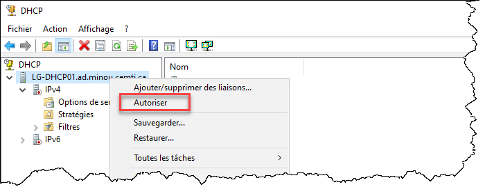

Cliquez-droit sur IPv4 et créez une nouvelle étendue.

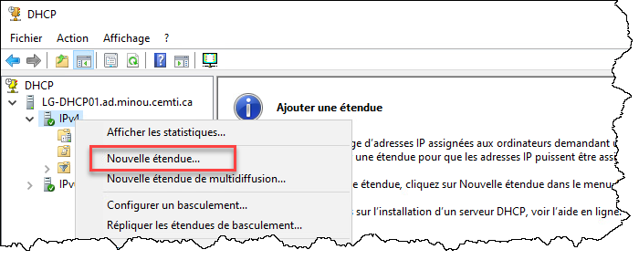

Donnez un nom qui représente l'étendue.

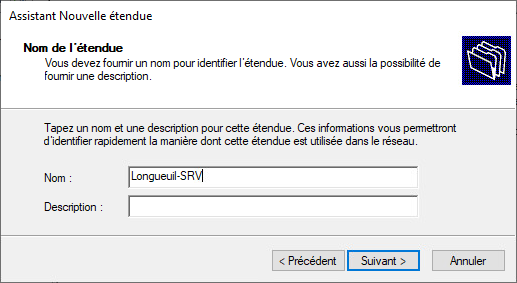

Définissez la plage d'adresses et le masque de sous-réseau. Il est bon de laisser quelques adresses hors de l'étendue au début ou à la fin, pour les machines qui doivent avoir une adresse IP statique (passerelle, serveurs, etc.)

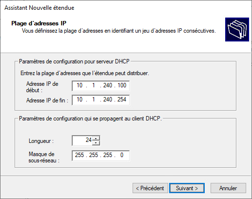

Vous pouvez exclure certaines adresses, si nécessaire.

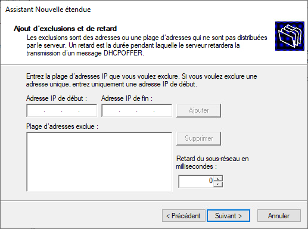

Vous pouvez aussi modifier la durée du bail, au besoin.

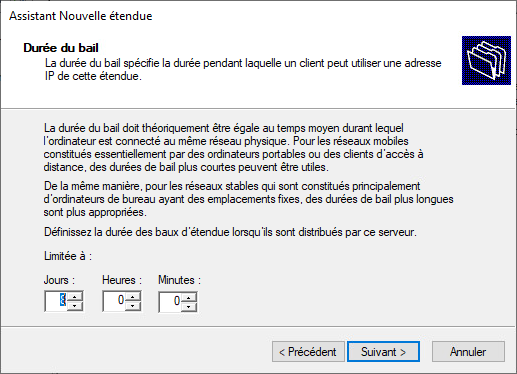

En plus de l'adresse IP, une étendue DHCP envoie d'autres options aux clients, comme l'adresse de la passerelle par défaut, les résolveurs DNS et le suffixe de domaine. Vous pouvez les configurer maintenant.

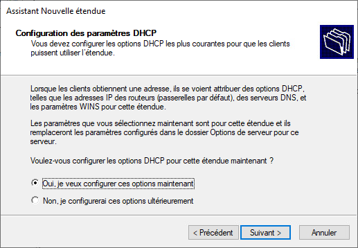

Ajoutez la passerelle par défaut

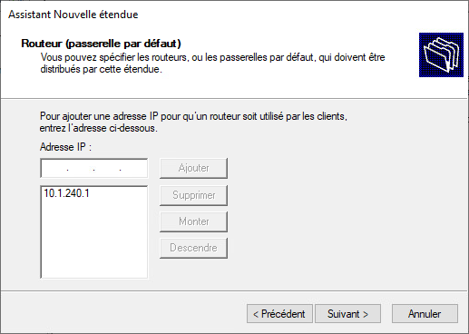

Ajoutez le nom de votre domaine Active Directory ainsi que l'adresse IP de vos contrôleurs de domaine.

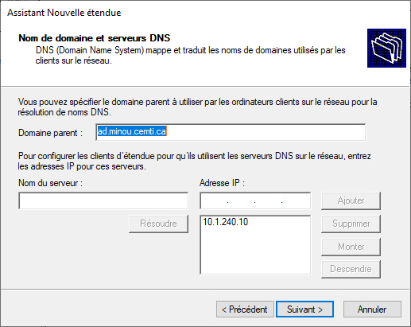

Si vous n'avez pas de serveur WINS, sautez cette section.

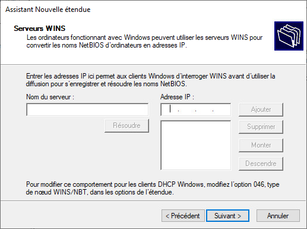

Vous pouvez activer l'étendue immédiatement.

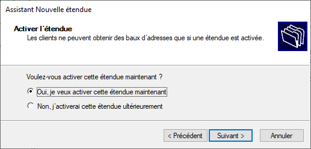

Vous pouvez voir les options dans la console de gestion DHCP.

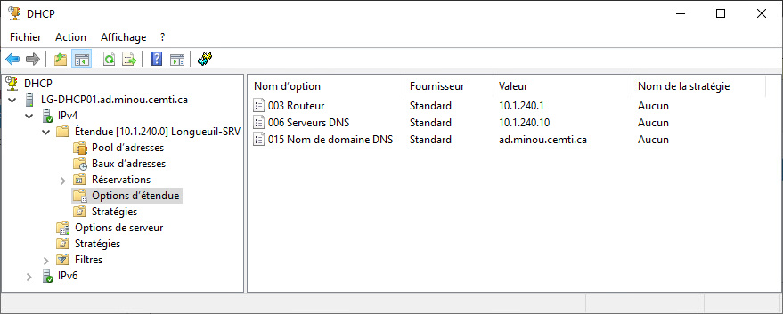

Pour tester, connectez une machine dans le réseau desservi par le serveur DHCP et configurez son interface réseau pour l'adressage automatique DHCP. Si l'adresse ne change pas, vous pouvez faire la commande ipconfig /renew pour forcer un renouvellement.


## Méthode PowerShell

Installer le rôle DHCP avec sa console de gestion.

```powershell
Install-WindowsFeature -Name DHCP -IncludeManagementTools
```

Il faut ensuite s'assurer de charger le module DHCP, c'est lui qui contient les commandes DHCP.

```powershell
Import-Module DhcpServer
```

Autoriser le serveur DHCP dans Active Directory (doit être lancé par un admin du domaine).

```powershell
Add-DhcpServerInDC -DnsName LG-DHCP01.ad.minou.cemti.ca -IPAddress 10.1.240.20
```

Activer les mises à jour DNS automatiques.

```powershell
Set-DhcpServerv4DnsSetting -DynamicUpdates Always -DeleteDnsRRonLeaseExpiry $True
```

Créer une étendue, mais la mettre inactive pour le moment.

```powershell
$DhcpScopeSplat = @{
    Name       = "Longueuil-SRV"
    StartRange = "10.1.240.100"
    EndRange   = "10.1.240.254"
    SubnetMask = "255.255.255.0"
    State      = "Inactive"
}

Add-DhcpServerv4Scope @DhcpScopeSplat
```

Obtenir la liste des étendues configurées. Notez la valeur de ScopeId, vous en aurez besoin dans les prochaines commandes.

```powershell
Get-DhcpServerv4Scope
```

Configurer les options 3 (routeur), 6 (résolveur DNS) et 15 (nom de domaine) de l'étendue

```powershell
$DhcpOptionsSplat = @{
    ScopeId   = "10.1.240.0"
    Router    = "10.1.240.1"
    DnsServer = "10.1.240.10"
    DnsDomain = "ad.minou.cemti.ca"
}

Set-DhcpServerv4OptionValue @DhcpOptionsSplat
```

Activer l'étendue DHCP

```powershell
Set-DhcpServerv4Scope -ScopeId 10.1.240.0 -State Active
```

Enlever la notification dans le gestionnaire de serveur qui dit que le serveur DHCP n'est pas configuré

```powershell
$Splat = @{
    Path = "HKLM:\SOFTWARE\Microsoft\ServerManager\Roles\12"
    Name = "ConfigurationState"
    Value = 2
}

Set-ItemProperty @Splat
```
