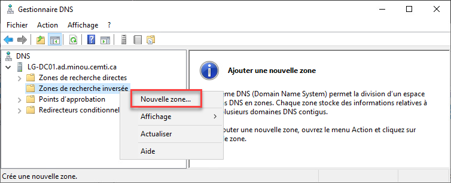
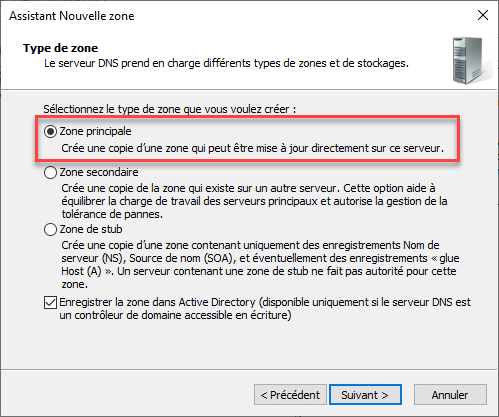
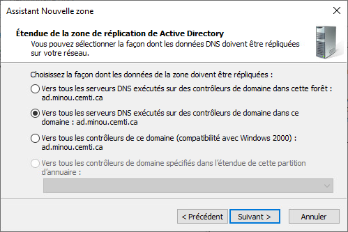
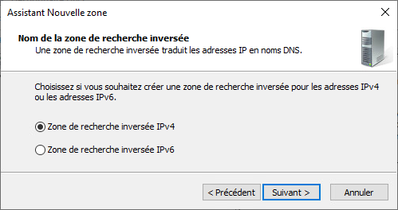
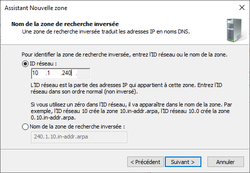
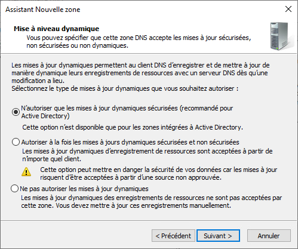
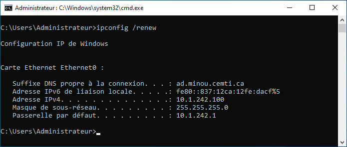
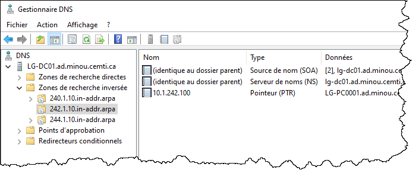

## Méthode graphique

Pour configurer une zone de recherche inversée, ouvrez le gestionnaire DNS, accessible par le gestionnaire de serveur (ou par la commande dnsmgmt.msc)



Sélectionnez une zone principale.



Si votre service DNS est lié à un domaine Active Directory, vous avez généralement avantage à répliquer la zone sur tous les contrôleurs de domaine.



Choisissez IPv4.



Ensuite, il faut entrer les trois premiers blocs d'adressage IP. L'assistant se chargera de traduire cette entrée en nom de zone inversée (C.B.A.in-addr.arpa).



Les machines membres du domaine vont mettre à jour dynamiquement leur enregistrement PTR en s'authentifiant avec leur compte machine. Si toutes les machines sont membres du domaine, vous pouvez choisir de n'autoriser que les mises à jour sécurisée, c'est-à-dire que chaque machine ne sera autorisée à modifier sa propre entrée.



La zone maintenant configurée, il suffit de rafraîchir le bail DHCP pour que l'enregistrement PTR soit créé dynamiquement.



Vous pouvez le voir dans la console DNS.



## Méthode PowerShell

On peut créer une zone de recherche inversée simplement en lançant cette commande PowerShell.

```powershell
Add-DnsServerPrimaryZone -NetworkID "10.1.240.0/24" -ReplicationScope "Domain"
```
