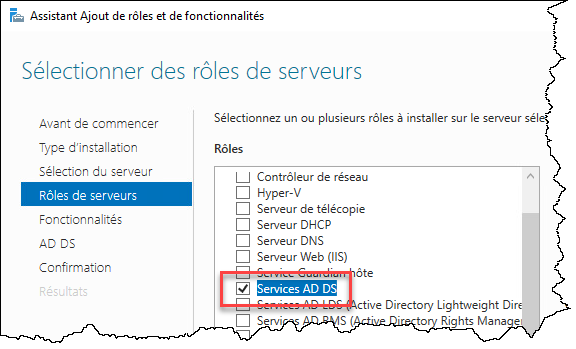
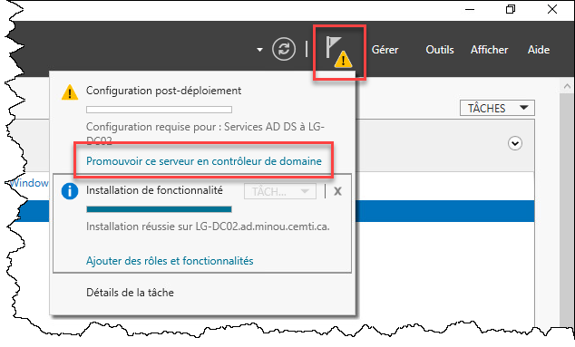
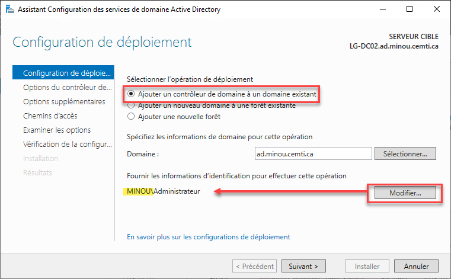
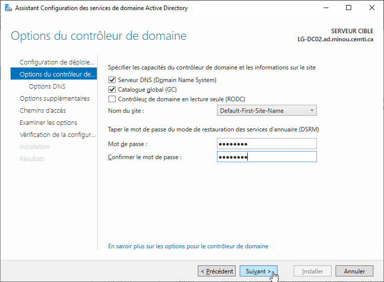
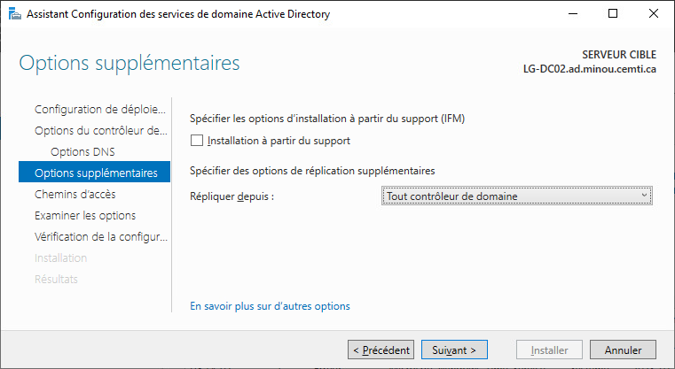
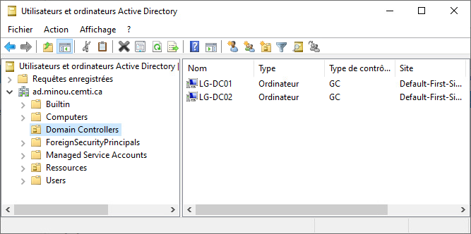

## Méthode graphique

Pour ajouter un contrôleur de domaine, vous devez tout d'abord:

- Installer un serveur Windows (ne pas cloner un contrôleur de domaine existant)
- Lui donner un nom d'hôte pertinent
- Joindre ce serveur au domaine

Puis, vous pouvez le préparer pour sa promotion. Pour ce faire, installez le rôle Active Directory Domain Services.



Une fois l'installation terminée, démarrez l'assistant de promotion.



Assurez-vous de sélectionner Ajouter un contrôleur de domaine à un domaine existant. Spécifiez aussi le nom d'utilisateur et le mot de passe d'un compte utilisateur du domaine (comme le compte DOMAINE\Administrateur, par exemple).



Définissez un mot de passe de restauration (avec l'espoir qu'on n'ait jamais besoin de l'utiliser)…



Finalement, vous pouvez spécifier quel contrôleur de domaine utiliser pour la réplication initiale. Pour l'instant, cela importe peu, alors laissez l'option par défaut.



La machine redémarrera, et ensuite, elle sera un contrôleur de domaine. On peut le voir dans la console Utilisateurs et ordinateurs Active Directory.



## Méthode PowerShell

Tout d'abord, joignez la machine au domaine, puis démarrez une session avec un compte utilisateur du domaine.

Installez le rôle Active Directory Domain Services:

```powershell
Install-WindowsFeature –Name AD-Domain-Services –IncludeManagementTools
```

Puis, faites la promotion du serveur en contrôleur de domaine:

```powershell
Install-ADDSDomainController –InstallDns –DomainName ad.minou.cemti.ca
```

Liens intéressants

    Install-WindowsFeature (ServerManager) | Microsoft Learn
    
    Install-ADDSDomainController (ADDSDeployment) | Microsoft Learn


