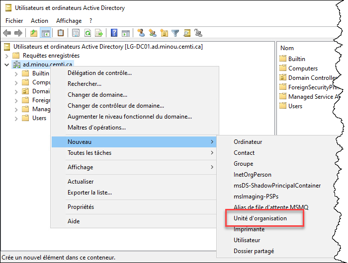
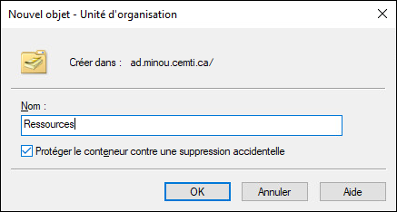

Une unité d'organisation (organizational unit en anglais, ou OU en abrégé) est un conteneur servant à organiser des objets dans Active Directory.

## Méthode graphique

Pour créer une unité d'organisation, il suffit d'ouvrir la console Utilisateurs et ordinateurs Active Directory (dsa.msc) et de procéder à la création à partir du menu contextuel du conteneur où créer le nouvel objet.



Donnez un nom à votre unité d'organisation. Vous pouvez aussi protéger cet objet contre la suppression accidentelle.



## Méthode PowerShell

Pour créer une OU avec PowerShell, utilisez cette commande en spécifiant le nom de l'OU ainsi que le chemin vers le conteneur où le créer, en format Distinguished Name.

```powershell
New-ADOrganizationalUnit -Name "Ressources" -Path "DC=ad,DC=minou,DC=cemti,DC=ca"
```

Liens intéressants:

New-ADOrganizationalUnit (ActiveDirectory) | Microsoft Learn

