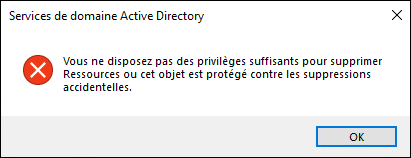
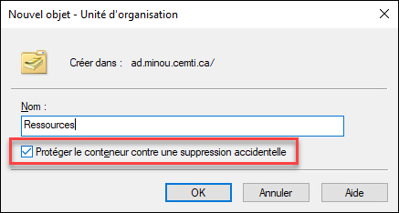
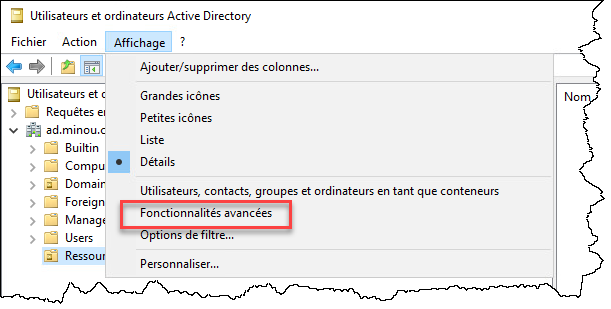
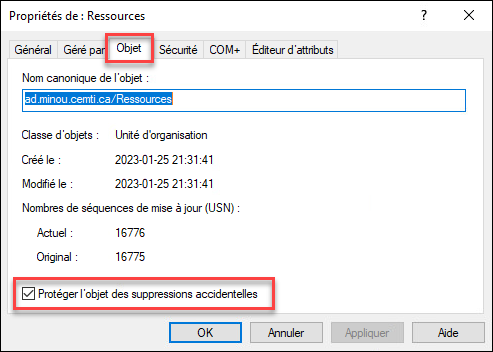

## Méthode graphique

Lorsque vous tentez de supprimer une unité d'organisation dans Active Directory, il se peut que vous obteniez cette erreur.



Si votre compte possède bel et bien toutes les autorisations pour supprimer des objets (par exemple, il est admin du domaine), alors il y a de fortes chances que l'objet soit protégé contre la suppression accidentelle. C'est une protection qui est activée par défaut lorsqu'on crée une OU.



Pour désactiver cette protection, il vous faut d'abord activer les fonctionnalités avancées dans votre console.



Puis dans les propriétés de l'objet que vous tentez de supprimer, sous l'onglet Objet, désactivez la protection. Vous pourrez ensuite le supprimer à partir de la console.



## Méthode PowerShell

Pour désactiver la protection en utilisant PowerShell:

```powershell
Get-ADOrganizationalUnit -Identity "OU=Ressources,DC=ad,DC=minou,DC=cemti,DC=ca" |
    Set-ADObject -ProtectedFromAccidentalDeletion:$false
```

Puis pour supprimer l'OU:

```powershell
Get-ADOrganizationalUnit -Identity "OU=Ressources,DC=ad,DC=minou,DC=cemti,DC=ca" |
    Remove-ADOrganizationalUnit
```

On peut aussi faire les deux en même temps!

```powershell
Get-ADOrganizationalUnit -Identity "OU=Ressources,DC=ad,DC=minou,DC=cemti,DC=ca" |
    Set-ADObject -ProtectedFromAccidentalDeletion:$false -PassThru |
        Remove-ADOrganizationalUnit
```

Liens intéressants:

    How to Delete Protected OU in Active Directory? – TheITBros


