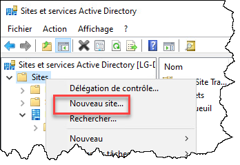
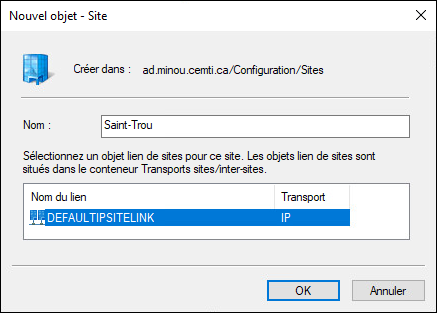
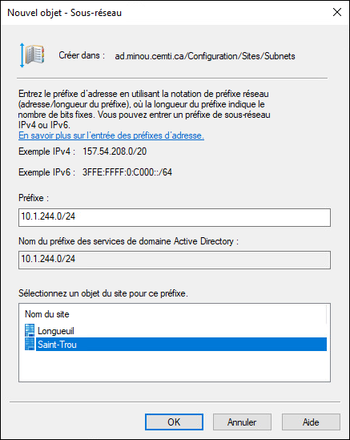
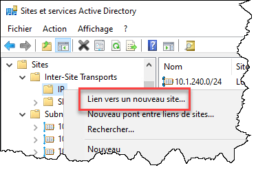
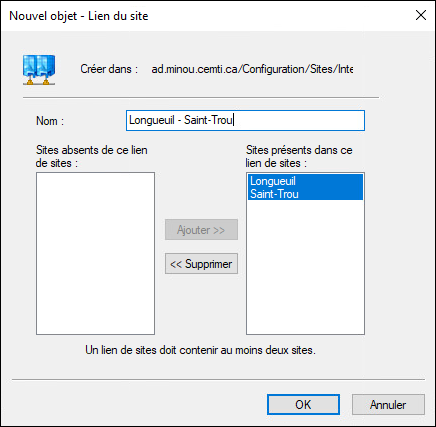
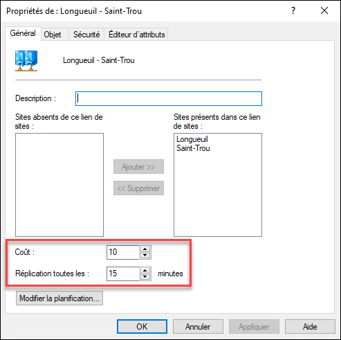
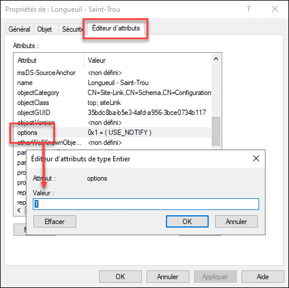

## Méthode graphique

Pour créer un nouveau site, il vous faut d'abord ouvrir la console Sites et services Active Directory (dssite.msc)

### Création du nouveau site

Créez le nouveau site à partir du menu contextuel.



Donnez-lui un nom.



### Création d'un sous-réseau

La création d'un site est souvent accompagnée de la définition de nouveaux sous-réseaux dans l'infrastructure. Il faut donc ajouter les sous-réseaux qui se trouvent dans ce site.

Les sous-réseaux doivent être identifiés par leur adresse réseau ainsi que leur masque CIDR (par exemple, 10.1.244.0/24)



### Configuration d'un lien inter-site

Dans un réseau d'entreprise, il est capital d'optimiser les liens inter-site, les plus vulnérable. Il est recommandé de définir les liens inter-site afin de contrôler entre quels sites et selon quelles règles les réplications sont effectuées.



Ajoutez les sites qui feront partie du lien.



Entrez dans les propriétés de l'objet nouvellement créé et sous l'onglet Général, paramétrez le coût du lien (plus il est bas, plus il sera préféré) ainsi que la fréquence des réplications (minimum de 15 minutes).



### Notifications de réplication

Si votre lien réseau inter-site le permet, vous pouvez activer les notifications de réplication inter-site. Pour ce faire, affectez à l'attribut options du lien la valeur 1.

:::warning Attention!
Il faut vraiment que le lien puisse supporter la charge supplémentaire apportée par les notifications de réplication. Cela peut avoir un impact considérable sur la stabilité du réseau, lorsque le lien est lent ou offre peu de bande passante.
:::



## Méthode PowerShell

Pour créer un nouveau site:

```powershell
New-ADReplicationSite -Name "Saint-Trou"
```

Pour créer un sous-réseau et l'affecter à un site:

```powershell
New-ADReplicationSubnet -Name "10.1.244.0/24" -Site "Saint-Trou"
```

Pour créer un lien inter-site et lui affecter un coût et une fréquence:

```powershell
$SiteLinkSplat = @{
    Name = "Longueuil - Saint-Trou"
    SitesIncluded = "Longueuil", "Saint-Trou"
    Cost = 10
    ReplicationFrequencyInMinutes = 15
}

New-ADReplicationSiteLink @SiteLinkSplat
```

On peut aussi créer ce lien avec l'option de notification.

```powershell
$SiteLinkNotifySplat = @{
    Name = "Longueuil - Saint-Trou"
    SitesIncluded = "Longueuil", "Saint-Trou"
    Cost = 10
    ReplicationFrequencyInMinutes = 15
    OtherAttributes = @{ "options" = 1 }
}

New-ADReplicationSiteLink @SiteLinkNotifySplat
```

Liens intéressants:

    ActiveDirectory Module | Microsoft Learn
    
    How to Manage Active Directory Sites with PowerShell (adamtheautomator.com)
