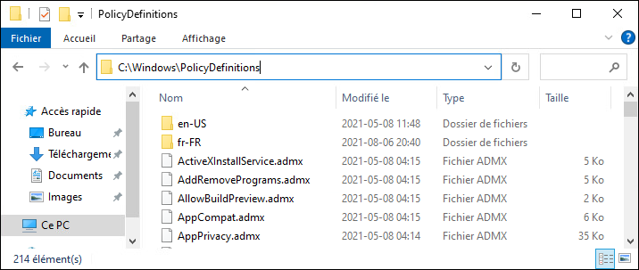
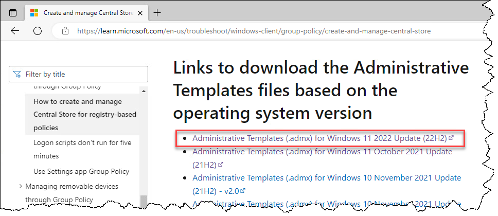
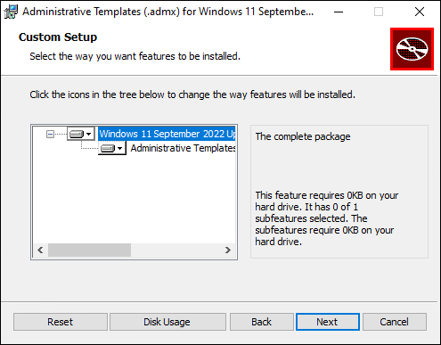
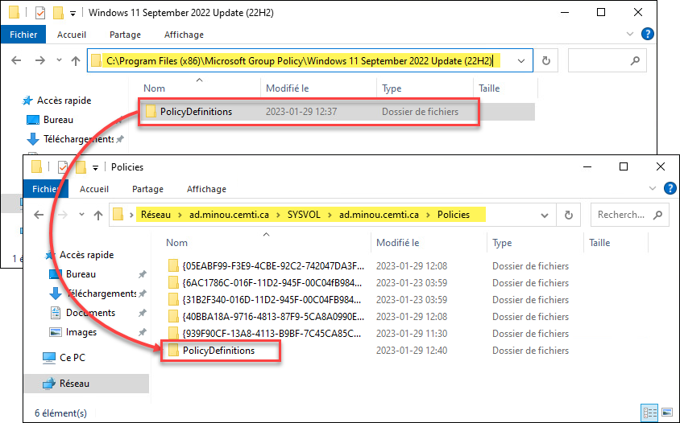
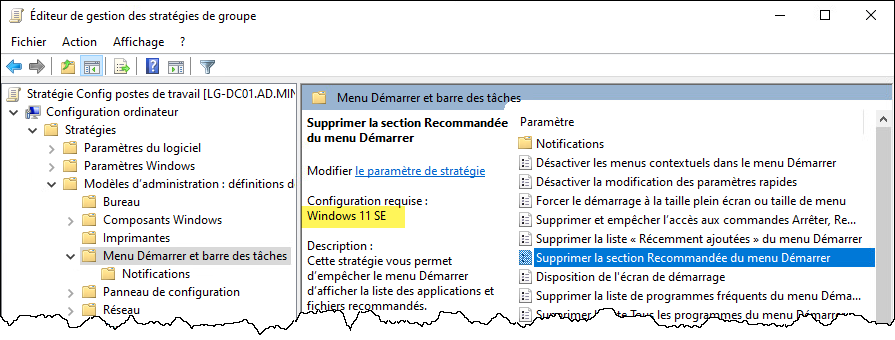

Par défaut, lorsqu'on installe Windows, l'éventail de GPO disponibles s'installe avec lui. Lorsqu'on ouvre la console GPMC, celle-ci regarde les définitions de GPO connues par le système d'exploitation, et les expose dans la console. Cela peut poser problème dans un environnement composé de plusieurs versions différentes de Windows. Les GPO ne discriminent pas en fonction de la version, donc si un GPO a été configuré sur une version de Windows plus récente, des parties de celui-ci seront illisibles si la console est opérée sur une version plus ancienne. Il est donc recommandé de déposer les définitions de GPO dans un endroit centralisé, lisible par toutes les consoles, indépendamment de la version du système d'exploitation de son hôte. Cet endroit se nomme le magasin central, ou Central Store en anglais. Il faut le créer manuellement, car il n'est pas configuré par défaut.

## Étape 1: Obtenir les modèle administratifs

Il faut d'abord se procurer les fichiers de définition de GPO, appelés **modèles administratifs**, ou *administrative templates* en anglais. Ce sont une combinaison de fichiers `.admx` et `.adml`. Les fichiers admx contiennent les informations techniques des GPO (les clés de registre et valeur admissibles de chaque paramètre) et les fichiers adml contiennent le texte affichable dans la console dans chacune des langues supportées.

Il y a deux options possibles: soit vous prenez les définitions déjà présentes sur une machine Windows (client ou serveur, peu importe) et vous en servez comme base pour monter le magasin central, soit vous téléchargez les définitions les plus récentes sur le site de Microsoft.

### Option A: Copier un magasin local

À l'installation de Windows, les définitions pertinentes pour cette version de Windows sont contenues sous le répertoire `C:\Windows\PolicyDefinitions`. Elles ne sont disponible que dans la langue d'installation de Windows, ainsi que toute autre langue ajoutée par l'installation d'un pack linguistique. Ce sont ces définitions qui sont chargées par défaut lorsqu'on tente de configurer une stratégie locale avec la console `gpedit.msc`.



### Option B: Télécharger les définitions (recommandé)

En téléchargeant les définitions du site de Microsoft, on s'assure d'avoir les définitions les plus récentes ainsi que le support de toutes les langues.

:link: [Liens pour télécharger les modèles administratifs (microsoft.com)](https://learn.microsoft.com/en-us/troubleshoot/windows-client/group-policy/create-and-manage-central-store#links-to-download-the-administrative-templates-files-based-on-the-operating-system-version)

*Note: les modèles administratifs sont généralement rétro-compatibles. Par exemple, les modèles pour Windows 11 contiennent des nouveaux paramètres introduits sous Windows 11, mais les paramètres pour Windows 10 et antérieur sont toujours accessibles.*



Le fichier téléchargé est un MSI. Vous pouvez l'installer sur votre contrôleur de domaine ou n'importe quelle machine, ça n'a pas d'importance. Ce fichier ne fait qu'extraire les modèles administratifs dans un répertoire et n'installe aucune application.



Cet installateur ne fait que copier des fichiers .ADMX et .ADML dans le répertoire `PolicyDefinitions` contenu dans `C:\Program Files (x86)\Microsoft Group Policy\`. Les fichiers ADMX sont des fichiers XML décrivant le mappage des paramètres à des enregistrements dans le registre, et les fichiers ADML décrivent quant à eux les champs textuels de ces paramètres à afficher dans la console, selon la langue de l'interface. Chaque fichier ADMX est associé à un fichier ADML pour chaque langue, contenu dans le répertoire correspondant à cette langue.

## Étape 2: Créer le magasin central

Peu importe que vous ayez choisi l'option A ou B, vous avez identifié un répertoire `PolicyDefinitions` contenant des fichiers ADMX et ADML. Il est temps maintenant de copier ces fichiers dans un endroit centralisé pour tout le domaine.

Il suffit simplement de copier le répertoire `PolicyDefinitions` et tout son contenu dans le répertoire suivant:

```text
\\fqdn.du.domaine.com\SYSVOL\fqdn.du.domaine.com\Policies
```

Le partage de fichiers SYSVOL possède l'avantage d'être répliqué automatiquement entre tous les contrôleurs de domaine. Une fois la réplication effectuée, toute console ira charger les définitions contenues dans le magasin central, au lieu de celles définies localement.



Vous devriez maintenant pouvoir accéder à des paramètres qui n'existaient pas avant, même s'ils ne sont pas pris en charge par votre système d'exploitation.



:::tip Truc de débogage
Il est possible de **forcer l'utilisation des définitions locales** (celles définies dans `C:\Windows\PolicyDefinitions`) même si un magasin central existe dans le domaine. Cela peut être utile, par exemple, pour tester une nouvelle version de Windows sans affecter l'ensemble du domaine. Pour ce faire, il suffit d'effectuer cette modification dans le registre:

```text
Clé:        KEY_LOCAL_MACHINE\SOFTWARE\Policies\Microsoft\Windows\Group Policy
Nom:        EnableLocalStoreOverride
Type:       REG_DWORD
Données:    0 - Utiliser PolicyDefinitions sur SYSVOL (défaut)
            1 - Utiliser C:\Windows\PolicyDefinitions
```
