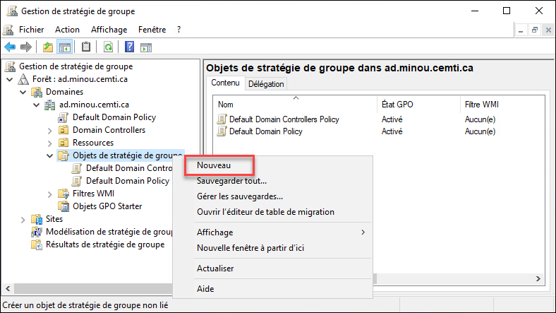
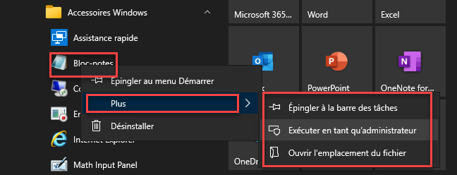
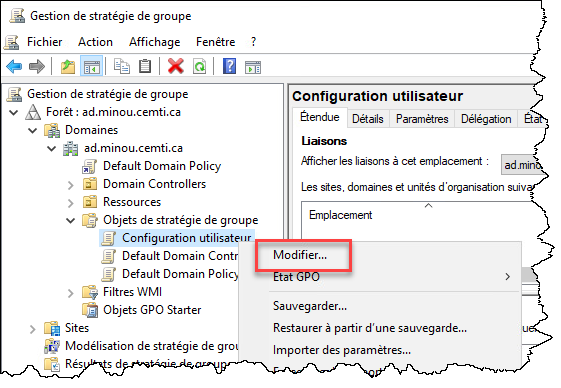
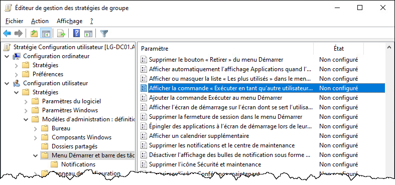
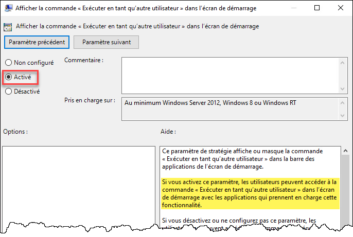
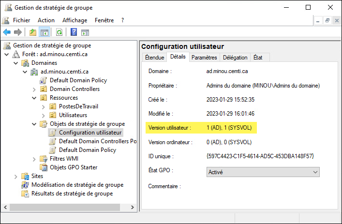
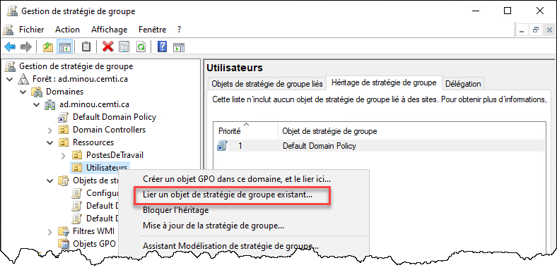
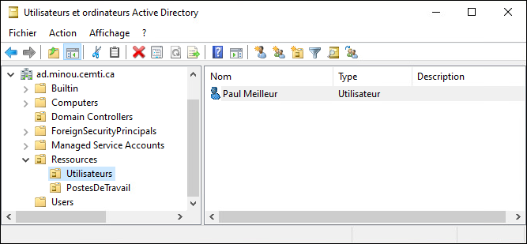
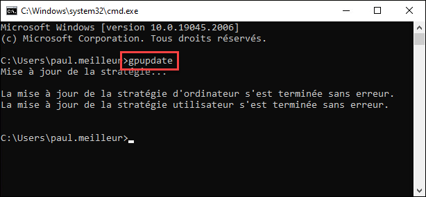
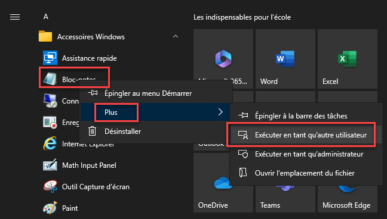

Voici un exemple de création, de liaison et d'application d'un GPO.

## Méthode graphique

### Création du GPO dans la console

Premièrement, démarrez la console Gestion des stratégies de groupe (par le gestionnaire de serveur, ou avec la commande `gpmc.msc`). Dans la section Objets de stratégie de groupe, ouvrez le menu contextuel et sélectionnez Nouveau. Donnez un nom à votre GPO et ne sélectionnez pas de GPO de départ.



### Configuration du GPO

Une fois le GPO créé, vous pouvez le configurer, c'est-à-dire lui définir un ou plusieurs paramètres. Dans cet exemple, je veux que ce GPO active l'option Exécuter en tant qu'un autre utilisateur dans le menu Démarrer, car par défaut, cette option n'apparaît pas.



Tout d'abord, il faut ouvrir la console de modification du GPO.



Ensuite, on va modifier les paramètres désirés.



Pour chacun des paramètres, on peut activer ou désactiver son application (ou le laisser à "non configuré" pour que le GPO ignore ce paramètre). Certains paramètres offrent aussi des options supplémentaires, à configurer dans le panneau Options. Pour savoir l'effet de l'activation ou de la désactivation de ce paramètre, consultez le bloc d'aide en bas à droite. Une fois le paramètre correctement configuré, cliquez sur OK.



Lorsque tous les paramètres sont configurés dans le GPO, fermez la fenêtre de l'éditeur. Vous pouvez voir, dans l'onglet Détails, la version du GPO. Les versions des sections Utilisateur et Ordinateur sont indépendantes, et incrémentées chaque fois qu'il y a un changement. 

***Note:** La version étiquetée "AD" correspond à celle de l'objet GPO dans la base de données LDAP du domaine, alors que celle étiquetée "SYSVOL" représente la version des fichiers qui contiennent les paramètres à appliquer. Si les deux versions (AD et SYSVOL) d'une même section d'un même GPO diffèrent, cela peut indiquer un problème de réplication entre les contrôleurs de domaine.*



### Liaison du GPO

Pour pouvoir être appliqué, il faut le lier à un emplacement dans l'arborescence Active Directory. Le point de liaison peut être soit la racine du domaine (dans l'exemple, ad.minou.cemti.ca), soit une unité d'organisation (OU), ou encore un site (comme Longueuil ou Saint-Trou). Le GPO s'appliquera aux objets contenus dans le point de liaison:

- La section **Ordinateur** du GPO s'appliquera aux **comptes ordinateurs** contenus dans le point de liaison
- La section **Utilisateur** du GPO s'appliquera aux **comptes utilisateurs** contenus dans le point de liaison

*Note: L'application d'un GPO ne tient pas compte des groupes. Si un lien de GPO est défini dans un OU qui contient des groupes d'utilisateurs, le GPO ne s'appliquera à ces utilisateurs. Pour qu'ils s'applique, les comptes utilisateurs doivent se trouver dans le point de liaison directement (ou récursivement).*

Dans la console de gestion de stratégie de groupe (*gpmc.msc*), il suffit de sélectionner **Lier un objet de stratégie de groupe existant**, puis de spécifier le GPO à lier. Alternativement, il est possible de procéder à la création et à la liaison en une seule étape.



### Application du GPO

Il est toujours important de tester le GPO pour s'assurer qu'il est est bien configuré. Pour ce faire, puisque le GPO ne contient qu'une section Utilisateur, on s'assure d'avoir un utilisateur situé à l'emplacement du point de liaison (dans ce cas, l'OU Utilisateurs).



On démarre une session sur un ordinateur membre du domaine (un serveur ou un poste de travail, peu importe). L'application du GPO se fait automatiquement au démarrage de session, et à toutes les 90 minutes environ sur les sessions ouvertes. Pour ne pas attendre ou redémarrer sa session, on peut tout simplement lancer la commande `gpupdate`.



Une fois la nouvelle session établie (ou la commande gpupdate complétée), on peut observer l'effet de la GPO.



## Méthode PowerShell

### Création du GPO

Pour créer un GPO avec PowerShell, la commande suivante suffit. Un GPO vide sera créé et ne sera lié nulle part.

```powershell
New-GPO -Name "Nom du GPO"
```

### Configuration du GPO

Il est possible de configurer un GPO avec PowerShell, mais c'est difficile à faire. Par exemple, pour le faire sur un paramètre de modèle d'administration, il faut connaître l'entrée de registre qui est modifiée par ce paramètre (ce qui n'est pas documenté la plupart du temps, mais on peut le voir dans le code du fichier ADMX). Je vous conseille vivement d'utiliser la console graphique pour cette partie.

```powershell
$GPRegistryValueSplat = @{
    Name      = "Nom du GPO"
    Key       = "HKCU\Software\Policies\Microsoft\Windows\Control Panel\Desktop"
    ValueName = "ScreenSaveTimeOut"
    Type      = "DWord"
    Value     = 300
}

Set-GPRegistryValue @GPRegistryValueSplat
```

:::tip
Pour plus d'information technique sur les GPO et les entrées au registre qui leur sont associées, voici un outil qui pourra vous aider.

:link: [Group Policy Search](https://gpsearch.azurewebsites.net/)
:::

### Liaison du GPO

```powershell
New-GPLink -Name "Nom Du GPO" -Target "OU=Nom de l'OU,DC=ad,DC=minou,DC=cemti,DC=ca"
```

Finalement, pour appliquer le GPO, il existe la commande PowerShell Invoke-GPUpdate, cependant celle-ci n'est pas installée par défaut avec Windows, alors que la commande classique gpupdate l'est. Cette dernière est donc beaucoup plus pratique, puisque le plus souvent, ce sont sur les clients qu'on en a besoin, et non sur les contrôleurs de domaine.

<ConsoleWindow title="cmd.exe" noCopy="true">
```text
C:\Windows\System32> gpupdate
Mise à jour de la stratégie...

La mise à jour de la stratégie d'ordinateur s'est terminée sans erreur.
La mise à jour de la stratégie utilisateur s'est terminée sans erreur.
```
</ConsoleWindow>
