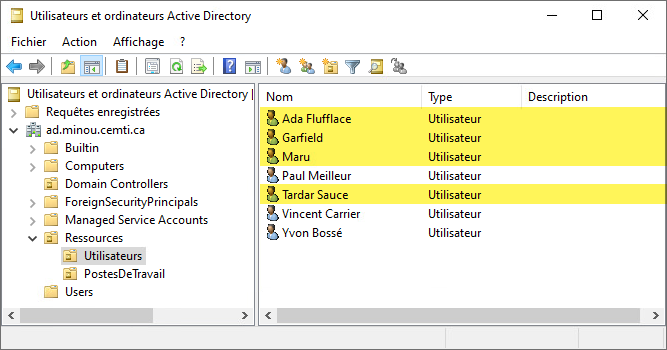
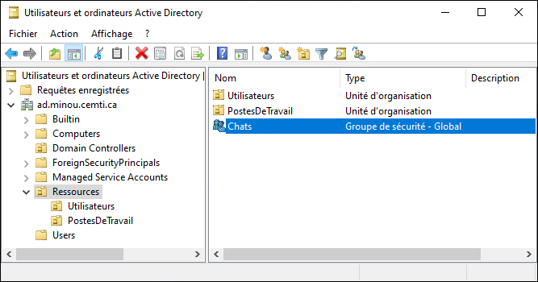
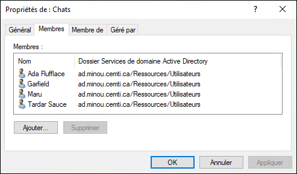
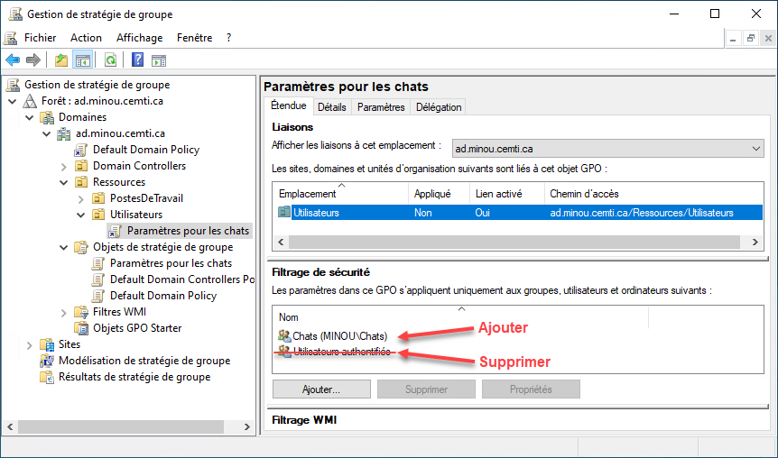
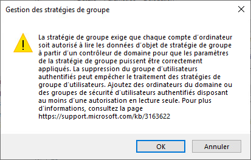
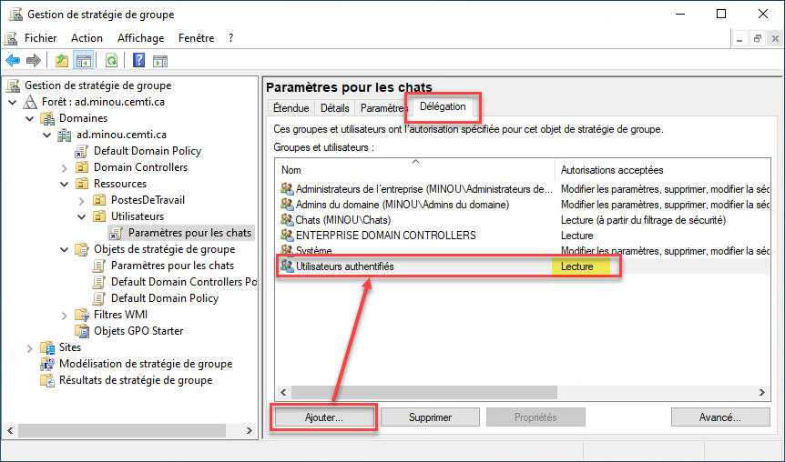

La liaison d'un GPO sur un OU possède un défaut considérable: il est impossible pour un objet (utilisateur ou ordinateur) d'être dans plus d'un OU à la fois.

## Méthode graphique

Dans cet exemple, on veut définir un GPO qui ne s'applique que lorsque l'utilisateur est un chat. En effet, dans notre domaine MINOU, plusieurs utilisateurs sont des chats.



Tous les chats sont membres d'un groupe de sécurité nommé Chats.





Dans la console GPMC, le GPO Paramètres pour les chats est lié à l'OU Utilisateurs. Cependant, dans cet OU, il n'y a pas que des chats. Pour éviter de devoir créer un OU pour les chats, on va plutôt configurer le GPO pour qu'il ne s'applique que pour les membres du groupe Chats. Le principe est simple: on va retirer les droits de lecture et exécution à tous les utilisateurs (le groupe Utilisateurs authentifiés) et ne donner ce droits qu'au groupe Chats.



En retirant le groupe Utilisateurs authentifiés, on vous présentera ce message d'avertissement. C'est pour vous rappeler que lorsque ce GPO est destiné à des utilisateurs, vous devez obligatoirement ajouter des droits en lecture seule au groupe Utilisateurs authentifiés ou Ordinateurs du domaine, car sinon, l'ordinateur ne pourra pas accéder au GPO pour l'appliquer à l'utilisateur qui y démarre une session.



Il faut donc aller dans l'onglet Délégation du GPO, et ajouter le groupe Utilisateurs authentifiés avec l'autorisation Lecture.



## Méthode PowerShell

Pour ajouter le groupe de sécurité "Chats" à la liste de filtrage de sécurité:

```powershell
$GPPermissionsSplat = @{
    Name            = "Paramètres pour les chats"   # Nom du GPO
    TargetName      = "Chats"                       # Nom du groupe à qui donner les droits
    PermissionLevel = "GpoApply"                    # Droit de lecture et application (filtrage de sécurité)
    TargetType      = "Group"                       # La cible est un groupe
    Replace         = $true                         # Remplacer le droit existant pour ce groupe
}

Set-GPPermissions @GPPermissionsSplat
```

Pour retirer le groupe Authenticated Users de la liste de filtrage et lui donner plutôt un simple droit de lecture (sans application):

```powershell
$GPPermissionsSplat = @{
    Name            = "Paramètres pour les chats"   # Nom du GPO
    TargetName      = "Authenticated Users"         # Groupe des utilisateurs authentifiés
    PermissionLevel = "GpoRead"                     # Droit en lecture seule
    TargetType      = "Group"                       # La cible est un groupe
    Replace         = $true                         # Remplacer le droit existant pour ce groupe
}

Set-GPPermissions @GPPermissionsSplat
```
