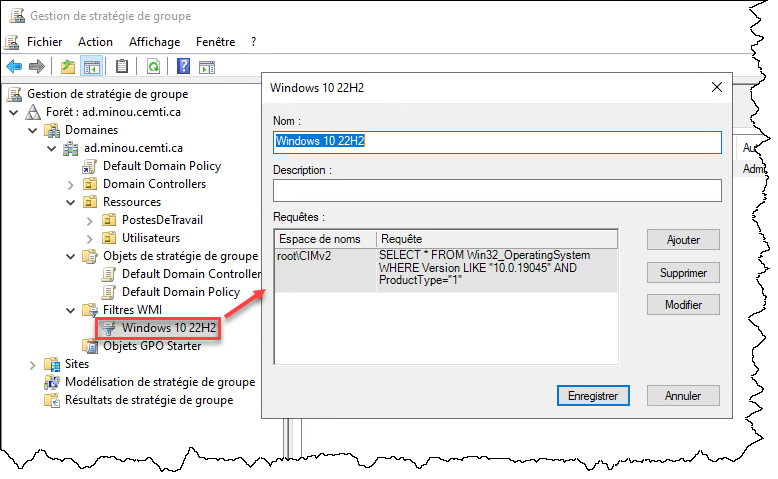
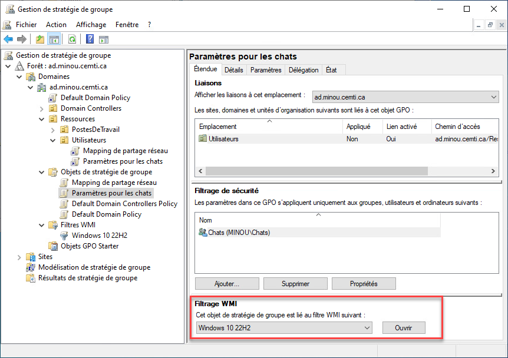

Un filtre WMI sert à déterminer si le GPO doit s'appliquer ou non, en fonction d'un test sur le client. Dans l'exemple suivant, on définit un filtre WMI afin qu'un GPO ne soit applique que si le système d'exploitation est Windows 10 22H2.

:::warning Attention!
Les filtres WMI sont certes utiles, mais WMI est une technologie qui n'est pas particulièrement performante. Certaines requêtes sont très **lentes à exécuter**, ce qui peut **ralentir considérablement la durée du démarrage de session** et causer de la **frustration** chez les utilisateurs.

Il est important de **tester** le temps d'exécution avant de mettre un tel filtre en production. Il est également recommandé de **privilégier d'autres méthodes** de filtrage lorsque possible.
:::

## Créer le filtre WMI

Dans la console GPMC, dans la section Filtres WMI, créer un nouveau filtre. Il faut donner un nom, optionnellement une description, ainsi qu'une ou plusieurs requêtes WMI (avec le langage WQL). Si la requête est vraie (c'est-à-dire qu'elle ne retourne pas un objet nul), alors un GPO qui porte ce filtre sera appliqué; dans le cas contraire, il ne sera pas appliqué.

Note: Si le filtre comporte plusieurs requêtes, elles doivent toutes être vraies pour que le filtre laisse le GPO s'appliquer.

La requête suivante sera vraie si le système d'exploitation est Windows 10 22H2.

```sql
SELECT * FROM Win32_OperatingSystem WHERE Version="10.0.19045" AND ProductType="1"
```



## Ajout du filtre WMI au GPO

Dans les options du GPO, sélectionner le filtre WMI souhaité. Si une seule des requêtes configurées dans ce filtre ne retournent rien (donc sont fausses), alors le GPO ne s'appliquera pas.




## Méthode PowerShell

Le module Active Directory ne permet pas directement de manipuler les filtres WMI, mais il existe un module communautaire qui facilite la configuration de filtres WMI. Ce module n'est **pas développé ni supporté par Microsoft**. Pour l'installer, il suffit de lancer cette commande:

```powershell
Install-Module GPWmiFilter
```

Pour créer le filtre:

```powershell
$GPWmiFilterSplat = @{
    Name = "Windows 10 22H2"
    Filter = 'SELECT * FROM Win32_OperatingSystem WHERE Version="10.0.19045" AND ProductType="1"'
}

New-GPWmiFilter @GPWmiFilterSplat
```

Pour assigner un filtre à un GPO:

```powershell
$GPWmiFilterAssignmentSplat = @{
    Policy = "Paramètres pour les chats"
    Filter = Get-GPWmiFilter -Name "Windows 10 22H2"
}

Set-GPWmiFilterAssignment @GPWmiFilterAssignmentSplat
```
