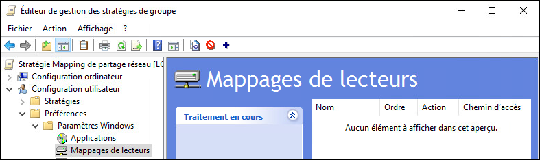
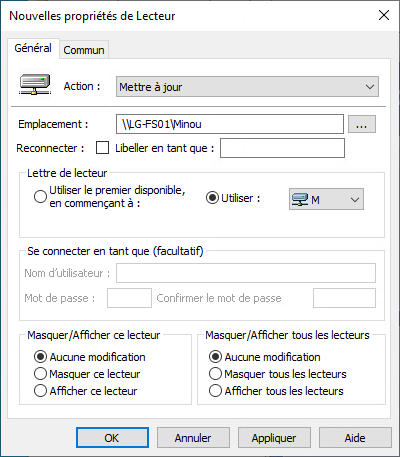
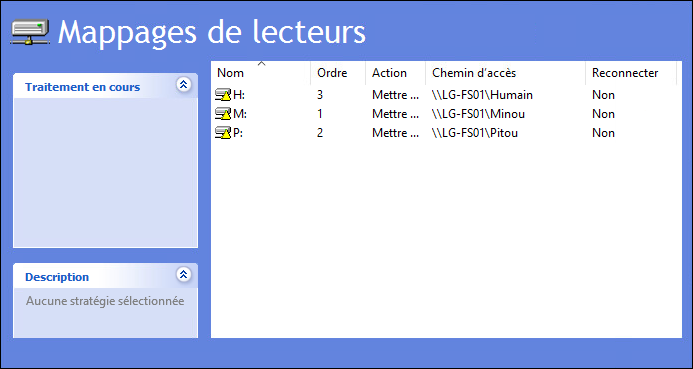
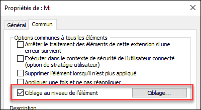
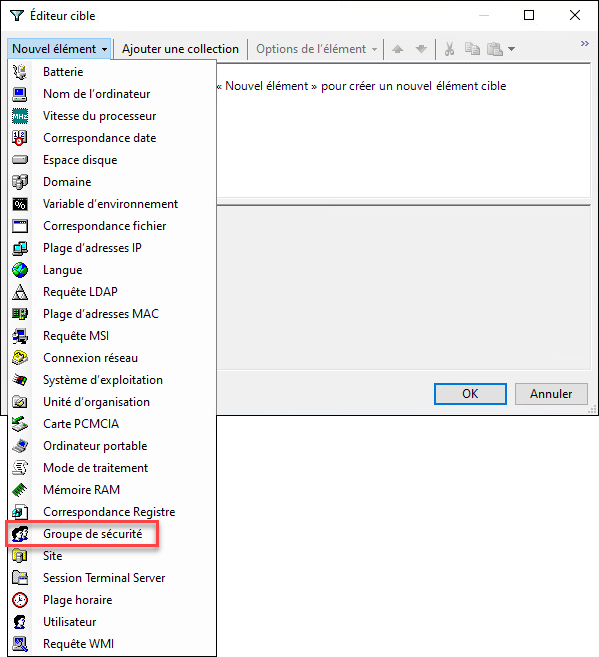
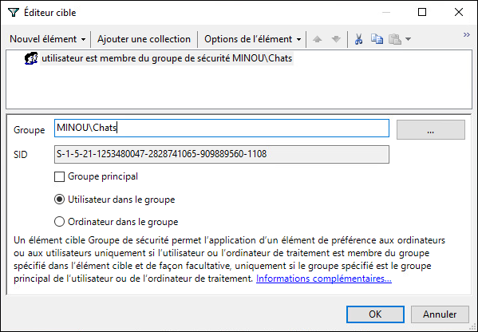

Le ciblage au niveau de l'élément est une manière de définir des règles d'application d'une partie du GPO, et non du GPO au complet. Ce type de ciblage n'existe que pour les éléments de la section Préférences d'un GPO, il n'est pas possible de l'utiliser pour les stratégies de sécurité ou les modèles d'administration.

Dans cet exemple, on définit plusieurs mappages de lecteurs réseau, où chaque mappage est conditionnel à l'appartenance de l'utilisateur à un groupe de sécurité.

Dans l'éditeur de GPO, naviguer dans Préférences, Paramètres Windows, Mappages de lecteurs.

Créer les mappages en définissant un emplacement vers un partage de fichier (un chemin UNC) ainsi qu'une lettre.

On a, dans cet exemple, trois mappages.

On voudrait que le mappage du lecteur M: (Minou) se fasse uniquement si l'utilisateur courant est membre du groupe des Chats. Dans les propriétés de ce mappage, dans l'onglet Commun, cocher Ciblage au niveau de l'élément. Puis cliquer sur le bouton Ciblage pour ouvrir l'éditeur cible.

L'éditeur cible vous permet de définir des règles qui permettront au client de déterminer s'il doit appliquer cet item ou non. Par exemple, pour que l'application de cet item soit conditionnel à l'appartenance de l'utilisateur à un groupe précis, ajouter un élément Groupe de sécurité.

Sélectionnez le groupe souhaité, puis indiquez si c'est l'utilisateur ou l'ordinateur qui doit se trouver dans le groupe. Dans notre cas, c'est l'utilisateur qui importe.

Enregistrez le GPO. Même si le GPO est exécuté, ce mappage spécifique ne sera pas appliqué si l'utilisateur n'est pas membre du groupe MINOU\Chats.
