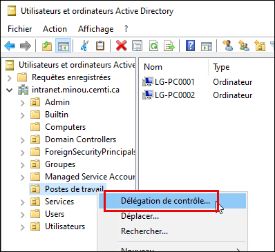
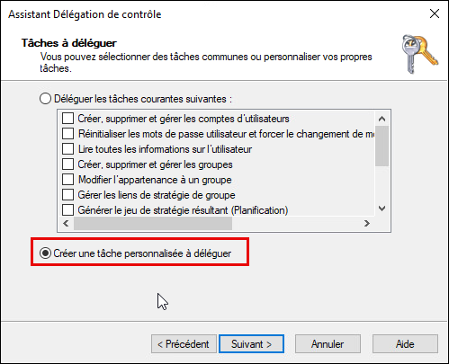
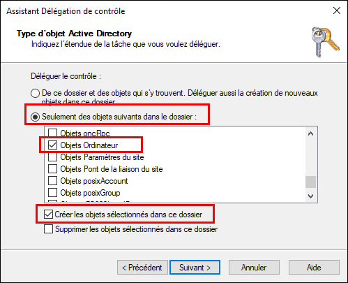
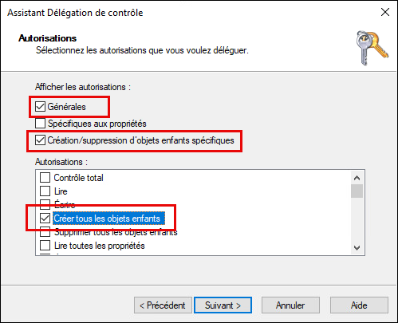

Ce tutoriel vous guidera à travers les étapes pour déléger des privilèges de jonction au domaine Active Directory.

Dans la console `dsa.msc`, cliquez-droit sur l'OU dans lequel les délégués pourront créer des comptes ordinateur, puis sélectionnez l'option **Délégation de contrôle**.

**Ajoutez le principal de sécurité** (utilisateur ou groupe) à qui vous souhaitez donner le privilège de jonction au domaine. Puis sélectionnez **Créer une tâche personnalisée à déléguer**.

Sélectionnez **Seulement des objets suivants dans le dossier** et cochez seulement les **Objets Ordinateurs**. Cochez **Créer les objets sélectionnés dans ce dossier**.

Sélectionnez **Créer tous les objets enfants**.

Suivez le reste des étapes. Ce principal de sécurité devrait ensuite disposer de privilèges de jonction au domaine.

:::tip
Pour vérifier les délégations effective sur l'OU, il ne suffit pas de rouvrir l'assistant de délégation; vous ne verrez rien. Une fois la délégation appliquée, elle est configurée dans les ACL de l'OU et devient plus difficile à consulter.

Vous pouvez utiliser [**cet outil**](/astuces/03) pour générer un rapport de délégation.
:::
