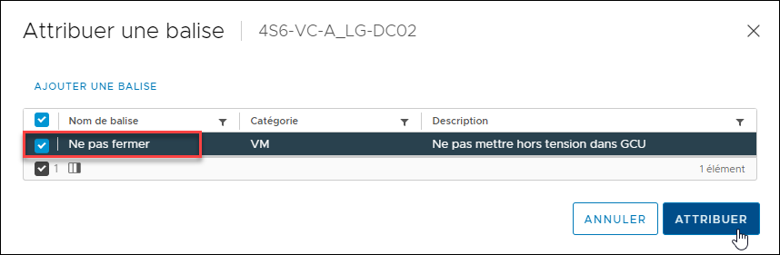

Dans l'environnement Labinfo, toutes les VM sont fermées automatiquement à chaque jour, pendant la nuit, afin de libérer des ressources. Or, les serveurs, et particulièrement les contrôleurs de domaine, ont avantage à être allumés en permanence. Pour faire en sorte qu'une VM reste allumée en permanence, vous devez lui attribuer la balise "Ne pas fermer".

Dans la console Web de Labinfo, cliquez-droit sur votre machine virtuelle, sous **Balises et attributs personnalisés**, st cliquez sur **Attribuer une balise**.

Cochez la balise **Ne pas fermer**, puis cliquez sur **Attribuer**.

Vous devez répéter cette opération pour chaque machine virtuelle que vous voulez mettre à l'abri de la fermeture automatique.

:::warning
Ne faites ceci que pour les serveurs qui doivent absolument être allumés en permanence: tous les contrôleurs de domaine, le serveur DHCP, la passerelle. L'existence de cette balise est un compromis de la part de la DISTI; si vous mettez cette balise sur toutes vos VM systématiquement, la DISTI pourrait retirer cette balise. Utilisez-la avec discernement.
:::
