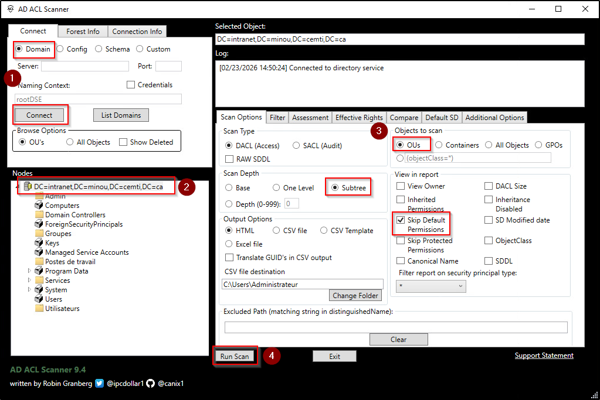

L'outil de délégation dans la console Utilisateurs et ordinateurs Active Directory (*dsa.msc*) est pratique pour créer des délégations, mais il ne permet pas de voir les délégations existantes. Celles-ci sont noyées dans la liste de permissions (DACL), et consulter les délégations peut être ardu.

Voici un outil qui facilite le processus.

:link: https://github.com/canix1/ADACLScanner/releases/latest

Téléchargez le script **ADACLScan.ps1** et débloquez le fichier, puis exécutez-le.

<ConsoleWindow title="Windows PowerShell" backgroundColor="#012456" noCopy="true" wrap="none">
```text
PS C:\Scripts> ¶(yellow)Unblock-File¶ .\ADACLScan.ps1
PS C:\Scripts> ¶(yellow).\ADACLScan.ps1¶

```
</ConsoleWindow>

Cet outil va réaliser un scan des listes de permissions à partir de l'emplacement choisi dans votre arborescence. Pour cibler uniquement les permissions que vous avez expressément modifiées sur les OU, voici les paramètres à spécifier dans l'outil. Ensuite, appuyez sur **Run Scan**. L'outil vous présentera un rapport, en format HTML, des permissions déléguées.




