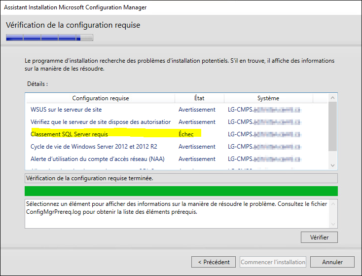
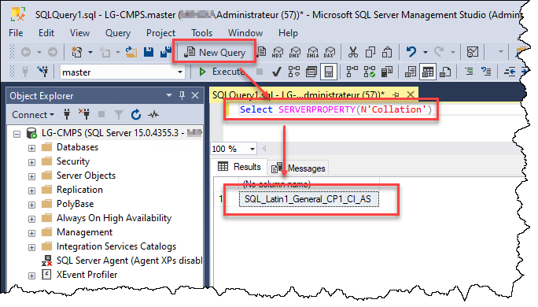

Si vous vous trompez de classement (collation) à l'installation de Microsoft SQL Server, vous pourriez obtenir une erreur comme celle-ci à l'installation d'SCCM:



Pour confirmer qu'il s'agit bien d'une erreur dans la configuration des règles de classement, il faut ouvrir SQL Server Management Studio (SSMS) et lancer la requête suivante:

```sql
Select SERVERPROPERTY(N'Collation')
```

La valeur attendue est **SQL_Latin1_General_CP1_CI_AS**.



Si la valeur n'est pas exactement celle-ci, alors il faut reconstruire les bases de données système. Pour ce faire, il faut relancer le setup de MSSQL avec cette commande, lancée à partir d'une console CMD élevée en tant qu'administrateur:

```cmd
setup.exe /QUIET /ACTION=REBUILDDATABASE /INSTANCENAME=MSSQLSERVER /SQLSYSADMINACCOUNTS=MONDOMAINE\administrateur MONDOMAINE\CM-Admins "MONDOMAINE\Admins du domaine" /SQLCOLLATION=SQL_Latin1_General_CP1_CI_AS
```

*\* Remplacer MONDOMAINE par le nom NetBIOS de votre domaine.*

Il est important **qu'aucune base de données utilisateur** n'existe dans cette instance MSSQL, autrement il y aura un impact. Pour une instance qui héberge déjà des bases de données, des étapes supplémentaires sont nécessaires avant et après la reconstruction. Voir les liens en référence pour plus d'information.

Sources:
- https://www.mssqltips.com/sqlservertip/2901/how-to-change-server-level-collation-for-a-sql-server-instance/
- https://learn.microsoft.com/en-us/sql/relational-databases/databases/rebuild-system-databases?view=sql-server-ver16
