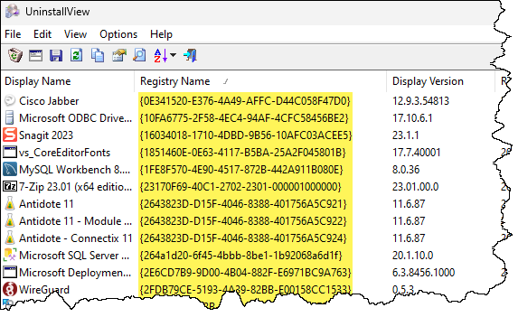
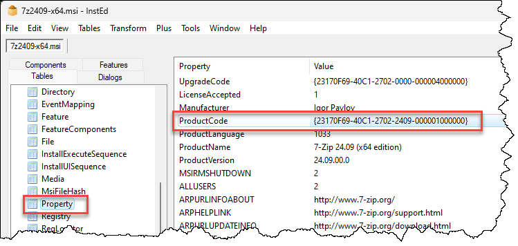

Le code de produit est un code qui identifie de manière unique chaque application MSI. Il est unique à chaque application et à chaque version. Voici comment l'obtenir:

## Application installée

Si l'application a déjà été installée sur le système, vous pouvez utiliser un outil comme UninstallView de NirSoft (https://www.nirsoft.net/utils/uninstall_view.html).



Au lieu de télécharger un outil, on peut aussi utiliser obtenir cette information à l'aide de PowerShell.

Si le client SCCM est installé, c'est plus rapide:

```powershell
Get-CimInstance -Query "SELECT * FROM Win32Reg_AddRemovePrograms WHERE DisplayName LIKE '%7-zip%'" |
    Format-Table DisplayName, ProdID
```

Si le client SCCM n'est pas installé, on peut le faire aussi mais c'est plus long:

```powershell
Get-CimInstance -Query "SELECT * FROM Win32_Product Where Name LIKE '%7-Zip%'" |
    Format-Table Name, IdentifyingNumber
```

On encore, on peut passer par le registre.

```powershell
Get-ChildItem HKLM:\SOFTWARE\Microsoft\Windows\CurrentVersion\Uninstall | 
    Where-Object { ($_ | Get-ItemProperty).DisplayName -like "*7-zip*"}
```

:::warning
Si le code de produit n'est pas un GUID, ce n'est pas une installation MSI.
:::

## À partir du fichier MSI

Sans devoir installer au préalable l'application, il est possible d'extraire le code de produit directement du fichier MSI.

On peut le faire de façon graphique, mais pour cela on doit installer un outil. Je vous recommande InstEd (http://www.instedit.com/download.html).

Ouvrez le fichier MSI dans le logiciel et naviguez dans la table Property. Le code de produit s'y trouve.



## En PowerShell

Si vous ne souhaitez pas recourir à un outil graphique, sachez qu'il est possible d'obtenir cette information avec PowerShell. Je vous ai fait un petit script pour ça:

```powershell title="Get-MSIProductCode.ps1" showLineNumbers
param(
    [ValidateScript({Test-Path -Path $_})]
    [string[]]$Path = (Get-Location).Path
)

$WindowsInstaller = New-Object -ComObject WindowsInstaller.Installer

Get-ChildItem -LiteralPath $Path | Where-Object { $_.Extension -eq '.msi'} | ForEach-Object {
    $msiDatabase = $WindowsInstaller.OpenDatabase($_.FullName, 0)
    $msiView = $msiDatabase.OpenView("SELECT Value FROM Property WHERE Property='ProductCode'")
    $msiView.Execute()
    $msiProductCode = $msiView.Fetch().StringData(1)
    [PSCustomObject]@{
        FileName   = $_.FullName
        ProductCode = $msiProductCode
    }
}
```

Vous n'avez qu'à lancer ce script avec le chemin vers un fichier ou plusieurs fichiers MSI.

<ConsoleWindow title="Windows PowerShell" backgroundColor="#012456">
```text
PS C:\Scripts> .\Get-MSIProductCode.ps1 -Path "C:\chemin\vers\7z2409-x64.msi"

FileName                      ProductCode
--------                      -----------
C:\chemin\vers\7z2409-x64.msi {23170F69-40F1-2702-2409-000001000000}
```
</ConsoleWindow>
