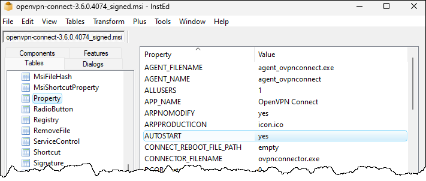
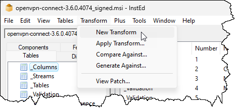
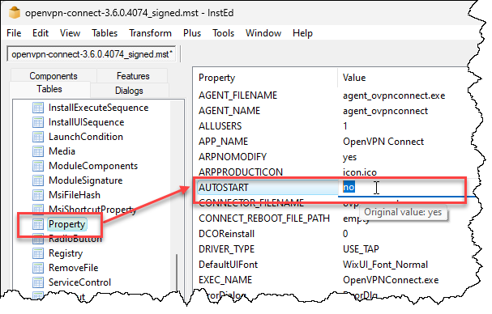
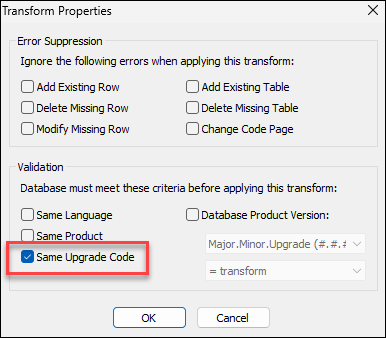

Il arrive parfois qu'on veuille installer une application MSI de manière automatisée mais avec des modifications.

Dans cet exemple, nous modifierons l'installation du client [OpenVPN Connect](https://openvpn.net/connect-docs/connect-for-windows.html#alternative-installation-methods-56623) par le paquet MSI, car son installation pose souvent problème pour les déploiements centralisés.

## Identification de la problématique

Lors de l'installation d'une application par SCCM (ou toute autre méthode automatisée) et utilisant le fichier MSI, l'application démarre automatiquement après son installation. Lors d'un déploiement, on ne veut pas ça car cela crée un processus résident inaccessible par l'utilisateur (SCCM opère en tant que SYSTEM, un compte différent de celui de l'utilisateur).

Il faut donc trouver une manière de modifier le comportement de l'installation pour sauter cette partie.

## Analyse

Dans un fichier MSI, on retrouve des propriétés d'installation. On peut obtenir ces propriétés avec un outil tel que [Orca](https://learn.microsoft.com/en-us/windows/win32/msi/orca-exe), [InstEd](https://instedit.github.io/instedit_site/), [MasterPackager](https://www.masterpackager.com/master-packager) etc.

Cette procédure est réalisée avec [InstEd](https://instedit.github.io/instedit_site/).



Une propriété du fichier se nomme AUTOSTART et sa valeur par défaut est `yes`. Il faudra la changer à `no`.

Vous avez plusieurs options:

- Changer la propriété dans la ligne de commande MSIEXEC (plus simple)
- Modifier le fichier MSI avec un éditeur (pas recommandé)
- Créer un fichier MST et l'appliquer à la ligne de commande (recommandé)

:::tip
Si vous souhaitez utiliser [PSAppDeployToolkit](https://psappdeploytoolkit.com/) avec le mode [Zero-Config MSI](https://psappdeploytoolkit.com/docs/4.1.x/deployment-concepts/zero-config-deployment), vous devez faire un fichier MST. Vous ne serez pas en mesure de spécifier des propriétés à MSIEXEC sans devoir désactiver le mode Zero-Config.
:::

## Option 1: Ligne de commande

Cette option est la plus simple. Il suffit de spécifier la propriété ainsi que sa nouvelle valeur à la fin de la commande MSIEXEC. Par exemple:

<ConsoleWindow title="cmd.exe">
```
C:\> msiexec /i "C:\chemin\vers\openvpn-connect-3.6.0.4070_signed.msi" /qb- AUTOSTART=no
```
</ConsoleWindow>

## Option 2: Transformation MSI

Un fichier MST, ou *MSI Transform*, sert à définir des changements à apporter lors du chargement d'un fichier MSI. Pour le créer, vous devrez télécharger l'outil [InstEd](https://instedit.github.io/instedit_site/download2.html?file=InstEd-1.5.15.26.msi) et l'installer sur la machine sur laquelle vous travaillez (dans le lab, c'est OK si vous l'installez sur le serveur SCCM).

Dans le menu Transform, cliquez sur **New Transform**. Enregistrez le fichier.



Ouvrez la table Property et localisez la propriété `AUTOSTART`. Donnez-lui la valeur `no`.



> :pen: *Notez que les propriétés disponibles varient d'un MSI à l'autre.*

Sauvegardez le fichier (`ctrl+S` ou par le menu **File, Save**) puis cochez **Same Upgrade Code**.



Déposez le fichier MST dans le même répertoire que le fichier MSI. Pour faire l'installation du MSI en tenant compte des transformations, il faut ajouter la propriété `TRANSFORMS` à la fin de la ligne de commande MSIEXEC.

<ConsoleWindow title="cmd.exe">
```
C:\> msiexec /i "C:\chemin\vers\openvpn-connect-3.6.0.4070_signed.msi" /qb- TRANSFORMS="C:\chemin\vers\openvpn-connect-3.6.0.4070_signed.mst"
```
</ConsoleWindow>

:::tip
Si vous utilisez PSAppDeployToolkit avec le mode Zero-Config MSI, il faut obligatoirement que le nom du fichier MST soit identique à celui du fichier MSI. Les deux fichiers doivent être déposés dans le répertoire Files.
:::
