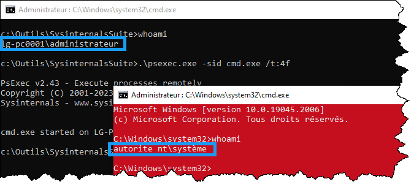

Cette astuce vous permettre d'élever une console de commande (ou tout autre processus) en tant que l'utilisateur SYSTEM, aussi appelé Système local. Il porte le SID S-1-5-18.

L'avantage d'utiliser une console élevée en tant que SYSTEM est que votre test de commande sera très semblable à ce que SCCM fera lorsqu'il lancera une commande d'installation. Si vous faites le test avec une console élevée standard, il arrive parfois que l'installation ne se passe pas exactement de la même manière.

Premièrement, téléchargez l'outil [PSExec de SysInternals](https://docs.microsoft.com/en-us/sysinternals/downloads/). Extrayez le fichier Zip dans un répertoire approprié (par exemple, C:\Outils).

Puis, dans une console de commande élevée en tant qu'administrateur, positionnée dans le répertoire qui contient psexec, lancez la commande:

<ConsoleWindow title="cmd">
```text
C:\Outils> psexec.exe -sid cmd.exe /t:4f
```
</ConsoleWindow>

Les paramètres de la commande sont:

```text
-s :       Exécuter en tant que SYSTEM
-i :       Mode interactif (permet d'interagir avec le processus)
-d :       Ne pas bloquer la console ayant servi à démarrer le processus
cmd.exe :  La commande la exécuter en tant que SYSTEM
/t:4f :    Colore la console en rouge pour la différencier plus facilement (purement optionnel)
```

Une nouvelle fenêtre de terminal apparaîtra. Cette console opère en tant que l'utilisateur SYSTEM, qui possède (presque) tous les droits sur le système d'exploitation. Vous pouvez confirmer le contexte de sécurité avec la commande `whoami`.



:::tip Téléchargement des outils Sysinternats en PowerShell
Vous pouvez effectuer le téléchargement de PSExec avec PowerShell! Collez simplement ce code dans un terminal PowerShell!

```powershell title="Install-SysinternalsSuite.ps1" showLineNumbers
# Déclaration de l'URI où télécharger le fichier zip
$uri = "https://download.sysinternals.com/files/SysinternalsSuite.zip"

# Création du répertoire C:\Outils
$dossierOutils = New-Item -Path 'C:\Outils' -ItemType Directory -Force

# Démarrage du téléchargement (on utilise BITS pour plus de performance)
$zipPath = Join-Path -Path $dossierOutils -ChildPath (Split-Path $uri -Leaf)
Start-BitsTransfer -Source $uri -Destination $zipPath

# Extraction de l'archive (avec une classe .NET, c'est plus rapide que Expand-Archive)
$dossierSysinternals = Join-Path -Path $dossierOutils -ChildPath "SysinternalsSuite"
Add-Type –AssemblyName "System.IO.Compression.Filesystem"
[System.IO.Compression.ZipFile]::ExtractToDirectory($zipPath,$dossierSysinternals)

# Suppression du fichier Zip; il est déjà extrait, on n'en a plus besoin
Remove-Item $zipPath

# Démarrage de l'explorateur et changement de répertoire de travail
Invoke-Item -Path $dossierSysinternals
Push-Location -Path $dossierSysinternals
```
:::
