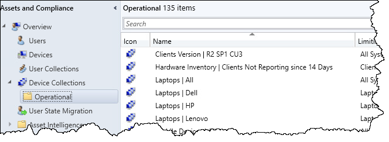

L'instigateur du blogue technique québécois [SystemCenterDudes.com](https://www.systemcenterdudes.com/), Benoit Lecours, développe et maintient [un script PowerShell](https://www.systemcenterdudes.com/create-operational-sccm-collection-using-powershell-script/) qui crée un ensemble de collections dans SCCM, se prêtant à un grand nombre de situation opérationnelles typiques. Ces collections sont pratiques pour cibler des déploiements (en agissant comme "limiting collections" d'autres collections), ou pour générer des rapports.



Le script peut être [téléchargé sur GitHub](https://github.com/vcarrier/scdudes-scripts/tree/master/OperationalCollections) (je l'ai mis sur mon GitHub car l'original a un bug). Pour lancer le script, il suffit de l'exécuter à partir d'une console PowerShell.

:::tip Exécuter le script directement
Pour lancer le script sans devoir le télécharger au préalable, utilisez la technique `irm | iex` avec PowerShell.

<ConsoleWindow title="Windows PowerShell" backgroundColor="#012456" wrap="character">
```text
PS C:\> ¶(#16c60c)$url¶ ¶(#767676)=¶ ¶(#3a96dd)"https://raw.githubusercontent.com/vcarrier/scdudes-scripts/refs/heads/master/OperationalCollections/Operational%20Collection%203.7.ps1"¶

PS C:\> ¶(#f9f1a5)irm¶ ¶(#16c60c)$url¶ | ¶(#f9f1a5)iex¶
```
</ConsoleWindow>
:::
