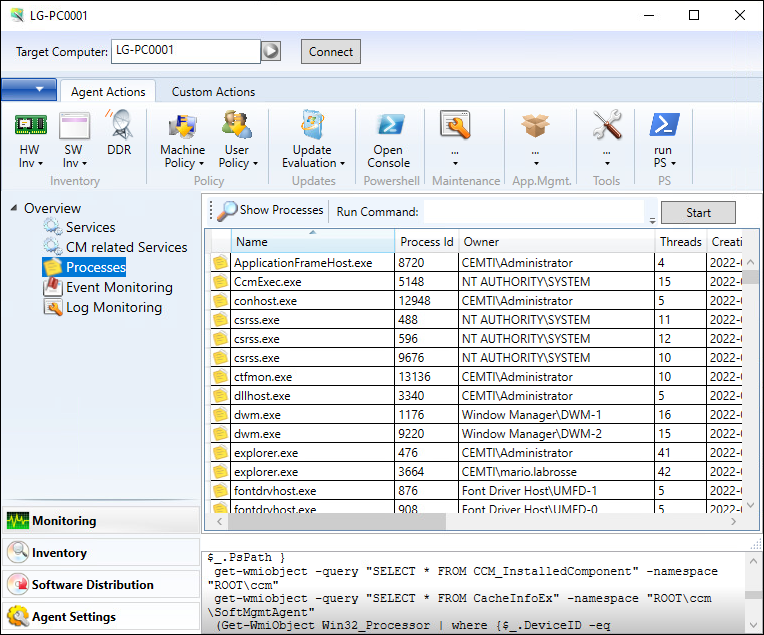

Voici un outil très intéressant, Client Center for Configuration Manager, du développeur suisse Roger Zander. C'est en quelque sorte un contrôle manuel sur le client SCCM. Cet outil se connecte à distance sur un client SCCM via WinRM/PSRemoting, et permet d'interagir directement avec le client.



Il faut bien sûr utiliser un compte qui possède des droits d'administration sur la machine cible, que celle-ci soit configurée pour accepter les connexions WinRM/PSRemoting (Enable-PSRemoting) et que son pare-feu laisse entrer les connexions WinRM.

:link: [**Télécharger Client Center for Configuration Manager**](https://github.com/rzander/sccmclictr/releases)

Puis tentez de vous connecter sur un PC.

Si ça ne fonctionne pas, assurez-vous que WinRM soit activé en exécutant la commande suivante sur le poste de travail cible:

```powershell
Enable-PSRemoting -Force
```

:::tip
Ceci peut également se faire par GPO afin de déployer sur toutes les machines de l'environnement ([voir ce guide](https://www.it-connect.fr/activer-winrm-par-gpo-sous-windows-server/)).
:::
