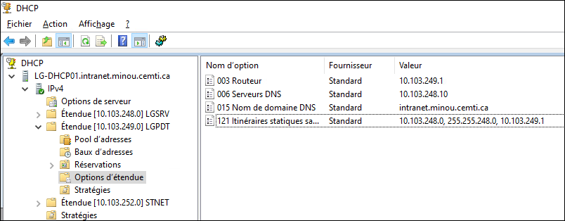
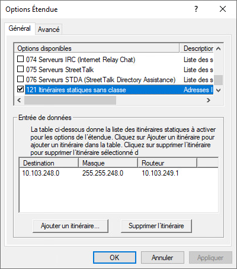
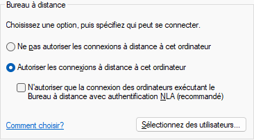

:::info Prérequis
Pour pouvoir mettre ceci en application, vous devez avoir accès à votre VLAN LGPDT via un port de switch dans la salle d'équipements.
:::

Il est possible de vous connecter à vos machines virtuelles par RDP en passant par la salle d'équipement.

Premier défi, faire en sorte que tous les VLANs de votre environnement virtuel soient inscrits à la table de routage. En effet, votre poste de travail dispose de plusieurs cartes réseau. Lorsque connecté à votre environnement virtuel, l'une de ses cartes réseau recevra une adresse IP dans le VLAN LGPDT ainsi que sa passerelle par défaut. Vous aurez donc deux adapteurs réseau disposant d'une passerelle. Or, dans la table de routage, il ne peut y avoir qu'une route par défaut. Dans nos laboratoires, les ordinateurs sont configurés pour privilégier l'adapteur connecté au réseau du collège.

Pour faire en sorte que l'ensemble des VLANs composant votre environnement virtuel soient routés via la passerelle par défaut de votre carte réseau qui y est connectée, il peut être pratique d'utiliser DHCP en définissant l'option 121 de votre étendue de Longueuil-PDT pour router toute adresse de votre bloc /21 assigné en début de session vers l'adresse de la passerelle par défaut.





Une fois cette configuration faite, sur votre poste de laboratoire, faites la commande suivante **avec le nom de votre port de switch**.

<ConsoleWindow title="Administrateur: cmd.exe">
```text
C:\> ipconfig /renew *22X2*
```
</ConsoleWindow>

Puis faites la commande `route print` et assurez-vous de voir une entrée correspondante à l'adresse de votre bloc avec le masque 255.255.248.0 vers l'adresse de votre passerelle. Tentez de pinger votre serveur SCCM.

<ConsoleWindow title="Administrateur: cmd.exe">
```text
C:\> route print -4 * 10.103.249.1
   (...)
IPv4 Table de routage
===========================================================================
Itinéraires actifs :
Destination réseau    Masque réseau  Adr. passerelle   Adr. interface Métrique
          0.0.0.0          0.0.0.0     10.103.249.1    10.103.249.10     60
     10.103.248.0    255.255.248.0     10.103.249.1    10.103.249.10     31
===========================================================================
  (...)
```
</ConsoleWindow>

Pour se connecter en RDP sur votre serveur SCCM, exécutez le client RDP (mstsc.exe) et entrez le nom d'hôte de votre serveur SCCM (LG-CMPS). Pour s'authentifier, il faut utiliser la forme NetBIOS du nom d'utilisateur: `DOMAINE\Utilisateur`

Si ça ne fonctionne pas, assurez-vous que le bureau à distance est activé sur votre serveur et qu'il ne requiert pas l'authentification NLA.


