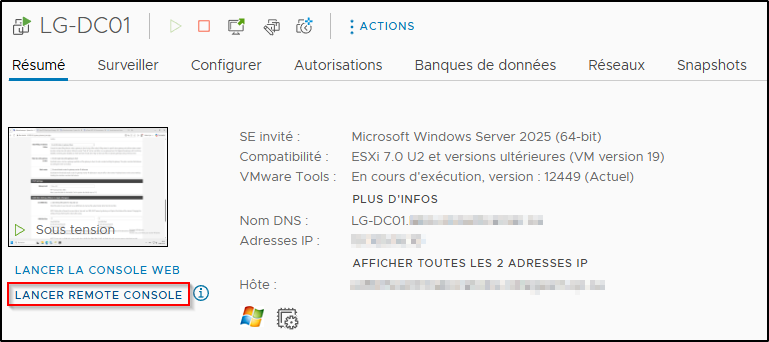
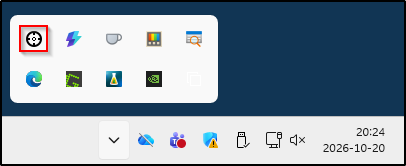

Il y a deux manières de coller du texte vers une machine virtuelle dans Labinfo.

## Option 1: Utiliser Remote Console

Dans l'interface vSphere, sélectionnez votre VM et cliquez sur **Lancer Remote Console**. Cela ouvrira votre VM dans VMware Workstation (si ce logiciel est installé sur votre ordinateur). Vous pourrez utiliser votre VM à partir de ce client.

Si les VMware Tools sont installés sur la VM, vous allez pouvoir copier et coller du texte entre votre machine locale et votre VM.

:::info
Cette technique ne fonctionne que si les VMware Tools sont installés sur la VM. Donc si c'est une machine Linux, pfSense ou autre, dont les VMware Tools ont une portée limitée, ça pourrait poser problème.
:::

## Option 2: ClickPaste

Vous pouvez utiliser l'outil ClickPaste, qui permet de traduire le contenu textuel dans le presse-papier en frappes de touches simulées tenant compte de la configuration du clavier.

Commencez par installer l'outil ClickPaste à partir de GitHub:

:link: https://github.com/Collective-Software/ClickPaste/releases/latest

Installez l'application (msi) ou extrayez le paquet (zip) puis démarrez le programme `ClickPaste.exe`. Il résidera parmi les icônes système de la barre de tâches.

Pour l'utiliser, copiez simplement du texte sur votre ordinateur (ctrl+c). Puis, faites la séquence de touches **Ctrl + Alt + V**. Votre curseur de souris se transformera en une petite croix. Cliquez simplement sur votre VM et elle recevra les frappes de touches instantanément.

Vous pouvez cliquer-droit sur l'icône de l'application dans la barre de tâches pour changer les paramètres (ajouter du délai entre les frappes, changer le raccourci clavier, etc.) mais règle générale elle est prête à l'emploi. Lorsque vous faites le collage, il faut évidemment vous assurer que votre curseur est au bon endroit dans la VM.

Cet outil fonctionne pour les VM en Web ainsi que sous VMware Workstation, mais il ne fonctionne que dans un sense. Vous pouvez passer du texte de votre ordinateur vers la VM, mais pas l'inverse.

